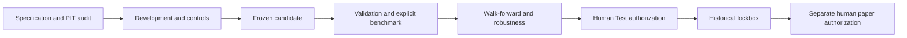
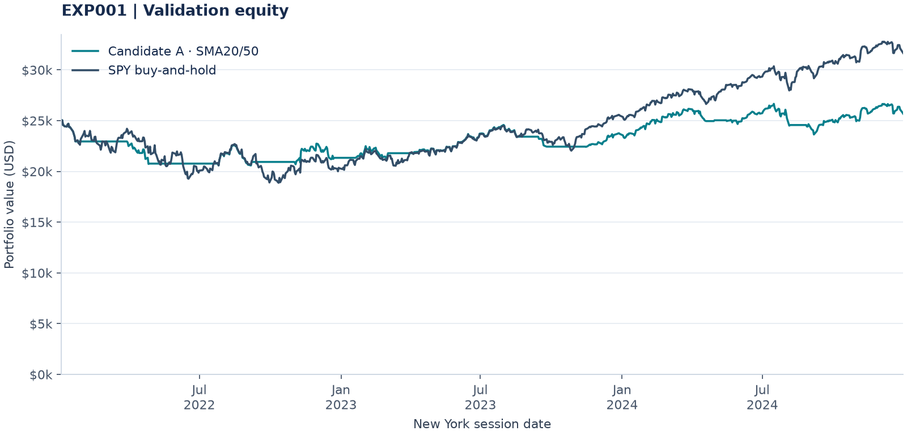
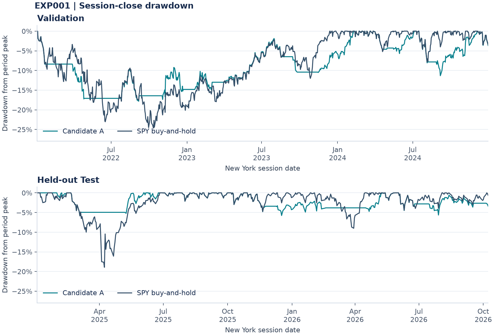
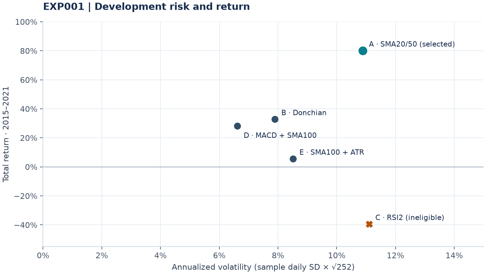

<!-- Generated by python -m src.presentation.exp001; edit the renderer, then regenerate. -->
# Research OS — Evidence-Native Quantitative Research

A research system for testing economically motivated trading hypotheses against point-in-time evidence, independent statistics and reproducible execution. Profitability is unestablished; failed hypotheses and source limitations remain part of the record.

**EXP001 finding:** the selected SMA trend strategy reduced volatility and drawdown but underperformed passive SPY in both out-of-sample windows. The experiment does not establish alpha.

[Final EXP001 report](reports/EXP001_final_report.md) · [Processed results](data/processed/EXP001_SPY_AI_SELECTION/metrics.json) · [Reproduction](#reproducing-exp001) · [Publishing notes](docs/publishing.md)

## Research OS direction

The [governing roadmap](docs/acceleration/master_plan.md) defines an evidence-native quantitative intelligence system: primary-source provenance, deterministic scientific gates, proof-carrying experiments, independent execution, then earned graph/causal, portfolio and forward milestones. Research OS stays canonical; Nexus is a downstream adapter. AI assists interpretation and falsification while deterministic code controls timing, identity, statistics, trials and stages.

The [Phase 3D checkpoint](docs/acceleration/phase3d_report.md) implements reviewed source contracts, a minimal proof compiler, exact input replay and a synthetic local execution ledger. Scientific closure remains incomplete: broader revenue-tag presence does not certify accounting comparability, historical listing/terminal coverage remains unresolved, and no replacement inference method qualifies. The owner approved the exact 2015–2021 pilot modeled availability policy; activation still requires independent source/calendar certification. Earlier phase evidence stays immutable; EXP004 remains paused and EXP005 absent/NOT_READY. No real strategy study, remote Nexus call or automatic Phase 4 transition occurred.

The [closure continuation](docs/acceleration/phase3d_closure_report.md) adds bounded original-source review, inference feasibility guards and public synthetic CI. Both revised monthly inference candidates fail calibration. Scoped source disclosures improve evidence without certifying complete revenue triples, class spans or terminal position contracts. The earlier checkpoint and failures remain intact; work stops before Phase 4A.

## Research OS compatibility infrastructure

Reusable infrastructure now supports validated experiment specifications, frozen hashes, sequential stage gates, bounded job planning, durable submission/trial journals, resumable raw extraction, parameter stability, paired resampling, and generated experiment cards. EXP001 remains the only completed economic evaluation; later experiments record feasibility and execution limits.

The [Phase 1 acceleration audit](docs/acceleration/phase1.md) prioritizes certified data and execution, economically motivated forecasts, independent incremental-alpha evidence, risk-aware construction, then forward paper evidence. Existing infrastructure is reused. EXP004 is operationally paused under the latest owner instruction; its scientific freeze and historical records remain unchanged. The [historical-symbol support case](docs/acceleration/nexus_support/README.md) is prepared but unsent. The bounded [SEC provenance pilot](docs/acceleration/sec_pilot.md) follows that recommendation, without backfill, EXP005 freeze or performance execution.

EdgarTools and compatible PyArrow dependencies use an isolated environment with a [version/hash lock](docs/acceleration/sec_pilot_requirements.lock); existing research dependency pins remain unchanged.

The [Phase 2 SEC pilot report](docs/acceleration/phase2_report.md) records completed acquisition, immutable archival, offline XBRL/primary-text parsing and exact SQLite/Parquet/DuckDB reconciliation for the three fixed filings. Source fidelity is PARTIAL; precise public availability and historical tradable class identities remain unresolved, so trading eligibility and Nexus execution compatibility are BLOCKED. No alpha study or EXP005 was started. The earlier [implementation plan](docs/acceleration/phase2_plan.md) remains the planning checkpoint.

The [Phase 3A certification report](docs/acceleration/phase3a_report.md) certifies scoped annual accounting observations against their original filing elements and records a proposed, unapproved availability policy. Historical class/listing bridges and the October acceptance-time convention remain partial; exact public availability remains unknown, item segmentation is deferred, and Nexus execution stays blocked. Phase 2 snapshots and results remain unchanged.

The authorized [Phase 3B design](docs/acceleration/phase3b_design.md) proposes revenue growth acceleration from three comparable original annual filing snapshots, tested against matched momentum with a fixed small trial ceiling. Calendar-only tests show the pilot's one-hour timestamp ambiguity leaves proposed eligible sessions unchanged, without certifying timestamps or approving availability. Longitudinal semantics, universe coverage, historical identity, execution and inferential calibration still block EXP005 freeze. No signal series, strategy study or new experiment was started; work stops at the design milestone. See the [gate review](docs/acceleration/phase3b_gate_review.md) and [source requirements](docs/acceleration/phase3b_source_requirements.json).

The [Phase 3C free-source pilot](docs/acceleration/phase3c_report.md) preserves a fixed source cohort, archives bounded SEC/OpenFIGI/Tiingo responses and tests original revenue chains, historical identity, market-source coverage and synthetic inference. The exact revenue concept is too narrow in the tested filing vintages, historical listing/terminal bindings remain incomplete, and the proposed inference method fails synthetic calibration. Availability is ready for owner review as an unapproved proposal; EXP005 freeze remains NOT_READY. No real signal series, strategy performance, new experiment or Nexus operation occurred. Source reports and [gate review](docs/acceleration/phase3c_gate_review.md) distinguish observations from certification; EXP004 remains paused.



Remote execution requires explicit opt-in, a registered SDK key, an authorized MCP extraction bridge, and current budget metadata. Aurora role prompts are implemented; remote agent execution stays blocked because the exposed SDK cannot enforce sealed-data/tool isolation. Paper deployment has a separate gate; live operations are disabled. See [Research OS architecture and commands](docs/research_os.md) and the [observed Nexus capability inventory](docs/nexus_capabilities.md).

```sh
python -m pip install -r requirements-research.txt
python -m src.research demo EXP999 --dry-run
```

## Research thesis

Can AI-assisted research discover trading strategies that remain robust outside their development period? This project separates hypothesis generation from evaluation: explicit benchmarks, transaction costs, independent statistics, and frozen out-of-sample windows constrain what can be claimed. EXP001 is a historical pilot, not a live trading system. Broader robustness studies and forward paper testing remain future work.

## Research system

```mermaid
flowchart LR
    A["Aurora / NexusTrade<br/>Hypotheses and strategies"] --> B["Nexus simulations<br/>History, events, summaries"]
    B --> C["Immutable raw extraction<br/>Private local inputs"]
    C --> D["Python<br/>Session-close processing"]
    D --> E["Independent statistics<br/>Frozen definitions"]
    E --> F["Development selection<br/>Validation and held-out Test"]
    F -. "proposed" .-> G["Robustness studies"]
    G -. "proposed" .-> H["Forward paper portfolio"]
```



Nexus supplies strategy simulations and stored engine outputs. Repository engineering supplies bounded extraction, close selection, independent metrics, integrity checks, regression protection, and reproducible reporting. The Python processor works locally; documentation generation uses processed files only.

## Experiment registry

| Experiment | Status | Strategy / asset | Development | Validation | Held-out Test | Finding |
|---|---|---|---|---|---|---|
| [EXP001](reports/EXP001_final_report.md) | Complete historical evaluation | Five candidates; SMA20/50 selected / SPY | 2015-01-01 to 2021-12-31 | 2022-01-01 to 2024-12-31 | 2025-01-01 to 2026-10-08 | Lower risk, lower out-of-sample return than SPY |
| [EXP003](experiments/EXP003/README.md) | Closed; source feasibility blocked | Momentum + qualifying insider purchases / source-covered historical CS universe | Joint inception unresolved; end 2020-12-31 | Designated 2021–2023; unopened | Designated 2024; unopened | Economic hypothesis never tested; original draft preserved |
| [EXP004](experiments/EXP004/README.md) | Operationally paused; amended freeze preserved | Cross-sectional price momentum / historical source-defined CS universe | 2015-01-02–2020-12-31 | 2021–2023; inaccessible during design | 2024; sealed | All 72 numeric panels pass; no candidate results; native population preservation failed |


The manifest retains its historical `SEALED` marker. The final report records the subsequent authorized Test opening once, after the strategy and processing methodology were frozen. No Experiment 002 or forward trading result is reported.

## EXP001: risk reduction came at a return cost

### Validation · 2022-01-01 to 2024-12-31

| Portfolio | Total return | Ann. volatility | Sharpe (RF=0) | Sortino | Max drawdown |
|---|---:|---:|---:|---:|---:|
| Candidate A | 2.72% | 11.51% | 0.130 | 0.183 | 17.81% |
| SPY buy-and-hold | 26.61% | 17.27% | 0.540 | 0.770 | 24.65% |

### Held-out Test · 2025-01-01 to 2026-10-08

| Portfolio | Total return | Ann. volatility | Sharpe (RF=0) | Sortino | Max drawdown |
|---|---:|---:|---:|---:|---:|
| Candidate A | 16.44% | 9.89% | 0.928 | 1.345 | 5.86% |
| SPY buy-and-hold | 32.91% | 16.86% | 1.076 | 1.628 | 18.93% |

In Test, A trailed SPY by 16.46 percentage points of total return while reducing annualized volatility by 6.98 points and maximum drawdown by 13.06 points. A also had lower Sharpe and Sortino than SPY in both out-of-sample periods. Lower risk and benchmark outperformance are separate claims; only the former is supported here.

Returns are cumulative period returns, not annualized growth. Each period starts with $25,000; periods have different lengths and are not chained. Volatility is annualized; Sharpe and Sortino are dimensionless; drawdown is a positive peak-to-trough loss from daily closes. All values include the simulated costs already reflected in equity.


*Held-out Test: independently funded portfolios, in USD, at true New York session closes. Neither series is rescaled to its first close.*

<details>
<summary>Validation equity and drawdown comparisons</summary>



*Validation is a separate historical window; it did not change the selected strategy.*



*Drawdowns reset to each period's own running peak. These daily-close losses differ from engine drawdowns calculated using all history ticks.*

</details>

## Development selection

| Candidate | Strategy family | Total return | Ann. volatility | Sharpe (RF=0) | Max drawdown | Eligible |
|---|---|---:|---:|---:|---:|---|
| A | SMA20/50 | 80.18% | 10.88% | 0.829 | 14.86% | Yes |
| B | Donchian | 32.91% | 7.90% | 0.555 | 21.24% | Yes |
| C | RSI2 | -39.36% | 11.10% | -0.582 | 46.20% | No |
| D | MACD + SMA100 | 28.21% | 6.62% | 0.571 | 12.94% | Yes |
| E | SMA100 + ATR | 5.62% | 8.51% | 0.136 | 16.09% | Yes |

Eligibility required maximum drawdown at most 25% and at least 20 recorded completed round trips. A had 46 and the highest eligible zero-RF Sharpe. C failed the drawdown limit. Selection used Development only; no Validation or Test observation replaced or retuned the winner. Strategy families are recorded labels, not reconstructed full snapshots.



*All five candidates share the same Development window. This descriptive comparison uses period return and annualized volatility; selection used eligible Sharpe, not this chart's coordinates.*

## Frozen methodology

- **Split:** Development selects; Validation evaluates the frozen candidate; held-out Test is opened once after strategy and methodology freeze, per the experiment record.
- **Benchmark:** separately saved SPY buy-and-hold portfolios in Validation and Test. No explicit Development SPY portfolio is supplied.
- **Equity:** true New York session closes, regular 16:00 and event-backed 13:00 early closes; calendar artifacts are excluded.
- **Returns:** simple adjacent-close returns, sample standard deviation, 252 trading days/year, risk-free rate zero. Sortino uses MAR=0 and downside squared returns over all return observations.
- **Capital and costs:** $25,000 initial funding per period; 99.5% entry allocation; 0.10% stock fee per fill. Fees and dividends already affect stored equity and are not added or subtracted again.
- **Drawdown:** each period's daily running peak, without a prior-period peak or synthetic funding row.

Stored engine Sharpe/Sortino use different risk-free-rate conventions and are not directly comparable to these zero-RF ratios. Daily-close drawdown also differs from intraday engine drawdown. The [full report](reports/EXP001_final_report.md) documents reconciliation, costs, definitions, and limitations.

## Repository structure

```text
experiments/       Experiment manifests and frozen design
src/metrics/       Independent metric definitions
src/nexus/         Local EXP001 processor and report renderer
src/presentation/ README tables and chart generation
src/research/     Research OS specifications, gates and orchestration
tests/            Metric, session, integrity, and regression checks
reports/          Complete human-facing experiment reports
docs/assets/      Reproducible figures and source hashes
data/processed/   Canonical session-close CSVs and metrics
data/raw/         Private immutable Nexus responses (ignored)
```

## Reproducing EXP001

Use Python 3.11 or newer; this workspace was verified with Python 3.13. The research calculations use the standard library, with `tzdata` supplying timezones on Windows. Matplotlib is a separate presentation dependency.

From the repository root:

```sh
python -m pip install -r requirements-docs.txt
python -m src.presentation.exp001
python -m src.presentation.exp001 --check
```

These commands regenerate this README and four charts from published processed files, without Nexus or raw data. `--check` renders into a temporary directory and verifies that committed presentation artifacts match the current sources.

For a local workspace that already has the original ignored raw files and extraction integrity reports:

```sh
python -m src.nexus.process_exp001
python -m unittest discover -s tests -v
```

The processor verifies source hashes and frozen Development/Validation baselines before extending Test outputs. Tests verify metrics, event-backed closes, calendar boundaries, unchanged legacy results, and deterministic reruns. These integration tests require private raw inputs; a public clone with processed data alone can reproduce presentation, not the full extraction audit. No reproduction command creates a Nexus job.

See [publishing and data boundaries](docs/publishing.md) for Git setup, units, licensing decisions, and public-data limitations. Presentation prose lives in `src/presentation/exp001.py`; edit it there and regenerate rather than hand-editing generated numeric tables.

## Current findings and limitations

EXP001 establishes an auditable pilot research pipeline, not a market-beating system. It measures familiar moving-average timing behavior: lower realized volatility and drawdown, with too little upside to outperform SPY out of sample. Five-candidate selection introduces bias; one asset and these windows cannot demonstrate persistence, significance, or an AI-specific causal advantage. Full execution assumptions and strategy snapshots were not available from the extracted status metadata. Local freeze hashes corroborate the processing sequence but cannot independently audit all account activity.

## Proposed next work

EXP002 closed as a [negative research-design feasibility result](experiments/EXP002/research/final_freeze_review.md). Its final native monthly membership audit remains materially underfilled, and the institutional source lacks certified dated CUSIP mapping evidence for omission-as-zero. The owner stop rule is recorded as **ABANDON EXP002**; the economic hypothesis was never tested. Its closure included no candidate study, held-out access or freeze.

[EXP003](experiments/EXP003/README.md) is now closed as source-feasibility-blocked: complete insider window/identity evidence was unavailable. Its economic hypothesis was never tested. The [external disposition](experiments/dispositions.json) records the owner closure while preserving its original draft and audits unchanged.

[EXP004](experiments/EXP004/README.md) is an independent price-only momentum experiment with exactly four frozen horizon/holding cells, a monthly equal-weight universe comparator and explicit SPY. An owner-approved pre-performance amendment temporarily excludes ambiguous corporate-action windows from the same population for all comparisons; the original freeze remains archived unchanged. All 72 Development numeric panels pass. Nexus rejected historical symbols during custom uploads, and a one-session synthetic runtime fixture reduced four requested symbols to one. Candidate and benchmark runs remain unsubmitted because a pruned universe would violate the frozen design. See the [Development report](reports/EXP004_development_report.md). No candidate metrics, credit purchase or held-out access occurred; source observations stayed pre-2021.

Future research could investigate richer cross-sectional signals, fundamentals and insider/institutional data; regime-aware models and systematic optimization; walk-forward and bootstrap robustness checks; multi-strategy ensembles; and eventually forward paper testing. These are proposals, not completed capabilities or authorized new experiments.

---

This repository is research. Historical simulation does not guarantee future results, and nothing here is financial advice.
