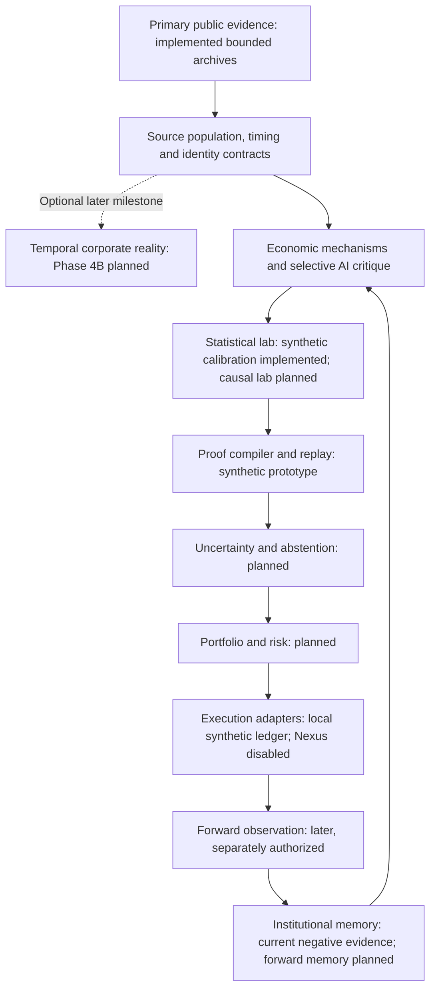
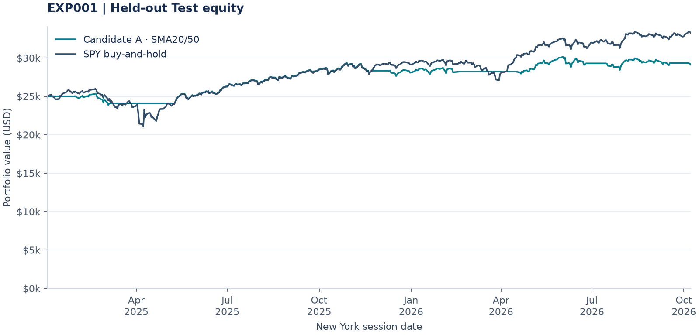

<!-- Generated by python -m src.presentation.exp001; edit src/presentation/README.template.md and regenerate. -->
# Research OS — Quantitative Research

## TL;DR

**A Python research-engineering project investigating whether economically motivated investment ideas survive realistic costs and independent testing.** It combines public-source data pipelines, point-in-time controls, statistical analysis and reproducible backtesting. AI helps with interpretation and engineering; deterministic code governs evidence and experiment boundaries.

One investment study is complete, reusable research infrastructure is built, and recent disclosure candidates were closed at source gates; the frozen momentum study has complete price enrichment but remains blocked at execution-evidence certification. **No profitable strategy or validated paper/live system has been established.**

**Current direction:** investigate unconventional economic relationships with a credible path to investment value. The latest [eight-family evidence-first campaign](docs/strategy/measurement_gate_campaign_report.md) formalises [Measurement Gate M](docs/strategy/measurement_gate_m.md): prove the distinctive variable and matched outcome before deep research. No original claim passed; a narrower insurer gross-book object is measurable but rejected as an investment priority. No economic pilot qualifies. [Insurance assessment/tax-credit measurement](docs/strategy/discovery_bottleneck_report.md) remains the pre-existing leading measurement candidate on hold; the [offshore proposal](docs/strategy/short_horizon_discovery_report.md) is also unapproved. Earlier [discovery](docs/strategy/expanded_discovery_report.md), [salmon](docs/strategy/salmon_verification_final_report.md) and [healthcare/chemical](docs/strategy/frontier_selection_ii_report.md) findings are preserved. No new economic test or profitable edge is established; river remains unapproved.

**Selection standard:** seek [economic value and plausible competitive differentiation](docs/strategy/frontier_selection_standard.md). Research and commercial interest can support relevance; obscurity earns no credit. Assess the specific signal and closest substitutes separately from familiarity with its dataset. No remaining profitable advantage has been demonstrated.

### Six key highlights

- **End-to-end investment research:** completed a benchmarked SPY timing study with frozen selection rules, explicit costs and separate Development, Validation and historical Test windows. Lower risk did not translate into benchmark outperformance; the negative result is retained.
- **Data engineering and provenance:** immutable original-byte archives, SHA-256 integrity checks, offline SEC/XBRL parsing and exact SQLite/Parquet/DuckDB reconciliation.
- **Point-in-time discipline:** separate filing acceptance, public availability and ingestion clocks; preserve amendments, missingness and unresolved historical security identities.
- **Statistical scrutiny:** independent metrics, bounded trial ledgers and synthetic dependence/power calibration. Unsupported inference methods and designs are rejected before performance research.
- **Execution and integration engineering:** a Decimal reference ledger tests fees, cash flows and corporate actions on synthetic fixtures. Nexus historical-universe pruning was detected and remains an execution blocker.
- **Reproducible software delivery:** automated public CI, regression tests, versioned contracts and generated reports/figures from canonical results. Public software checks are separate from private-source and real-market certification.

**Core tools:** Python, NumPy, PyArrow/Parquet, DuckDB, SQLite, Matplotlib, Git and GitHub Actions. Start with the [completed study](reports/EXP001_final_report.md), [current momentum execution-evidence audit](docs/acceleration/exp004_execution_gap_report.md) or [implementation boundaries](#architecture-and-implementation-status).

## Vision, progress and next steps

The long-term goal is a small, auditable research platform that turns economic hypotheses into independently supported, cost-aware investment decisions. Each claim must earn its evidence: **exploratory economic measurements → historically actionable forecasts → execution-aware investment tests → independent confirmation → forward paper evidence.** Early exploratory work may use disclosed reconstructed data; stronger investment claims require stronger certification.

| Step | Progress and next requirement |
| --- | --- |
| Build the evidence foundation | Bounded source archives, offline reconciliation, experiment controls and synthetic execution tests are implemented. Complete historical identity, lifecycle and execution certification remain open. |
| Test one economic mechanism | The SPY timing study is complete. Revenue, SEC Item 2.02 and congressional-purchase candidates closed before performance at inference/source gates. Frozen momentum inputs passed numeric QA; same-source OPEN enrichment preserves all frozen rows; a bounded 26-gap forensic pass found raw daily candidates but could not certify complete execution evidence. No new strategy performance exists. |
| Establish independent investment evidence | Eight new families received explicit measurement cards; four had original-source checks. Required net/cohort variables remain missing, and a separately recorded measurable gross-book reformulation supplies no demonstrated investment increment. Acquisition is closed, with no economic pilot, registered candidate or return test. Historically actionable work still requires timed inputs, benchmarks, costs and justified inference. |
| Earn portfolio and forward capabilities | Risk-aware construction, optional evidence-linked relationship/causal tools and separately authorized forward paper observation are later milestones, conditional on surviving evidence. |

Progress is measured by reproducible artifacts and closed scientific gates, rather than promised profitability or a deployment deadline. Rejected designs document what the platform has learned and which requirements remain unresolved. The [governing roadmap](docs/acceleration/master_plan.md) records the detailed milestones and authorization boundaries.

## Research approach

**Reproducible investment experiments from primary evidence.** Research OS tests whether economically motivated hypotheses contain net-of-cost alpha, and refuses to accept results without provenance, information timing, historical identity, execution and statistical justification.

AI assists interpretation, planning, critique and engineering. Deterministic code controls what counts as evidence. The aim is to make false discoveries difficult to accept; profitability has not been established.

[Current roadmap](docs/acceleration/master_plan.md) · [Operating contracts](docs/research_os.md) · [Phase 4A selection](docs/acceleration/phase4a_plan.md) · [Final Phase 3](docs/acceleration/phase3_final_report.md)

## Why this exists

A plausible mechanism and an attractive backtest are a beginning, not a conclusion. Filing revisions can leak future knowledge, ticker joins can discard ended securities, and many event rows can represent very little independent evidence. Research OS separates these questions before a result can advance: what was known, which security existed, how the population was constructed, how execution was accounted for, and whether the statistical claim is justified.

Failed experiments and rejected designs stay in the record. That memory makes the next experiment cheaper to reject and easier to reproduce.

## Architecture and implementation status



Research OS is canonical for sources, populations, identity, timing, experiment definitions, trials, inference and stages. The diagram includes the intended architecture; arrows do not claim a completed end-to-end production pipeline.

| Layer | Built and tested | Certification boundary |
| --- | --- | --- |
| Source provenance | Original-byte archives, SHA-256, request/error receipts, source registries and immutable versions | Bounded sources; complete market coverage is unproved |
| SEC / point-in-time pilot | Accession-specific XBRL and full primary text, offline replay, SQLite/Parquet/DuckDB reconciliation; separate acceptance, public-availability, reconstruction and ingestion clocks | Exact public availability UNKNOWN; item segmentation and full historical class bindings incomplete |
| Accounting and identity | Explicit revenue comparability and effective-date/class contracts; unresolved values stay unavailable | Contracts exist; full triples, listing spans and terminal positions remain uncertified |
| Experiment controls | Schema validation, frozen hashes, stage gates, durable jobs/trials, ceilings and uncertain-submission reconciliation | Application controls; filesystem owners can modify code/state; human Test/paper decisions remain separate |
| Proof compiler / replay | Content-hashed manifests, input/code/environment fingerprints, exact input replay, resolution/power guards; design-only structural compile | Synthetic execution and structural design checks only; no scientifically certified real freeze or Stage C adapter |
| Statistics | Independent legacy metrics, paired descriptive resampling, multiplicity utilities and frozen synthetic calibration | Software and model-conditional passes do not certify real assumptions or alpha |
| Independent execution | Decimal ledger, stable-ID bindings, fees/cash, dividend receivables, splits, renames, cash/stock conversions, explicit cancellation and exact population reconciliation | Synthetic fixtures only; deferred/mixed consideration, CVRs and complete real lifecycle paths remain unsupported |
| Adapter boundary | Generic execution interface and defined Nexus adapter | Nexus adapter disabled; historical population preservation not certified |
| Verification / memory | Public synthetic CI, local integration tests, preservation audits, reports and retained negative findings | Public CI cannot certify private source archives, real-market execution or profitability |

Implementation: [source pilot](src/research/sec_pilot/), [contracts/compiler](src/research/phase3d/), [local ledger](src/research/phase3d/execution.py), [stage/trial store](src/research/store.py), [tests](tests/).

## Scientific principles

- Preserve original sources and revisions; derivatives carry source and transformation hashes.
- Keep economic dates, public information timing, reconstruction and ingestion distinct. A modeled eligibility bound never becomes an observed publication timestamp.
- Resolve issuer, class, stable security ID and effective spans separately. Delisting is not zero recovery; disappearing holdings cannot be dropped or valued forever at the last price.
- Freeze mechanisms, controls, costs, trial ceilings and stage rules before performance. Count failed, partial and unresolved attempts.
- Calibrate inference before expensive certification. Event count is not independent sample size; synthetic success depends on its model.
- Separate Development, historical workflow holdouts and future paper evidence. Only observations collected forward after freeze can be genuinely unseen. Human Test/paper authorization cannot be supplied by automation.

## Research history

| Record | Question | Outcome |
| --- | --- | --- |
| [EXP001](reports/EXP001_final_report.md) | Five SPY timing candidates; SMA20/50 selected using Development only | Lower volatility/drawdown but lower return and risk-adjusted ratios than passive SPY in both out-of-sample windows; no convincing alpha |
| [EXP002](experiments/EXP002/research/final_freeze_review.md) | Momentum with institutional/insider information | Abandoned before freeze: historical population and omission-as-zero institutional evidence failed critical feasibility gates |
| [EXP003](experiments/EXP003/research/final_freeze_review.md) | Momentum with qualifying insider purchases | Closed before freeze: joint source inception/coverage remained uncertified; economic hypothesis untested |
| [EXP004](reports/EXP004_development_report.md) | Cross-sectional price momentum | Operationally paused: numeric inputs passed, but Nexus rejected historical symbols and a diagnostic pruned the requested population; no fair candidate study |
| [EXP005 proposal](docs/acceleration/phase3_final_report.md) | Annual revenue-growth acceleration versus matched momentum | Abandoned for its approved confirmatory design before creation/freeze; no real signals or strategy performance observed |


EXP005 failed scientific certification. Its five annual confirmation groups could not support the required Student inference without an independently justified restriction on persistent cross-year common exposure. This does not show that revenue acceleration has no alpha. The final pass stopped upstream; new accounting/identity campaigns and adapter/compiler implementation were explicitly deferred.

<details>
<summary>EXP001: canonical out-of-sample evidence and reproduction</summary>

Development: 2015-01-01 to 2021-12-31. Selection required maximum drawdown ≤25% and at least 20 recorded completed round trips; SMA20/50 had the highest eligible zero-risk-free-rate Sharpe. Five-candidate selection, one asset and limited windows constrain the claim.

### Validation: 2022-01-01 to 2024-12-31

| Portfolio | Total return | Ann. volatility | Sharpe (RF=0) | Sortino | Max drawdown |
|---|---:|---:|---:|---:|---:|
| Candidate A | 2.72% | 11.51% | 0.130 | 0.183 | 17.81% |
| SPY buy-and-hold | 26.61% | 17.27% | 0.540 | 0.770 | 24.65% |

### Historical Test: 2025-01-01 to 2026-10-08

| Portfolio | Total return | Ann. volatility | Sharpe (RF=0) | Sortino | Max drawdown |
|---|---:|---:|---:|---:|---:|
| Candidate A | 16.44% | 9.89% | 0.928 | 1.345 | 5.86% |
| SPY buy-and-hold | 32.91% | 16.86% | 1.076 | 1.628 | 18.93% |

Returns are cumulative period returns. Each window had independent $25,000 funding, 99.5% entry allocation and a 0.10% stock fee per fill. Stored equity already includes fees and dividends. Volatility is annualized from daily closes; Sharpe uses RF=0, Sortino MAR=0, and drawdown is a positive daily peak-to-trough loss. These conventions differ from some engine summaries. The manifest's original sealed marker is preserved; the final report documents the subsequent authorized one-time Test opening.



The [full report](reports/EXP001_final_report.md), [canonical metrics](data/processed/EXP001_SPY_AI_SELECTION/metrics.json) and [figure provenance](docs/assets/exp001_sources.json) retain selection, benchmark, costs, windows and limitations. No AI-specific causal advantage or persistent market edge is established.

</details>

## Programme history and Phase 3 lessons

| Phase | What it established |
| --- | --- |
| [1](docs/acceleration/phase1.md) | Capability/source audit, guardrails and historical execution limits |
| [2](docs/acceleration/phase2_report.md) | Three-filing immutable SEC/XBRL pilot, offline replay and exact cross-store reconciliation |
| [3A](docs/acceleration/phase3a_report.md) | Scoped accounting semantics; timing and historical identity remained partial |
| [3B](docs/acceleration/phase3b_gate_review.md) | Revenue mechanism, matched control and bounded pre-performance trial proposal |
| [3C](docs/acceleration/phase3c_report.md) | Fixed free-source census: incomplete accounting, identity/terminal evidence and failed inference calibration |
| [3D](docs/acceleration/phase3d_closure_report.md) | Source contracts, proof/replay prototype, synthetic Decimal engine, public CI and inference feasibility guards |
| [3E](docs/acceleration/phase3e_report.md) | Date-scope incompatibility stopped the original programme before acquisition/calibration |
| [3E-R](docs/acceleration/phase3e_redesign_report.md) | Historical geometry and modeled availability redesign; conditional synthetic evidence and owner planning approval |
| [Final Phase 3](docs/acceleration/phase3_final_report.md) | COMPLETE_EXP005_ABANDONED: approved inference not certified; no real performance |

The reusable lessons are practical: ticker history does not establish security identity; filing acceptance does not establish first-public availability; equal XBRL concepts do not establish equal accounting scope. A convenient significance rule may be unresolvable, and a narrow synthetic calibration can miss dependence that matters in the actual design. Source collection cannot establish a missing statistical restriction by itself. Rejecting a design before performance is a useful research outcome.

## Current state and roadmap

**EXP004 execution-gap investigation stopped with unresolved evidence; no-fill remains inactive.** The [26-case forensic report](docs/acceleration/exp004_execution_gap_report.md) preserves complete 28-quarter price enrichment and all frozen identities. Independent requests returned 17 raw daily bar candidates, including 16 with two-sided scale agreement; none meets the complete historical provider-class/session-opening certificate. Nine cases have no recovered exact-date bar from that route; TWMC remains unresolved. All 26 remain represented. No no-trading certificate, amendment receipt or V002 engine exists; all folds/replays/performance remain NOT_RUN, Validation/Test0. This source result is not an economic verdict.

| Milestone | Next purpose | Entry boundary |
| --- | --- | --- |
| **4A** | Next experiment discovery, cheap feasibility and eventual freeze | EXP006/EXP007 closed; EXP004 local route blocked at missing execution inputs; no new performance |
| 4B | Temporal Corporate Reality Graph pilot | Separate milestone; primary evidence, dated relationships and uncertainty |
| 4C | First causal/counterfactual event experiment | Credible identification, controls, pre-trends and placebos; causal labels must be earned |
| 5 | Portfolio/risk, uncertainty/abstention and research value-of-information | Requires surviving evidence and a reviewed cost/risk contract |
| 6 | Nexus certification and forward paper infrastructure | Reconcile to local evidence, certify population semantics, then separate human paper authorization |
| 7 | Actual forward evidence, institutional memory and later selective autonomy | Requires elapsed future observations and scoped access controls |

The initial [Phase 4A shortlist and scorecard](docs/acceleration/phase4a_candidate_families.md) compared government procurement, FDA drug decisions and merger-enforcement events on mechanism and source/design feasibility. The owner then approved the [12-slot procurement source pilot](docs/acceleration/phase4a_procurement_pilot_report.md). The official publication route returned HTTP 403; one USAspending documentation check succeeded. The verdict is PROCUREMENT_FAMILY_REJECT under the frozen channel/frame, with one attempted slot and eleven deferred. No award, lineage match, recipient mapping or timing was established; this does not prove every official procurement channel impossible. The [cheap feasibility gate](docs/acceleration/phase4a_feasibility_framework.md) remains reusable. FDA/merger evidence is retained; no automatic next family, prices or performance are authorized.

Nexus remains a replaceable downstream execution/orchestration adapter, potentially including future certified paper and isolated assistant tasks. Historical execution is not yet certified: prior tests demonstrated population pruning. Remote Aurora remains blocked without audited tool/date isolation. Neither paper nor live trading is authorized, no paper strategy is validated, and no profitable strategy has been demonstrated.

## Running and reproducing

Verified environment: CPython 3.13; compatibility code supports Python 3.11+. Dependencies are separated by purpose:

```sh
python -m pip install -r requirements-research.txt
python -m pip install -r requirements-docs.txt
python -m src.research.public_checks
python -m src.research.phase4a --check
python -m src.research demo EXP999 --dry-run
python -m src.presentation.exp001 --check
```

Public checks block external network and private data reads. EXP999 uses temporary directories and fake transports. Presentation regeneration (`python -m src.presentation.exp001`) uses published EXP001 processed records; it creates no remote job. These checks demonstrate software behavior, not certified market execution or alpha.

Latest milestone validation: **485 local tests, 257 public tests, 0 skipped**. See [validation receipt](docs/acceleration/exp004_execution_gap_validation.json).

The complete local suite additionally needs ignored original archives:

```sh
python -m unittest discover -s tests -v
python -m src.research.phase3_final --check
```

Existing EXP001 integration tests use its already-opened local records for regression. SEC archive replay and private source reconciliation also require original ignored bodies/receipts; public reports can be checked from their canonical summaries. Acquisition/publication commands are remote mutations and are not routine reproduction. The isolated [EdgarTools/Arrow lock](docs/acceleration/sec_pilot_requirements.lock) preserves research dependency pins; install/replay instructions and notice obligations are in [the pilot specification](docs/acceleration/sec_pilot.md).

## Repository map and evidence boundaries

```text
src/research/         Specifications, stores, source pilots, contracts and gates
src/research/phase3d/ Proof/replay prototype and synthetic local execution
src/metrics/         Frozen independent metric definitions
src/nexus/           Legacy local EXP001 processing and Nexus extraction
src/presentation/    Generated README, canonical tables and figures
experiments/         Historical experiments and frozen artifacts
reports/             Human-facing economic/feasibility reports
docs/acceleration/   Programme decisions, source evidence and milestone reports
tests/               Public synthetic and private integrated checks
data/processed/      Canonical public EXP001 results
data/raw/            Immutable private source bodies and receipts, ignored
```

Credentials, personal request identities, private vendor bodies and operational state remain ignored. Published derived records do not independently verify the private archives. No repository licence has been selected; public visibility does not grant redistribution rights. See [publishing/data boundaries](docs/publishing.md) and [AGENTS.md](AGENTS.md). Historical reconstruction, survivorship, source-version drift and real-world inference assumptions remain explicit research problems.
