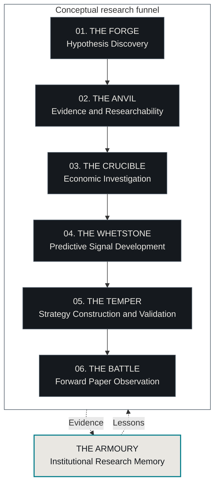

<!-- Generated by python -m src.presentation.exp001; edit src/presentation/README.template.md and regenerate. -->
# Research OS

**Forging an Edge**

Turning unconventional economic observations into reproducible, independently evaluated investment research. A Python system for discovering hypotheses, checking their foundations and testing whether useful information survives realistic investment constraints.

[Architecture & roadmap](docs/strategy/forging_an_edge_roadmap.md) · [Research results](#evidence-and-research-results) · [Offline quick start](#running-the-project) · [Operating contracts](docs/research_os.md)

## At a glance

A plausible story is cheap; reliable evidence is harder. Research OS separates discovery, measurement, economics, prediction and investment evaluation. AI helps formulate and criticise ideas; versioned records, deterministic checks and human approvals govern their advancement.

Built today: hypothesis archives, evidence ledgers, a research-memory graph, experiment controls, independent metrics, synthetic execution tests and one completed investment study. Newer generation and criticism components are tested offline; full discovery-to-investment automation remains unproven.

**No profitable strategy or validated paper/live trading system has been established.** Next: one measurable hypothesis taken into a bounded economic investigation, retaining null or negative results.

## The research pipeline



| Stage | The question it answers |
| --- | --- |
| **01. THE FORGE — Hypothesis Discovery** | What unusual economic relationship is worth investigating? |
| **02. THE ANVIL — Evidence and Researchability** | Can we identify the predictor, independently measure an outcome and establish material exposure? |
| **03. THE CRUCIBLE — Economic Investigation** | Does the proposed mechanism survive empirical scrutiny and competing explanations? |
| **04. THE WHETSTONE — Predictive Signal Development** | Was useful, incremental information available before the outcome? |
| **05. THE TEMPER — Strategy Construction and Validation** | Does a candidate survive costs, execution constraints and independently separated evaluation? |
| **06. THE BATTLE — Forward Paper Observation** | How does a frozen strategy behave as genuinely new market information arrives? |

**The Armoury** preserves hypotheses, sources, failures and lessons across every stage. This conceptual funnel has human-controlled handoffs; it is not an operational end-to-end pipeline. Source-first investigations can return hypotheses to The Forge. The Battle initially means separately authorised paper research.

[Jev Research Navigation](docs/jev_navigation_v001.md) helps inspect supplied evidence, retrieve Armoury lessons and identify existing blockers. It is an offline, read-only navigation layer; its former shadow-critic role is retired. The Quarry remains an optional future source of authorised candidate records. Jev neither acquires sources nor advances research.

## What exists today

Checked against `main` and GitHub on **24 October 2026**. Software tests establish behaviour, not scientific validity or investment value.

| Capability | Current evidence and limits |
| --- | --- |
| **Discovery** | [Scout](docs/opportunity_scout/README.md): tested card archives, generation lanes, structural checks, critique, incubation and human handoff controls. Outputs remain proposals. |
| **Generation and criticism** | [Exploratory runner](docs/opportunity_scout/exploratory_runner_v001.md): [PR #26 merged](https://github.com/jarems421/ai-assisted-quantitative-research/pull/26), 24 October; offline-tested, no live runner use. [Critic V1](docs/opportunity_scout/ai_critic_v001.md) is offline/advisory. Provider adapters [#27](https://github.com/jarems421/ai-assisted-quantitative-research/pull/27) and pipeline [#28](https://github.com/jarems421/ai-assisted-quantitative-research/pull/28): offline-tested, draft/unmerged. |
| **Researchability** | [Discovery Lab](docs/strategy/discovery_lab_design.md): tested append-only ledgers, Source Passports, frozen claims and mechanical checklists. M certification remains human; a new qualifying economic study is pending. |
| **Research memory** | [Graph v1.1](docs/strategy/graph_v1_1_design.md): tested derived joins/suggestions. [R3](docs/strategy/graph_pilot_r3_results.md) was INCONCLUSIVE, AI-assisted and potentially unblinded. R4 is NOT_RUN/unauthorised. No discovery advantage established. |
| **Source/statistical engineering** | [SEC/XBRL replay](docs/acceleration/phase2_report.md), contracts, reconciliation and [inference feasibility tests](docs/acceleration/phase3_final_report.md). Synthetic checks do not certify historical data or predictability. |
| **Strategy controls** | Tested freezes, trial ledgers, independent metrics and stage enforcement. EXP001 complete; EXP004 execution-blocked. [Decimal execution ledger](src/research/phase3d/execution.py): synthetic fixtures only. |
| **Forward observation** | Legacy human-gated paper controls exist; population/execution certification and a validated strategy are missing. No operational paper/live system. |

## Evidence and research results

### EXP001: lower risk, no convincing alpha

**Question:** could an AI-proposed SPY timing strategy improve on explicit SPY buy-and-hold? Five candidates were compared in Development (**2015-01-01 to 2021-12-31**). Eligibility required maximum drawdown ≤25% and at least 20 recorded completed round trips. SMA20/50, Candidate A, had the highest eligible independently calculated zero-risk-free-rate Sharpe and was frozen before the later windows.

Candidate A reduced volatility and drawdown but had **lower return, Sharpe and Sortino than passive SPY in both out-of-sample windows**. No AI-specific advantage was demonstrated. Five-candidate selection, one asset and limited windows constrain generalisation.

#### Validation: 2022-01-01 to 2024-12-31

| Portfolio | Total return | Ann. volatility | Sharpe (RF=0) | Sortino | Max drawdown |
|---|---:|---:|---:|---:|---:|
| Candidate A | 2.72% | 11.51% | 0.130 | 0.183 | 17.81% |
| SPY buy-and-hold | 26.61% | 17.27% | 0.540 | 0.770 | 24.65% |

#### Historical Test: 2025-01-01 to 2026-10-08

| Portfolio | Total return | Ann. volatility | Sharpe (RF=0) | Sortino | Max drawdown |
|---|---:|---:|---:|---:|---:|
| Candidate A | 16.44% | 9.89% | 0.928 | 1.345 | 5.86% |
| SPY buy-and-hold | 32.91% | 16.86% | 1.076 | 1.628 | 18.93% |

Each window had independent $25,000 funding, 99.5% entry allocation and a 0.10% stock fee per fill. Returns are cumulative, not chained. Equity includes simulated fees and dividends. Volatility is annualised from daily closes; Sharpe uses RF=0, Sortino MAR=0 and drawdown is a positive daily peak-to-trough loss.


The [report](reports/EXP001_final_report.md), [metrics](data/processed/EXP001_SPY_AI_SELECTION/metrics.json) and [figure provenance](docs/assets/exp001_sources.json) retain the design and limitations. The manifest's historical sealed marker is preserved; the report records its later authorised one-time Test opening.

### Other investigations: learning where research stops

| Record | Question and recorded outcome |
| --- | --- |
| [EXP002](experiments/EXP002/research/final_freeze_review.md) | Institutional/insider momentum: abandoned before freeze; population and omission-as-zero evidence failed feasibility. |
| [EXP003](experiments/EXP003/research/final_freeze_review.md) | Insider-purchase momentum: closed before freeze; joint source inception/coverage uncertified. Mechanism untested. |
| [EXP004](docs/acceleration/exp004_execution_gap_report.md) | Price momentum: paused. Numeric enrichment exists; all 26 execution gaps remain uncertified. Validation/Test and local performance NOT_RUN. |
| [EXP005 proposal](docs/acceleration/phase3_final_report.md) | Revenue acceleration versus matched momentum: abandoned before creation/freeze; inference uncertified. No strategy performance. |
| [EXP006](docs/acceleration/exp006_cover_identity_report.md) | SEC Item 2.02: abandoned at source/population/identity gates. No performance; missing coverage is not zero. |
| [EXP007](docs/acceleration/exp007_house_repair_report.md) | Congressional purchases: closed at source validation; House-only repair failed the historical source gate. No performance result. |


The [measurement campaign](docs/strategy/measurement_gate_campaign_report.md) found no original M pass; a gross-book reformulation established no investment value. [SH09](docs/strategy/sh09_verification_report.md) lacked lease/net-exposure evidence. R3 retained five owner-approved REJECTs and zero M passes. **Missing data and blocked access do not falsify a mechanism.**

## What comes next

1. Finish and verify Forge generation-and-criticism automation using simulated providers first.
2. Propose a small, controlled discovery pilot, potentially alongside a competent simple baseline; obtain separate approval for any live run.
3. Take one hypothesis through The Anvil: predictor, independent outcome, credible source route and material exposure—or precise blockers.
4. Complete one reproducible **Level A economic investigation** before adding downstream features. Preserve null and negative outcomes.
5. Advance to historically actionable prediction, cost-aware investment evaluation and forward paper observation only when their prerequisites are met.

These priorities grant no authority. The [full roadmap](docs/strategy/forging_an_edge_roadmap.md) maps stages to code, handoffs and blockers; the [master plan](docs/acceleration/master_plan.md) and owner decisions govern.

## Running the project

From a clean public clone, use Python 3.11+ (verified: CPython 3.13). These commands use public records or synthetic fixtures, without credentials, private archives or a remote simulator:

```sh
python -m pip install -r requirements-research.txt
python -m pip install -r requirements-docs.txt
python -m src.research.public_checks
python -m src.research.discovery demo --check
python -m src.research.graph demo --check
python -m src.research demo EXP999 --dry-run
python -m src.presentation.exp001 --check
```

Public checks deny external network/private-data reads; EXP999 uses temporary fake transports. Rebuild this README, tables and figures with `python -m src.presentation.exp001` after editing [the template](src/presentation/README.template.md). Metrics remain generated from canonical records.

The [Research OS operator](docs/research_operator_v001.md) runs the offline Forge → Quarry → Jev → Anvil → Armoury profile on one Forge archive and stops at each human or evidence gate (`python -m src.research.operator plan|run|continue|report`). `python -m src.research.operator demo` shows the whole chain on synthetic fixtures. It automates workflow only: no model calls, acquisition or approvals.

[Source Retrieval V001](docs/source_retrieval_v001.md) is the first original-evidence acquisition component: one owner-authorised, exact-URL HTTPS retrieval attempt per request, with receipts, stop reconciliation and an immutable result for the campaign controller. It is tested offline and against a loopback-only TLS server; no live retrieval has been authorised.

The [offline CI inventory and safety review](docs/offline_ci_hardening.md) documents
the Windows/Linux verification matrix, exact exclusions and reproducible commands.
Run `python -m src.research.offline_checks` after installing
`requirements-offline-ci.txt` for the additional restricted suite. Earlier milestone
counts are historical: see the [EXP004 validation receipt](docs/acceleration/exp004_execution_gap_validation.json).

The full suite (`python -m unittest discover -s tests -v`) requires ignored originals. EXP001 integration tests can reprocess records. See [publishing boundaries](docs/publishing.md) and [offline CI](docs/offline_ci_hardening.md). Software passes do not certify market execution or alpha.

## Repository navigation

| Location | Start here for |
| --- | --- |
| [Scout](src/research/opportunity_scout/) / [Discovery Lab](src/research/discovery/) / [Graph](src/research/graph/) | Hypothesis discovery, evidence records and derived research memory |
| [Operator](src/research/operator/) | One offline coordinator that runs the existing stages in order and reports where research stops |
| [Research controls](src/research/) / [contracts and ledger](src/research/phase3d/) | Specifications, gates, statistical feasibility and synthetic execution |
| [Metrics](src/metrics/) / [legacy processing](src/nexus/) | Frozen definitions and EXP001 processing |
| [Experiments](experiments/) / [reports](reports/) / [results](data/processed/) | Frozen artifacts, findings and public data |
| [Strategy](docs/strategy/) / [programme records](docs/acceleration/) | Designs, source findings, owner decisions and governing roadmap |
| [Presentation](src/presentation/) / [tests](tests/) | Generated README/figures and verification |

Original bodies and receipts stay private in ignored `data/raw/`.

## Research integrity and limits

- **Information timing:** occurrence, publication, dataset and retrieval clocks differ. Disclosed Level A reconstruction does not establish Level B historical actionability.
- **Population and identity:** ticker similarity does not verify securities or ownership. Delistings, actions and missing constituents stay accounted for.
- **Independent evaluation:** freeze questions, costs, candidates and ceilings; count failed/unresolved trials. Modern AI may know historical holdouts. Genuinely forward evidence requires elapsed future time.
- **Human authority:** AI critiques are advisory. M, READY/handoffs, Test and paper retain human gates. Roadmaps do not reopen paused campaigns or stopped sources.
- **Honest outcomes:** preserve rejected, abandoned, blocked and incubated claims, reasons and provenance. No demonstrated alpha or operational paper/live trading is claimed.

Detailed boundaries: [Measurement Gate M](docs/strategy/measurement_gate_m.md), [Levels A/B/C](docs/strategy/next_frontier_review.md), [selection standard](docs/strategy/frontier_selection_standard.md), [operating contracts](docs/research_os.md) and [repository instructions](AGENTS.md). No repository licence has been selected; public visibility does not grant redistribution rights.
