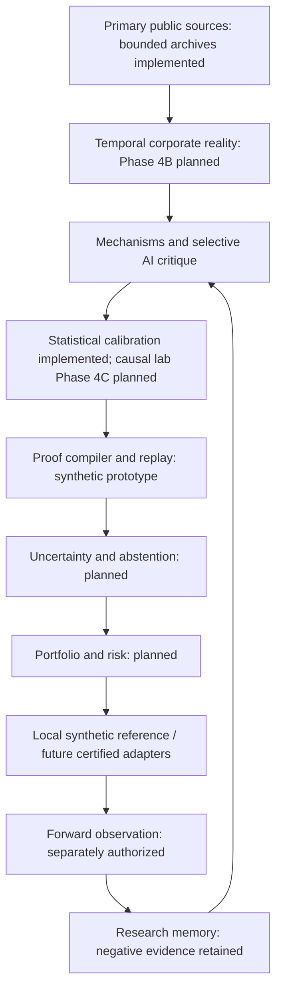

# Research OS: governing roadmap

**Current direction: Phase 4A THREE_PREDECLARED_FAMILIES_EXHAUSTED; NEXT_EXPERIMENT NONE_SELECTED.** The [complete Phase 4 transition](owner_phase4_transition_2026-10-12.md) supersedes the old instruction to freeze EXP005 and run Development. The owner authorized the [third/final merger pilot](owner_merger_pilot_2026-10-13.md), which stopped at its first exact source route. [Three-family synthesis](phase4a_family_screen_summary.md) records the bounded procurement/FDA/merger rejections and owner reassessment questions. Historical plans/reports, raw bytes, frozen experiments and negative findings remain unchanged. No fourth family or Phase 4B/4C begins automatically.

Research OS builds reproducible, point-in-time investment experiments from primary evidence. It seeks net-of-cost alpha while requiring provenance, timing, historical identity, execution and statistical justification before accepting positive evidence. AI assists interpretation and critique; deterministic contracts control what may advance. Profitability is unestablished.

## Phase 3 is institutional memory

Canonical disposition: **PHASE3_COMPLETION = COMPLETE_EXP005_ABANDONED**. EXP005 is abandoned for its approved confirmatory design, absent, unregistered, unfrozen, with no real performance. The [final report](phase3_final_report.md) and [inference certificate](phase3_final_inference_certificate.json) document the persistent-common-factor obstruction. This does not demonstrate that revenue acceleration has no alpha. Do not reopen or repair EXP005.

The final pass stopped before the 29-chain/60-case certification campaigns, Stage C adapter and real-design compiler were completed. Their deferred statuses remain explicit. EXP004 is operationally paused; its frozen economic design and publication/runtime evidence remain intact. Neither experiment advances from infrastructure tests.

Retain the immutable SEC/XBRL pilot, hashes/replay, accounting/identity contracts, population reconciliation, stage/trial controls, synthetic proof compiler, Decimal reference ledger, calibration/resolution guards, public CI and preservation checks. Reuse them; do not build parallel replacements merely to change the roadmap.

V002 and v003 retain their exact owner planning approvals and inactive status. Observed public availability remains UNKNOWN; the Salesforce chronology-conflict contributor stays unavailable. These policies are not automatic timing authorization for the next event family.

## Forward milestones

| Phase | Purpose | Entry/authorization boundary |
| --- | --- | --- |
| **4A** | **Next experiment discovery, feasibility and eventual freeze** | THREE_PREDECLARED_FAMILIES_EXHAUSTED; NONE_SELECTED; stop for architecture/research-direction review, no fourth family or performance |
| 4B | Temporal Corporate Reality Graph pilot | Separate milestone; start with evidence-linked dated relationships, not a full graph platform |
| 4C | First causal/counterfactual event experiment | Credible controls, pre-trends/placebos and explicit identification assumptions; no automatic causal label |
| 5 | Portfolio/risk, uncertainty/abstention and research value-of-information | Requires surviving economic evidence, costs, risk constraints and mechanism diversity |
| 6 | Nexus certification and forward paper infrastructure | Reconcile to the independent reference; certify historical population/execution semantics; paper needs separate human authorization |
| 7 | Forward evidence, institutional memory and later selective autonomous research | Actual future observations and audited access controls; software cannot manufacture elapsed evidence |

## Phase 4A: fail cheaply before certifying expensively

Compare three to five economically motivated primary-source event families before choosing a full experiment. The initial [selection plan](phase4a_plan.md) bounds this pass to three: government procurement awards, FDA drug approval decisions and public merger-enforcement decisions. Government contracts lead the investigation direction but do not win by instruction or assumed profitability.

The [feasibility framework](phase4a_feasibility_framework.md) requires evidence for source, timing, identity, population, execution, controls, inference, power/resolution and trial-budget feasibility. Assess effective independent/event variation before a large source-certification campaign. More records do not establish more independent observations. Keep unknown timestamps, unavailable mappings, selection/coverage gaps and ended histories in denominator accounting.

Use authoritative documentation and source/design reasoning, not exploratory returns. No price-history download for strategy analysis, event study, candidate/control return, alpha, threshold/holding-period optimization, strategy ranking or next-experiment registration/freeze occurs in this step. After family approval, evidence acquisition and contract preparation still need a bounded reviewed instruction; performance remains separately gated.

Event contracts should preserve event ID/type, economic event date, observed public-known time or modeled timing policy, issuer/class/security, agency/counterparty, contract/application/case identifier, economic amount/type, effective relationships, source hash, revision lineage and unresolved mapping status. These fields anticipate graph reuse; they do not build Phase 4B now.

## Architecture and responsibilities

Research OS remains canonical for populations, identity, information timing, strategy specifications, trials, inference and research stages. Nexus remains a replaceable downstream adapter for future certified execution/orchestration/paper work; the interface is defined and disabled. Prior historical pruning prevents certification for current requirements. Remote Aurora remains blocked until audited server-side tool/date isolation exists. No Nexus/Aurora call, support message, purchase, Orbis access, optimizer, paper or live operation is included here.

## Historical checkpoints

| Evidence | Finding retained |
| --- | --- |
| [Phase 1](phase1.md) | Capability audit and execution/source boundaries |
| [Phase 2](phase2_report.md) | Immutable three-filing SEC pilot and exact offline reconciliation |
| [Phase 3A](phase3a_report.md) | Scoped semantic observations; clocks/class identity partial |
| [Phase 3B](phase3b_gate_review.md) | Revenue hypothesis and pre-performance budget proposal |
| [Phase 3C](phase3c_report.md) | Free-source census; incomplete accounting/identity/terminal evidence and failed calibration |
| [Phase 3D](phase3d_report.md) / [closure](phase3d_closure_report.md) | Reusable proof/replay and synthetic local ledger; old failed methods preserved |
| [Phase 3E](phase3e_report.md) | Old twelve-year programme incompatible with approved pilot scope; upstream stop |
| [Phase 3E-R](phase3e_redesign_report.md) | Historical geometry/modeling redesign and conditional synthetic results |
| [V003 decision](availability_policy_v003_owner_decision.md) | Exact planning/design approval; no activation or real-assumption certificate |
| [Final Phase 3](phase3_final_report.md) | COMPLETE_EXP005_ABANDONED; no real performance |

The [original long-term owner plan](owner_plan_2026-10-12.md) and supplied PDFs remain background/direction history; their old Phase 4A EXP005 path is superseded here. [Reading disposition](direction_review.json) preserves the prior 56-page audit. Old dates, estimates and stop statements are historical, not current permissions or deadlines.

## Current operating state

- PHASE4A_FAMILY_SCREEN = THREE_PREDECLARED_FAMILIES_EXHAUSTED; NEXT_EXPERIMENT = NONE_SELECTED.
- PERFORMANCE_AUTHORIZED = FALSE; NEXUS_EXECUTION = BLOCKED.
- EXP004 = OPERATIONALLY_PAUSED; EXP005 = ABANDONED_FOR_APPROVED_DESIGN_AND_ABSENT.
- PAPER_TRADING and LIVE_TRADING = NOT_AUTHORIZED; profitability UNESTABLISHED.

The approved [procurement manifest](phase4a_procurement_pilot_manifest.json) retains all 12 fixed slots. The official January 2019 discovery route returned HTTP 403; one independent USAspending documentation response returned HTTP 200, with no eligible announcement substitute. Total starts: 2; every event-data/SEC/OpenFIGI/price/remote research count: 0. Eleven unvisited slots are deferred, not observed missing announcements. No timing, recipient, award-lineage or sample geometry is certified. The original scorecard remains historical evidence; FDA/merger work is not automatically launched. Stop for owner review. No source-heavy campaign or later phase follows automatically.

The [FDA frame audit](phase4a_fda_frame_review_v002.json) retains the approved 10-start Gate 1 /60-start total contract. The initial 200/200/302 responses and REDESIGN review remain preserved. The owner follow-up continued the original budget under a separately frozen landing-route amendment: the landing page returned 200 and the exact negative-letter documentation URL returned 404. Five starts, zero retries; acquisition then stopped. The final verdict is FDA_FAMILY_REJECT for the bounded audited frame/routes, not proof that every FDA frame is approval-selected or inaccessible. No event slots, eligible-action definition, applicant/security mappings, regulatory timing or cluster geometry were instantiated. No approval-selected event sample is permitted.

The third/final [merger pilot](phase4a_merger_pilot_report.md) made one request: its frozen FTC case-directory URL returned404. No pre-decision risk set was established. HSR granularity/confidentiality, DOJ and SEC alternatives remain untested, not proven unsuitable. MERGER_FAMILY_REJECT applies to the bounded audited route/frame. Gate2 did not run; no deal, identity/lifecycle/timing/control/cluster certificate exists.

All three predeclared families are exhausted. The [synthesis](phase4a_family_screen_summary.md) prepares the mandatory owner architecture/research-direction decision. No candidate4, larger source campaign or automatic Phase4B/4C begins. Event-driven economics were never tested; exact source access should precede further mechanism scoring. All timing, experiment, graph, causal, performance and paper/live permissions remain separately gated.
