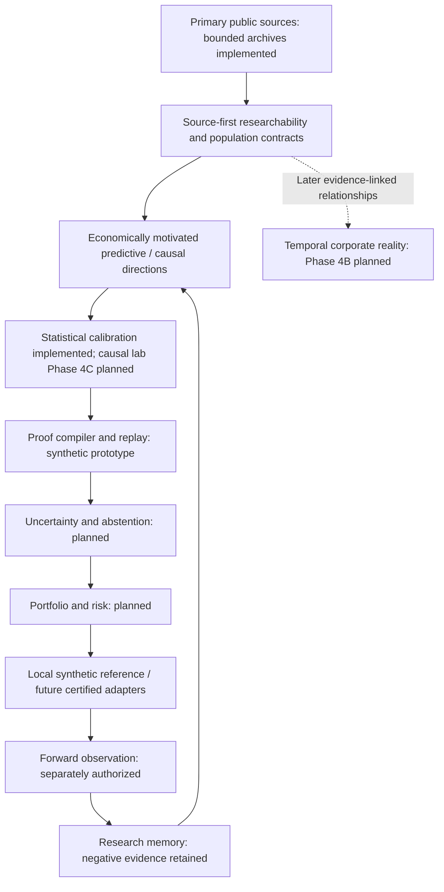

# Research OS: governing roadmap

**2026-10-21 Measurement Gate M campaign closed:** under the [new owner brief](../strategy/owner_measurement_gate_campaign_2026-10-21.md), the [eight-family investigation](../strategy/measurement_gate_campaign_report.md) reviewed the 29-page independent report, implemented a prospective manual [pre-Level-A M rule](../strategy/measurement_gate_m.md) and a lightweight claim/attempt ledger. Four source-checked families produced no original M pass. EF06 v2 records a narrower measurable group-gross object and rejects it as an investment priority; it is not a retained-premium or predictive result. Seventeen searches and nineteen ordinary starts retained 9.44 MiB, including an explicitly incomplete HCI filing prefix; source dispatch is closed. No new acquisition or Level A design is recommended. F19 remains HOLD/unapproved; SH09's prior proposal, river and all old experiment/source stops remain unchanged. M does not create a fourth evidence level, runtime gate or automatic next phase.

**2026-10-21 short-horizon discovery closed:** the [ten-hypothesis review](../strategy/short_horizon_discovery_report.md), under its [owner instruction](../strategy/owner_short_horizon_discovery_2026-10-21.md), recommends no economic pilot. Offshore cleanup exposure returning to former owners is the only proposed source-verification challenger: original disclosures show a material burden and a concrete asset-level route, but historical court/title/cost/security inputs and incremental information remain unverified. SH03 RNG and SH01 shared-loan comparisons are not promoted. F19 remains the existing leading measurement candidate, unapproved and closed; its annual-PDF follow-up is not activated. Forty searches/20 opens were used for documentary review, with zero ordinary acquisition, paid/cloud actions or economic tests. A proposed two-hour/eight-document/25 MiB SH09 check awaits separate approval; no automatic next source or phase follows. Prior experiments, stops and selection history remain intact.

**2026-10-21 evidence-first review closed:** the [latest investigation](../strategy/discovery_bottleneck_report.md) checked F19 insurance assessments/offsets and F09 creditor protection under a separate [owner brief](../strategy/owner_discovery_bottleneck_2026-10-21.md). No investment pilot qualifies. F19 has a public annual reconciliation route and a material reported assessment; the distinctive cohort/capacity join remains unverified. F09's essential cash amounts are redacted. Eighteen ordinary starts retained 27.30 MiB, including an explicitly incomplete parent filing prefix. Only a proposed two-original, 80 MiB F19 follow-up awaits approval; current source stops remain closed. No economic study, new experiment, old-source reopening or automatic next phase follows. Earlier rankings and proposals below are historical.

**2026-10-20 Frontier Selection II closed:** the [bounded F02/F03 comparison](../strategy/frontier_selection_ii_report.md), under its [separate owner instruction](../strategy/owner_frontier_selection_ii_2026-10-20.md), recommends neither economic pilot. Healthcare has material product exposure but explicit issuer interpretation/close research; chemical permissions and commercial replacements do not establish qualified, material substitute sales at risk. Four fixed cases, 27 ordinary starts and 18,936,679 response bytes produced no economic test. Candidate source stops are persisted; F09 is only a suggested future selection question. River is unapproved, salmon closed, and EXP001–EXP007/earlier source boundaries unchanged. Older proposed rankings below retain their historical scope.

**Current salmon disposition:** the [owner-approved two-analyst-day verification](../strategy/owner_salmon_verification_2026-10-20.md) is closed. The [final source report](../strategy/salmon_verification_final_report.md) records working authenticated access, eight selected health site-weeks, four detailed visit checks and two weekly tracks. Treatment tasks, independent treatment sharing and historically feasible capacity remain unestablished. The 28-start check stopped with two starts unused; no economic pilot, generic lice fallback or automatic healthcare/chemical backup follows. Previous experiments and source stops remain unchanged; older scope descriptions below are historical.

**2026-10-20 expanded discovery completed:** the [latest brief](../strategy/owner_expanded_discovery_2026-10-20.md) explicitly leaves the river experiment NOT APPROVED and requires new territory. The [twenty-candidate map, five deep dives and top-three report](../strategy/expanded_discovery_report.md) recommend F01 shared salmon treatment capacity for a later bounded source verification; F02 payment wedges and F03 chemical-use permissions are other leading questions. Discovery included documentation, research and commercial comparisons only; no scientific acquisition, economic test, implementation or new pilot occurred. The agreed value/competition framework is preserved. All older proposal/continuation wording below is history and confers no new authority.

**Frontier selection refinement:** assess [economic value and competitive saturation together](../strategy/frontier_selection_standard.md). Named research/industry/commercial interest can support relevance; exact-signal usage and profitable advantage require separate evidence. No novelty bonus for obscurity, and no automatic commercial-data rejection. The updated seven-candidate assessment retains river as a proposed learning task, not a demonstrated investment opportunity. No new acquisition or implementation authority follows.

**2026-10-20 current direction:** the [latest owner instruction](../strategy/owner_next_frontier_2026-10-20.md) distinguishes Level A exploratory reconstructed economic evidence, Level B historically actionable prediction and Level C implementability. The [new seven-mechanism review](../strategy/next_frontier_review.md) records an NRC 403 on the first primary-source request, zero economic observations and no backup acquisition. A [river-transport experiment](../strategy/river_transport_pilot_proposed.json) is proposed, pending owner approval before its source check or full pilot. No new platform or historical experiment rescue is authorized. Earlier dispositions below remain history, not automatic continuation authority.

**2026-10-20 approved pilot disposition:** the owner approved the bounded web-adoption investigation and ordered source feasibility before economic analysis. The [Day 1 report](../strategy/web_adoption_day1_report.md) records accessible historical labels, but no certified historical detector/version publication bounds; the ordered software-consumption and NHTSA backup routes also did not pass their source gates. No business model or return screen ran. The source pass is closed; no further rescue, fourth candidate or next phase follows automatically. Earlier phase/Item 2.02 continuation text below is programme history, not authority to resume closed work. All existing experiments and source stops remain intact.

**EXP004 execution-gap investigation stopped with unresolved evidence; no-fill remains inactive.** The [26-case forensic report](exp004_execution_gap_report.md) preserves complete 28-quarter price enrichment and all frozen identities. Independent requests returned 17 raw daily bar candidates, including 16 with two-sided scale agreement; none meets the complete historical provider-class/session-opening certificate. Nine cases have no recovered exact-date bar from that route; TWMC remains unresolved. All 26 remain represented. No no-trading certificate, amendment receipt or V002 engine exists; all folds/replays/performance remain NOT_RUN, Validation/Test0. This source result is not an economic verdict.

Research OS builds reproducible, point-in-time investment experiments from primary evidence. It seeks net-of-cost alpha while requiring provenance, timing, historical identity, execution and statistical justification before accepting positive evidence. AI assists interpretation and critique; deterministic contracts control what may advance. Profitability is unestablished.

## Phase 3 is institutional memory

Canonical disposition: **PHASE3_COMPLETION = COMPLETE_EXP005_ABANDONED**. EXP005 is abandoned for its approved confirmatory design, absent, unregistered, unfrozen, with no real performance. The [final report](phase3_final_report.md) and [inference certificate](phase3_final_inference_certificate.json) document the persistent-common-factor obstruction. This does not demonstrate that revenue acceleration has no alpha. Do not reopen or repair EXP005.

The final pass stopped before the 29-chain/60-case certification campaigns, Stage C adapter and real-design compiler were completed. Their deferred statuses remain explicit. EXP004 is operationally paused; its frozen economic design and publication/runtime evidence remain intact. Neither experiment advances from infrastructure tests.

Retain the immutable SEC/XBRL pilot, hashes/replay, accounting/identity contracts, population reconciliation, stage/trial controls, synthetic proof compiler, Decimal reference ledger, calibration/resolution guards, public CI and preservation checks. Reuse them; do not build parallel replacements merely to change the roadmap.

V002 and v003 retain their exact owner planning approvals and inactive status. Observed public availability remains UNKNOWN; the Salesforce chronology-conflict contributor stays unavailable. These policies are not automatic timing authorization for the next event family.

## Forward milestones

| Phase | Purpose | Entry/authorization boundary |
| --- | --- | --- |
| **4A** | **Next experiment discovery, feasibility and eventual freeze** | EXP006/EXP007 closed; EXP004 local execution input-blocked; no automatic downstream phase |
| 4B | Temporal Corporate Reality Graph pilot | Separate milestone; start with evidence-linked dated relationships, not a full graph platform |
| 4C | First causal/counterfactual event experiment | Credible controls, pre-trends/placebos and explicit identification assumptions; no automatic causal label |
| 5 | Portfolio/risk, uncertainty/abstention and research value-of-information | Requires surviving economic evidence, costs, risk constraints and mechanism diversity |
| 6 | Nexus certification and forward paper infrastructure | Reconcile to the independent reference; certify historical population/execution semantics; paper needs separate human authorization |
| 7 | Forward evidence, institutional memory and later selective autonomous research | Actual future observations and audited access controls; software cannot manufacture elapsed evidence |

## Phase 4A: fail cheaply before certifying expensively

The mechanism-first [selection plan](phase4a_plan.md) and three-family pilots remain historical negative evidence. Current discovery follows the [source-first plan](phase4a_source_first_plan.md): freeze exact routes and prove access before interpretation, then assess denominator, PIT/timing, historical depth, identifiers/relationships and observation/dependence geometry. Only then derive economical mechanism directions. At most six source surfaces and36 new starts were authorized; the fixed three-surface pass used six starts, no discovery or corpus downloads.

The [researchability contract](phase4a_researchability_contract.md) uses evidenced statuses and hard gates, without ordinal-score totals. SEC has planning-level plausibility from current access, documented form-index coverage and prior original-byte/offline evidence; complete source census, PAC/deletion/version reconstruction, availability, identity, execution and inference remain unresolved. Federal Register is conditional; ClinicalTrials current-version PIT remains blocked under the probed route. No surface is certified for trading.

Future mechanisms may be PREDICTIVE or CAUSAL_CANDIDATE. Predictive work needs a predeclared benchmark and PIT/non-hindsight population, honest historical class identity, dependence/calibration/power, costs/trial rules and survivor-safe execution; it does not automatically need a natural experiment or treatment effect. Causal claims require additional identification/counterfactual evidence and the separately authorized Phase4C milestone. No frozen experiment/metric or source gate is weakened.

The bounded [v002 source-contract prototype](phase4a_source_contract_prototype.md) and one [Item 2.02 design candidate](next_experiment_design_candidate.md) are now complete. The owner commissioned closure and conditionally authorized Development after freeze. The first filing-date-only rule failed and remains permanently rejected. The owner then authorized the [acceptance-aware remedy](owner_item202_remedy_2026-10-13.md); its scoped policy passed and full census/bulk continuation ran. The [current review](exp006_freeze_review.md) stops at inconsistent scalable acceptance-clock provenance. A further bounded source/provenance instruction is needed; no renewed parameter or second-session-rule approval is implied. No graph or full platform is needed before this source contract. Standardize entity/version relationships only when the contract needs them.

## Architecture and responsibilities

Research OS remains canonical for populations, identity, information timing, strategy specifications, trials, inference and research stages. Nexus remains a replaceable downstream adapter for future certified execution/orchestration/paper work; the interface is defined and disabled. Prior historical pruning prevents certification for current requirements. Remote Aurora remains blocked until audited server-side tool/date isolation exists. No Nexus/Aurora call, support message, purchase, Orbis access, optimizer, paper or live operation is included here.

## Historical checkpoints

| Evidence | Finding retained |
| --- | --- |
| [Phase 1](phase1.md) | Capability audit and execution/source boundaries |
| [Phase 2](phase2_report.md) | Immutable three-filing SEC pilot and exact offline reconciliation |
| [Phase 3A](phase3a_report.md) | Scoped semantic observations; clocks/class identity partial |
| [Phase 3B](phase3b_gate_review.md) | Revenue hypothesis and pre-performance budget proposal |
| [Phase 3C](phase3c_report.md) | Free-source census; incomplete accounting/identity/terminal evidence and failed calibration |
| [Phase 3D](phase3d_report.md) / [closure](phase3d_closure_report.md) | Reusable proof/replay and synthetic local ledger; old failed methods preserved |
| [Phase 3E](phase3e_report.md) | Old twelve-year programme incompatible with approved pilot scope; upstream stop |
| [Phase 3E-R](phase3e_redesign_report.md) | Historical geometry/modeling redesign and conditional synthetic results |
| [V003 decision](availability_policy_v003_owner_decision.md) | Exact planning/design approval; no activation or real-assumption certificate |
| [Final Phase 3](phase3_final_report.md) | COMPLETE_EXP005_ABANDONED; no real performance |

The [original long-term owner plan](owner_plan_2026-10-12.md) and supplied PDFs remain background/direction history; their old Phase 4A EXP005 path is superseded here. [Reading disposition](direction_review.json) preserves the prior 56-page audit. Old dates, estimates and stop statements are historical, not current permissions or deadlines.

## Current operating state

- PHASE4A_FAMILY_SCREEN = COMPLETE_THREE_FAMILIES_EXHAUSTED; PHASE4A_I = INTEGRATION_AND_SOURCE_CONTRACT_COMPLETE; NEXT_DESIGN = SEC_ITEM202; ITEM202_AVAILABILITY_V002 = SCOPED_MODELED_POLICY_PASS; ITEM202_CLOSURE = SCALABLE_ACCEPTANCE_PROVENANCE_BLOCKED; EXPERIMENT_REGISTERED = FALSE; EXECUTABLE_FREEZE = BLOCKED.
- PERFORMANCE_AUTHORIZED = FALSE; NEXUS_EXECUTION = BLOCKED.
- EXP004 = OPERATIONALLY_PAUSED; EXP005 = ABANDONED_FOR_APPROVED_DESIGN_AND_ABSENT.
- PAPER_TRADING and LIVE_TRADING = NOT_AUTHORIZED; profitability UNESTABLISHED.

The approved [procurement manifest](phase4a_procurement_pilot_manifest.json) retains all 12 fixed slots. The official January 2019 discovery route returned HTTP 403; one independent USAspending documentation response returned HTTP 200, with no eligible announcement substitute. Total starts: 2; every event-data/SEC/OpenFIGI/price/remote research count: 0. Eleven unvisited slots are deferred, not observed missing announcements. No timing, recipient, award-lineage or sample geometry is certified. The original scorecard remains historical evidence; FDA/merger work is not automatically launched. Stop for owner review. No source-heavy campaign or later phase follows automatically.

The [FDA frame audit](phase4a_fda_frame_review_v002.json) retains the approved 10-start Gate 1 /60-start total contract. The initial 200/200/302 responses and REDESIGN review remain preserved. The owner follow-up continued the original budget under a separately frozen landing-route amendment: the landing page returned 200 and the exact negative-letter documentation URL returned 404. Five starts, zero retries; acquisition then stopped. The final verdict is FDA_FAMILY_REJECT for the bounded audited frame/routes, not proof that every FDA frame is approval-selected or inaccessible. No event slots, eligible-action definition, applicant/security mappings, regulatory timing or cluster geometry were instantiated. No approval-selected event sample is permitted.

The third/final [merger pilot](phase4a_merger_pilot_report.md) made one request: its frozen FTC case-directory URL returned404. No pre-decision risk set was established. HSR granularity/confidentiality, DOJ and SEC alternatives remain untested, not proven unsuitable. MERGER_FAMILY_REJECT applies to the bounded audited route/frame. Gate2 did not run; no deal, identity/lifecycle/timing/control/cluster certificate exists.

All three predeclared families are exhausted. The [synthesis](phase4a_family_screen_summary.md) prepares the mandatory owner architecture/research-direction decision. No candidate4, larger source campaign or automatic Phase4B/4C begins. Event-driven economics were never tested; exact source access should precede further mechanism scoring. All timing, experiment, graph, causal, performance and paper/live permissions remain separately gated.

The owner has now answered the architecture question through Phase4A-R. [Source-first decision](phase4a_architecture_decision.md): SOURCE_FIRST_DIRECTION_READY at planning level, SEC preferred, KEEP_PHASE4B_LATER. Stop for the next exact bounded SEC contract/design instruction. The older family-screen synthesis remains unchanged and does not authorize any additional family pilot.
