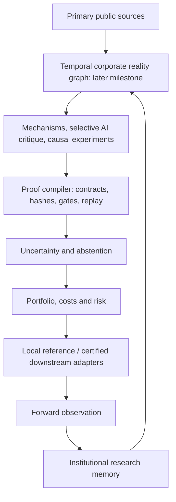

# Research OS: governing roadmap

Adopted 2026-10-12 by the owner. This is the active direction until the owner changes it. The [complete owner plan](owner_plan_2026-10-12.md) supplies the detailed scope and stop conditions. The two supplied PDFs are background research, not independent permission to execute their recommendations. [Reading and document disposition](direction_review.json) records their hashes, all 56 pages, and the documentation inventory.

Research OS is an evidence-native quantitative intelligence system. Its purpose is to determine whether economically motivated hypotheses contain reproducible net alpha, reject false evidence, and accumulate reusable research knowledge. Profitability is unestablished. Deterministic code controls provenance, timing, identity, statistics, trials and stages; AI helps interpret, propose and falsify. Specialization and accumulated evidence are the intended small-team advantages.

Nexus is a downstream adapter. Research OS remains canonical for populations, sources, eligibility, strategy definitions, trial accounting and inference. Orders eventually travel out; evidence travels back. Historical Nexus execution remains blocked by observed population pruning. No remote Nexus or Aurora work is authorized in Phase 3D.

| Milestone | Outcome required | Authorization |
| --- | --- | --- |
| 1 / 2 / 3A / 3B / 3C | Existing audit, immutable source pilot, semantic review, one revenue hypothesis, bounded feasibility evidence | Completed historical records; preserve failures |
| 3D | Scientific closure attempt, minimal proof compiler and local reference execution spine | Completed checkpoints; preserve scoped gains and failures |
| 3E | Evidence acquisition and final pre-performance experiment feasibility | Owner-authorized bounded phase; stopped at date-scope incompatibility, REDESIGN_REQUIRED |
| 3E-R | Historical stage and modeled-policy redesign | Exact v003 and conditional Stage C/hierarchy/materiality approved for planning only; policy inactive, further work requires a new instruction |
| Final Phase 3 | Certification under the approved fixed design | COMPLETE_EXP005_ABANDONED: mandatory inference stop; source/adapter campaigns deferred, no Phase 4A readiness |
| 4A | Separately authorized source acquisition, EXP005 freeze and Development evidence | Requires genuine mandatory readiness and a new owner instruction |
| 4B | Narrow SEC + USAspending + historical identity graph | Later separate milestone; relational/Parquet/DuckDB first |
| 4C | One event family, initially large government awards; credible controls, pre-trends, placebos and explicit causal assumptions | Later separate milestone |
| 5 | Risk/cost-aware construction, calibrated uncertainty/abstention, research value prioritization and mechanism diversity | Requires surviving evidence |
| 6 | Reconcile Nexus to local reference; separately human-authorized forward paper infrastructure | No live path; paper infrastructure is not paper validation |
| 7 | Actual future observation and research memory; later selective autonomy | Future calendar time cannot be replaced by software |

Revenue acceleration remains the sole first proposed filing family. A new versioned canonical revenue contract and a bounded inference revision are allowed before performance, because Phase 3C exposed source/calibration failures. They do not supersede old evidence in place. No real acceleration/ranking, market-return inspection, strategy study, optimization or EXP005 creation occurs in Phase 3D. Availability remains an explicit owner decision; a modeled buffer never becomes an observed public timestamp.

EXP004 stays operationally paused. EXP005 is absent and NOT_READY. The actual EXP004 freeze is four price momentum cells (180/365 calendar days × K20/K40), monthly universe EW and explicit SPY; the handoff's SMA/AI-leg description is not its authoritative design. Phase 3C recorded 114 Tiingo requests: 54 successful price responses, 54 successful metadata responses and six metadata 404s. These clarifications change no archived report or experiment.

Owner decision recorded 2026-10-12: the exact [pilot availability policy](availability_policy_v002_approved.json) is approved for 2015–2021 as a modeled eligibility rule, accepting timing uncertainty with observed public availability UNKNOWN. It is not activated and supplies no wider scope or experiment/execution authorization. Earlier proposed packets remain historical evidence.

Engineering estimates in the source documents are conditional, not deadlines: roughly 3–6 weeks for certification closure and 3–5 months for a stronger paper-ready platform if blockers are resolvable, followed by months of future observation. One milestone is earned at a time. Unresolved source, accounting, identity, terminal or inference evidence may keep EXP005 NOT_READY after implementation.

Historical reports and phase-specific stop statements describe their original authorization. Use this roadmap and the latest phase-specific owner instruction for current scope; the [Phase 3D plan](phase3d_plan.md) remains its earlier authorization checkpoint. Frozen strategies, metrics, raw archives, old plans and negative findings remain immutable.

The [bounded Phase 3D closure continuation](phase3d_closure_report.md) retains the original checkpoint and approved pilot policy. It adds original-source review packets, scoped accounting/lifecycle disclosures, minimum-p and power guards, separate Git/code replay checks and public synthetic CI. Both new inference candidates fail calibration; complete revenue triples, historical class spans and terminal position contracts remain uncertified. EXP005 is NOT_READY. Stop before Phase 4A; no automatic acquisition or strategy study follows this result.

The [complete Phase 3E instruction](owner_phase3e_2026-10-12.md) authorized purpose-linked new evidence and a final pre-performance feasibility decision. The [Phase 3E report](phase3e_report.md) records REDESIGN_REQUIRED and the explicit section 37 early stop: the conditional twelve-year staged programme cannot fit the approved seven-year policy, while fixed 2018–2020 originals cannot support a 2015 inception. No acquisition or v003 calibration occurred. Review the staged horizon/policy scope before commissioning further work; the existing exact pilot approval remains intact. Do not begin Phase 4A.

The owner then [authorized Phase 3E-R](owner_phase3er_2026-10-12.md), removing the old mandatory future 6/3/3 programme. The [redesign report](phase3e_redesign_report.md) compares three historical structures using bounded headers/reference calendars and frozen synthetic inference. The subsequent [owner decision](availability_policy_v003_owner_decision.md) approves exact v003 scope 2018-02-28–2026-09-30 and conditional Stage C: source warm-up 2018-02-28, price warm-up 2019-02-28, Development 2020-03-02–2021-12-31 and one owner-held historical confirmation 2022-01-01–2026-09-30. One formal primary effect, evidence against zero, the estimated two-point materiality floor and positive mandatory cost/delay robustness gates are approved for planning/design only. The original proposal/review/report artifacts retain their hashes. V003 remains NOT_ACTIVATED; observed public availability stays UNKNOWN and the Salesforce conflict unavailable. V002 is unchanged. Real inference assumptions and accounting/class/population/terminal/calendar/adapter/execution gates remain uncertified and fail-closed. EXP004 stays paused and EXP005 absent/NOT_READY. Stop pending a separate bounded instruction; no new acquisition, certification campaign, performance, Nexus/paper/live or Phase 4A is authorized.

The [final owner-authorized Phase 3 campaign](owner_phase3_final_2026-10-12.md) fixes that design and requires a decisive stop at scientifically unacceptable inference. The [final report](phase3_final_report.md) records ABANDON_EXP005 / COMPLETE_EXP005_ABANDONED: the five-group Student mean-variance estimate omits an unrestricted persistent common component, the existing cross-year stress fails, and no independently evidenced dependence restriction or bounded remedy preserving the fixed method/design is established. This is not evidence against revenue acceleration's economic effect. All 29 chains and 60 cases remain accounted for, but their new certification campaigns and adapter/compiler implementation were deferred at the upstream stop. Policy approvals and prior evidence remain unchanged, all gates fail-closed, EXP004 paused and EXP005 absent. No further planning phase, acquisition, performance or Phase 4A is started automatically.
