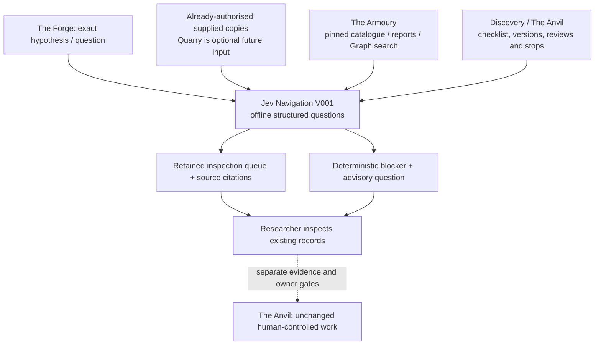

# Jev Research Navigation V001

**2026-10-24 · Offline, read-only navigation; no provider activated.** The owner's strategic direction replaces Jev's former shadow-critic role with three bounded classification tasks. Scientific criticism remains `gpt-6.1-sol` HIGH, economic criticism `gemini-4-argon` HIGH, and generation Claude Opus 5.5 MEDIUM: these are the requested Forge configuration, not verified live identities or permissions. This work does not edit Forge automation or PRs #30–32.

## How it fits



Jev allocates **attention**, not scientific authority. The Quarry is not built, invoked or required. The Armoury remains existing archives, ledgers, reports and its non-authoritative memory catalogue. The Forge's critics remain separate. The Anvil's M/H judgments, campaign approvals, frozen claims and stops remain authoritative. No Store, experiment stage, trial count, review, source stop or Graph classification is written.

## Implemented scope

The standalone [`src/research/jev_navigation_v1/`](../src/research/jev_navigation_v1/) package implements three strict `JEV_NAVIGATION_INPUT_V001` contracts, a pinned request, saved **synthetic** response import and deterministic JSON reports. It imports no legacy Jev critic, provider SDK, network/HTTP, credential or process module. There is no live adapter, model selection/fallback, crawler, database, dashboard, planner, new memory store or universal research runner.

| Task | Inputs and reuse | Output and limits |
| --- | --- | --- |
| `EVIDENCE_PROSPECTOR` | Exact question, predictor/outcome, unresolved M requirements and supplied documents/excerpts. Each record names source ID/version, retained artifact hash, original hash or UNKNOWN, exact quote/location, availability and limitations. | Independent yes/no/unsure questions for predictor, separate outcome, units/denominator, entity/historical relationship, listed exposure, public/version route, falsifier and background. Multiple leads may coexist. No positive categories means no established relevance or unresolved relevance, not scientific rejection. |
| `MEMORY_NAVIGATOR` | Existing [catalogue V002](strategy/graph/research_memory_catalogue_v002.json), its original citation validation, public reports, Graph `build(ledgers=[])` and `operators.search`, and the existing exclusion of NAME/TICKER identities. No implicit private-ledger discovery. | All seven actual investigations retained, cited verdicts/findings/documents/entities, exact recorded references, shared methodological problems, possible conceptual similarities and unsupported associations. A shared identifier or document is connectivity, never proof of economic transmission or independent corroboration. |
| `WORKFLOW_NAVIGATOR` | Explicit replayed Discovery ledger and latest candidate version; existing `checklist`/`next` rules; source-access metadata, latest recorded disposition, supplied stop citations, operational pause config, and optional pinned Forge/memory context files. | Existing deterministic blocker first, an existing stop before all suggestions, a templated next question and separately identified model context. Unsupported model bottlenecks are reported, not turned into tasks. Missing state stays insufficient information. |

Optional context files are retained/pinned, not interpreted as acquisition permission or as authoritative model decisions. This V001 does not need a Forge automation dependency or a generic adapter for every report schema. An actual historical catalogue verdict is reproduced verbatim, with its recorded timestamp/scope; it is not a newly adjudicated current result. Source authenticity, completeness, measurement meaning, historical actionability and economic significance remain **not established** by navigation.

## Official API boundary checked

Public documentation was read on 2026-10-24; no authenticated endpoint was called. [System One](https://docs.typesafe.ai/api/system-one) accepts supplied state and named typed questions and returns answers, model and token usage. [Choice](https://docs.typesafe.ai/primitives/choice) supports named options, probabilities and confidence, rather than an unrestricted explanation. The [confidence documentation](https://docs.typesafe.ai/confidence) defines Choice confidence as a statistic of the top probability; V001 checks that statistic and never treats it as task accuracy. Probabilities remain uncalibrated for these navigation tasks. Tied maxima and explicit unsure are abstentions. No probability/confidence threshold grants authority or influences ranking.

The [public model page](https://docs.typesafe.ai/models) lists versioned Jev 1.13/1.14 identifiers; no account-level availability, returned runtime identity or real navigation performance was verified. Nothing selects a live model. Prepared navigation requests explicitly say `provider: NOT_ACTIVATED` and `hosted_payload_created: false`: they are local task/question records, not dispatched System One payloads. A future adapter is a separate, owner-approved version, requiring the exact payload, model, permitted data classification, disclosure decision and request/spend ceiling. There is no live import in this version and no silent substitution.

## Input contract and preparation

Use `schema` to print the full strict JSON schema for a task. All object fields are explicit; unknown fields and duplicate JSON keys are refused.

```powershell
python -m src.research.jev_navigation_v1 schema EVIDENCE_PROSPECTOR
python -m src.research.jev_navigation_v1 prepare <input.json> --out .research/jev-navigation-v1-example
python -m src.research.jev_navigation_v1 report .research/jev-navigation-v1-example
```

The [demo builders](../src/research/jev_navigation_v1/demo.py) are complete executable input examples. The common `subject` has ID/version, question, predictor/outcome, unresolved M requirements, concept terms, exact entity/document identifiers and known requirement IDs. Task-specific fields are `documents`, `catalogue` or `context`. Use UNKNOWN content explicitly where a fact is unavailable; navigation never fills it from model memory.

An artifact reference is `{base: INPUT|REPOSITORY, path, sha256}`. INPUT paths stay inside the input manifest's directory. REPOSITORY paths name only explicit docs, reports or config files. Quotes must occur in the pinned local UTF-8 artifact; location is the supplied field/table/passage identifier. Reports include the resolved inspection path and exact citation. Original-source hash and excerpt-file hash are separate: hashing an excerpt does not make it an authentic original. No URL in a citation is fetched. Credential/account/internal paths and root escapes are refused.

Preparation writes only a **new** navigation workspace. Inside this checkout it must be under ignored `.research/jev-navigation-v1-*`; writing into another Git checkout is refused. Each preparation freezes the input manifest, every explicitly read artifact, the question definitions and the navigation/Discovery/Graph implementation content. Subsequent load/import/report re-derives the bundle. Altered source bytes, versions, ledger heads, catalogue citations, questions or policy code are refused. Keep sources in place: these local workspaces are not portable path-independent archives; moving sources requires a new explicit preparation from the exact retained bytes.

Prepared records are bounded to 32 per task, individual files to 4 MiB, each optional Forge/memory context file to 16 KiB, request JSON to 256 KiB and imported response bytes to 1 MiB. Context text is visible as supplied assertions, never converted into authority. Oversize input is refused, never silently truncated. These are offline implementation bounds, not a verified provider token budget.

## Synthetic response import and ordering

```powershell
python -m src.research.jev_navigation_v1 import-response <workspace> <saved-synthetic-response.json>
python -m src.research.jev_navigation_v1 report <workspace>
```

`JEV_NAVIGATION_SYNTHETIC_RESPONSE_V001` wraps the exact request hash, `fixture: SYNTHETIC_NOT_MODEL_OUTPUT` and the documented Choice-shaped response. Its model field must be `SYNTHETIC_SCRIPTED_NOT_JEV`. A real/provider-claimed response is refused, rather than falsely attested. All question IDs must match exactly; extra sources, free-text explanations, invalid distributions, inconsistent choices/confidence and non-integer usage are refused. The wrapper's request hash is a local fixture binding; the real API is not assumed to echo or authenticate it.

The sole import is claimed by exclusive raw-file creation **before parsing**. Kept bytes are never edited; invalid answers remain invalid, valid answers cannot be replaced, and interrupted imports are not retried automatically. `report` validates the raw bytes and re-derived import metadata again. A new synthetic exercise needs a new workspace; that does not create a real research trial or evidence of effectiveness.

Without a response, reports already provide keyword/Graph retrieval, exact provenance, current deterministic blockers and stops. With a synthetic response, the fixed ordering is relevant yes-count descending, then distinct keyword overlap descending, then stable record ID. For evidence, M-related positives count toward priority only for supplied unresolved requirements; falsifier leads also count, background does not. Every record remains in the queue. All-abstaining answers preserve baseline order. Probability and confidence never rank records. A STOPPED/UNAVAILABLE source retains its limitation and permits inspection of an already supplied copy only.

Workflow suggestions never replace the deterministic next requirement. A stop yields only the stop-scope question. Other model context questions must correspond to a mechanically recorded unresolved category. The output always contains `authorises: []`, as do every inspection item and CLI error. There is no actuation interface.

## Executable offline demonstration

```powershell
python -m src.research.jev_navigation_v1 demo --out .research/jev-navigation-v1-demo
```

This writes new local input examples, synthetic responses, three reproducible reports and an inspection-budget evaluation. It makes no provider, source, model-list or research call and writes no human decision.

1. **Evidence:** ten explicitly fictional passages include a binding order, separately recorded deliveries, a metrology appendix, an ownership concession, a potential control/falsifier, keyword-heavy decoys, an ambiguous fragment and a stopped-route receipt. At the declared budget of three, the keyword baseline orders D/A/J; scripted classifications order B/C/D. The separate source-content labels yield baseline precision/recall 0/0 and scripted precision 2/3, recall 2/5. The scripted classifier **wrongly promotes D**, misses important E/G, and abstains on H. These numbers demonstrate the diagnostics, not a Jev improvement: the deliberately adverse public fixtures and scripted classifier share a designer and are not a sealed or independent human benchmark.
2. **Memory:** the query about offshore decommissioning liability surfaces actual `HIST-SH09`. The report retains the existing report hash/quote, historical verdict/closure, lease-level schedule/allocation/net-economics blockers, document receipts and source restrictions. It does not call an access failure economic falsification, claim a new source exists or permit reopening the stopped route. Same-requirement connections are methodological, not economic.
3. **Workflow:** the existing Graph synthetic campaign A supplies a frozen claim and HOLD. A deliberately contrary scripted answer cannot remove that stop. The output remains `explicit_stop` and asks which retained record defines its scope. Other tests demonstrate a missing independent outcome outranking an incompatible model suggestion, unknown state remaining unknown, and EXP004's actual pause taking precedence.

Labels, candidate passages and scripted choices are separate [fixture artifacts](jev_navigation_v001/fixtures/). Labels are not in prepared requests and are never derived from probabilities or rankings. They are **synthetic designer judgments**, not invented human labels. The evaluation records precision/recall at the budget, missed relevant/important records, false priorities, unresolved inspections and abstentions for both orderings.

## Retirement, verification and remaining limits

The [retirement dependency map](jev_navigation_v001/legacy_retirement.md) is the current decision for Jev's role; old shadow-critic recommendations are not future plans. A small guard disables prospective real shadow imports in the non-frozen post-generation layer; synthetic compatibility imports and independent human label packets remain. The critic comparison CLI requires explicit historical replay. Frozen top-level Scout source, V001–V004/N1 contracts, five-question definitions, resource manifests, archives, evaluation schemas, Graph/Discovery source and historical documents remain unchanged.

The [focused regressions](../tests/test_jev_navigation_v1.py) exercise all three task types, source/response/version tampering, wrong-asset ranking errors, semantic versus methodological matches, exact real memory provenance, contradictory workflow answers, stops, unavailable/ambiguous state, strict response types, retained failures, no replacement import and retirement guards. New tests are registered as **additional restricted offline** tests with one appended inventory entry; public/Scout runners are unchanged. Full public/Graph, Scout, restricted-IO, inventory and presentation checks remain required. PR checks record final-head results and exact SHA; no local fixture result is called a live provider test.

Local restricted-IO validation passed **252 tests**, including **40 navigation/retirement tests**, with zero failures, errors, skips or forbidden operations and 11 existing explicit exclusions. The integration regression reads preserved V001 fixtures under the current Discovery implementation and confirms that V002 gross-exposure and source-revision blockers retain priority over contrary scripted classifications, without changing historical bytes. Graph quality, the six-artifact generated presentation, new guide links and test inventory checks passed. Full public/Graph and Scout regression results, native platform assurance and final-head CI are recorded in the draft PR. No observed or simulated classification is represented as a real Jev effectiveness result.

Software cannot establish source truth, economic meaning, an omitted dependence, an undisclosed prior hypothesis or a reviewer's independence. Exact identifiers can refer to generic or misidentified objects; the navigator never declares economic linkage. A model can miss a decisive passage, over-rank a distractor or abstain on important material. Keyword retrieval can fail on synonyms; the current memory catalogue is incomplete and non-authoritative. The tool sees only pinned supplied inputs and explicit controls, not every private campaign or unrecorded source stop. Sparse stop context is not permission to act: every output remains advisory and authorises nothing. Filesystem owners can replace code or artifacts; this is not an authentication or hostile-user sandbox.

The smallest next milestone is the [navigation-specific evaluation protocol](jev_navigation_v001/evaluation_protocol.md): independently label a small frozen, already-available holdout, first without model outputs. Evaluate inspection usefulness and stop/authority preservation at fixed budgets. A live Jev pilot requires separate exact-payload/data-classification owner approval and a reviewed adapter. No deployment, acquisition, scientific approval or model activation follows this work.
