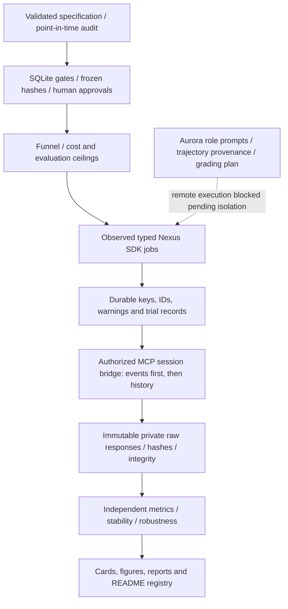

# Research OS v1

Research OS is a local control and provenance layer around observed Nexus capabilities. It does not infer alpha, change EXP001, or authorize trading. This implementation was exercised with synthetic EXP999 and fake transports only: no new Nexus portfolio, Aurora run, backtest, sweep, study, or deployment was submitted.

## Architecture and responsibility



Codex develops and operates the reviewed infrastructure within task authorization. Aurora can reason about hypotheses, but it cannot supply human approval or be trusted to enforce sealed-data access with a prompt. Nexus supplies server simulations, sweep/fold outputs, custom indicators and paper execution. Python validates access, preserves provenance and computes independent statistics. The [capability document](nexus_capabilities.md) distinguishes verified surfaces from missing controls; exact schemas/signatures are tracked alongside it.

## Specifications and stages

The [template](../experiments/_template/README.md) describes every required field. Inner Validation is inside Development, while outer Validation and historical Test are later disjoint windows. All sources and universe membership require point-in-time assertions; unestablished availability blocks freeze. Assertions still need evidence from filing/publication timestamps and vendor revision policies, not just a checked boolean.

Stages are strictly sequential:

```text
DRAFT -> HYPOTHESIS_FROZEN -> DEVELOPMENT -> CANDIDATE_FROZEN
      -> VALIDATION -> WALK_FORWARD -> ROBUSTNESS
      -> TEST_AUTHORIZED -> TEST_COMPLETE -> PAPER_AUTHORIZED -> PAPER
```

- Hypothesis freeze hashes the complete specification, including costs, ranges, budgets and methodology. Editing it later fails verification; use a new experiment for a changed hypothesis.
- Candidate freeze requires an independently assessed eligible Development trial, highest eligible declared primary metric, complexity limits, counted control evidence and frozen explicit benchmark portfolios. Full inline portfolio snapshots are hashed; subsequent evaluations cannot substitute altered snapshots.
- Validation/Test progression requires completed candidate and explicit benchmark jobs. Failed or unresolved jobs block progression. Walk-forward training and held-out folds stay inside Development and must respect chronology/embargo and nonoverlapping held-out periods.
- Robustness must have recorded scenario evidence before Test authorization. Missing tests remain `not_run`; they are never filled with guessed results. The owner reviews these results during the authorization decision.
- Test needs a reviewed `robustness.json` matching the frozen hashes and the interactive owner string **`OPEN EXP002 TEST`**. Paper needs a separate reviewed `final_review.json` and **`DEPLOY EXP002 PAPER`**. Noninteractive authorization is rejected. Automation must not type these confirmations for the owner.
- Paper deployment uses the observed SDK paper method only and requires a saved draft exactly matching the frozen portfolio. Server-added fields that cause mismatch require explicit review; no fields are silently discarded. A prior submission marker blocks retry because deploy has no idempotency key. No live stage, brokerage connector or order submission adapter exists.

This is application-level enforcement, not a sandbox against someone modifying Python, SQLite or review files. Approval provenance is local; no server human-identity attestation was exposed. Git preserves the tracked audit records, but the working filesystem remains under owner control.

## Commands

Install with `python -m pip install -r requirements-research.txt`. Run from the repository root with Python 3.11+ (verified on 3.13):

| Command | Purpose / required evidence |
|---|---|
| `python -m src.research propose EXP002` | Create an editable local DRAFT; TODO fields intentionally block freeze; no Nexus call |
| `... audit EXP002` | Validate schema, windows, PIT declarations and freeze integrity |
| `... research EXP002` | Generate five role prompts with cutoff and provenance; no remote Aurora job |
| `... freeze-hypothesis EXP002` | Freeze the complete specification |
| `... develop EXP002 --candidate candidate.json` | Enter Development and plan a bounded inline simulation |
| `... optimize EXP002 --candidate candidate.json --job-config sweep.json` | Declared exhaustive sweep with reviewed compiled SDK handle |
| `... resume EXP002 --job-key KEY` | Resume reads/extraction of the existing operation, never another submission |
| `... assess EXP002 --job-key KEY --input assessment.json` | Independent close metrics plus trade, participation and breadth eligibility evidence |
| `... ingest-surface EXP002 --job-key KEY --input normalized_cells.json` | Preserve every successful, failed or unresolved cell from an audited complete raw sweep; independently assess successful cells |
| `... freeze-candidate EXP002 --candidate candidate.json` | Freeze eligible winner and explicit benchmark/control snapshots |
| `... validate EXP002` | Plan frozen outer Validation; `--benchmark NAME` evaluates its frozen benchmark |
| `... walk-forward EXP002 --job-config walk_forward.json --folds N --evaluations N` | Observed SDK fold job handle; requires completed Validation |
| `... stress EXP002 --input stress_results.json` | Record predeclared scenario observations; do not fabricate cost/delay/universe reruns |
| `... authorize-test EXP002` | Owner-only interactive confirmation after evidence review |
| `... test EXP002` | Plan authorized Test; also run each `--benchmark NAME` before completion |
| `... report EXP002 --input report_bundle.json` | Generate independent metrics, card, candidate/benchmark tables, stress matrix and figures |
| `... evaluate-agent EXP002 --agent-id ID` | Optional MCP process-grading request plan; quote needed before any execution |
| `... authorize-paper EXP002` | Separate owner-only authorization after final report review |
| `... paper EXP002 --paper-portfolio ID` | Plan a checked paper deployment; no live equivalent |
| `... demo EXP999 --dry-run` | Fully temporary synthetic job, pagination, immutability and idempotency smoke test |

Every command supports `--dry-run`: state/report writes occur in a temporary workspace, and remote execution is disabled. A dry run previews one command against current persisted gates; it does not fabricate completion of earlier stages. `--dry-run` and `--execute` are mutually exclusive. Without `--execute`, job commands only plan (local stage transitions can still be persisted when not dry-running).

Remote simulation execution additionally needs `--execute`, an explicitly exported `NEXUSTRADE_API_KEY`, and `--mcp-bridge your_module:call`. The bridge is an authorized callable `call(tool_name, arguments) -> raw MCP response`, using the exact [observed declarations](nexus_mcp_inventory.json). No OAuth token is loaded or invented, no SDK anonymous workspace is created, and no guessed REST history endpoint is used. This setup task did not install a credentialed bridge or invoke one.

Sweep/walk-forward handles must use actual fields from the Nexus surface/preview, not names guessed from a parameter label. The CLI will return a required-evidence plan if no compiled handle is supplied. V1 execution accepts a bounded exhaustive typed gene grid matching the frozen ranges, with explicit `num_windows: 1`; generational or amplified multi-window plans require a reviewed planner extension. Remote optimizer/study execution also requires a normalized `server_preview` sidecar containing `payload_hash` (the local canonical digest of `{portfolio, args}`), `planned_evaluations`, `estimated_tokens`, and `expires_on`. This is local provenance from an authorized actual Nexus preview, not an invented server endpoint. Keep the full original preview in private raw storage and audit the normalization. Inner selection belongs inside Development, never outer Validation. `validate_folds` ingests explicit fold definitions, selected parameters and metrics, rejecting chronology/overlap failures. Raw engine surfaces are retained in full; normalization into the local surface/fold contracts is explicit rather than silently assuming an undocumented result shape.

## Inputs, extraction and provenance

- Candidate JSON contains `name`, `family`, `signals`, `signal_count`, `parameters`, inline `portfolio`, `trial_key`, `control_evidence` trial keys, and `benchmarks` mapping declared names to inline portfolios. Relevant controls comprise the simple benchmark, all single signals, full composite and leave-one-out ablations. Record `parameters.signals` on each control trial so distinct ablations can be checked; repeating one trial key does not satisfy the requirement. Failed controls remain in the ledger.
- Assessment JSON contains `closes`, `completed_trades`, `participation`, and `breadth`. Each close contains `date`, UTC `timestamp`, `portfolio_value`, and `close_evidence_timestamp`. It must match verified exchange/market evidence, be a regular 16:00 or evidenced 13:00 New York close, and stay in the authorized window. Source-normalization and close/calendar evidence need review; the metric function does not manufacture missing market evidence.
- Report bundles contain named `runs` with `stage` and `closes`, `limitations`, `interpretation`, optional benchmark interpretation, full parameter `surface`, `folds` and `stress` results. Missing studies are displayed honestly. `review_complete` is an explicit owner-reviewed assertion for the final paper review; default false. Figures and metrics are generated from these supplied observations.
- SQLite state is private under ignored `.research/`; each update exports tracked `experiments/<ID>/state.json` and `trials.json`. A clone does not inherit local approval authority automatically. Never delete failed trials or unresolved keys.
- Job keys hash logical request, stage and frozen spec. Reserve before transport. If the response is lost, mark `UNKNOWN`, retain the key and billing reservation, and never blindly resubmit. Read polling can retry only timeouts, connection failures, 429/502/503/504. MCP reads are throttled to two per second with backoff. Definitive failed jobs remain counted.
- History/events are paginated until explicit exhaustion, with final declared row count checks. Save every response field and page request immutably, extract events first when requested, preserve noise/audits, and keep administrative/corporate-action dates separate from simulated timestamps. Unknown pagination/schema fails closed. Interrupted extraction resumes saved pages; existing different bytes cannot be overwritten. A partially written/corrupt page requires manual reconciliation, not replacement.
- A run integrity report records counts, pages, bounds and SHA-256 hashes. Dates are interpreted as New York sessions, with the UTC end boundary extending into the next UTC date when appropriate. No deduplication or daily-close transformation occurs during raw extraction.
- The trial ledger records family, candidate, parameters, run ID, stage, status/metrics and eligibility. Status history is retained, assessed metrics cannot be rewritten, and changing trial provenance is rejected. Sweep jobs retain planned evaluation counts even if full per-cell normalization is pending; full raw surfaces are kept. `ingest-surface` requires an audited normalization tied to the saved response SHA-256, exact coverage of the declared grid including failed/unresolved cells, and successful cells' portfolio/run/close evidence. Each cell gets a durable trial key; counts remain in the parent to avoid double counting. Family and cumulative evaluation ceilings include failed/unresolved trials, and model-selection inference must include every attempted variant, not merely ledger rows.

## Budget and research funnel

The [pricing metadata](../config/research_pricing.json) records official sources, observation date and expiry. Expired pricing blocks jobs. Estimates use calendar days, interval/options class, event multiplier, asset factor, grid size, fold multiplier and optimizer minimum; they are not invoices. Quote Aurora separately, including its USD ceiling. Server previews can supply exact planned evaluation/token estimates to the budget module; no account pricing endpoint was exposed in the SDK/schema inventory.

The default funnel is audit without performance search; daily non-options Development screen; bounded parameter stability; frozen Validation; chronological walk-forward; robustness; human-authorized historical lockbox; separately authorized forward paper. Intraday/event-heavy work requires a hypothesis/execution rationale and its own ceiling. Do not divide a minute run to evade the observed warmup-inclusive 730-day cap.

## Robustness, statistics and contamination

Parameter surfaces retain every cell, best cell, adjacent declared-grid perturbations, neighbour average, range-normalized sensitivity, plateau fraction and isolated-optimum warning. Rank stability uses adjacent-fold Spearman correlation with average ranks for ties. These diagnostics do not silently choose a new winner.

The gauntlet ingests genuine transaction-cost, additional-bar delay, changed-universe, cadence and parameter reruns. Regime summaries require supplied bull/bear, high/low volatility and rate labels with availability evidence. Nonadjacent regime closes are never stitched into invented equity/drawdown series. No rate classification or execution counterfactual is guessed from returns.

Paired moving-block resampling uses the same indices for strategy and benchmark, fixed seeds and percentile confidence intervals for mean daily excess return. Block length and stationarity assumptions must be predeclared and sensitivity checked; the routine is not an alpha significance certificate. Holm adjustment uses the complete supplied p-value family, with failed/unresolved variants retained rather than removed. See the [step-down implementation reference](https://www.statsmodels.org/v0.13.5/_modules/statsmodels/stats/multitest.html) and [block-bootstrap coverage research](https://arxiv.org/abs/0804.4361). DSR and PBO/CSCV are deliberately not implemented or claimed; v1 uses Holm as its multiple-testing adjustment and does not invent valid p-values from Sharpe.

Historical workflow holdouts can still be known to modern models. Corpus mining is hypothesis evidence only: recorded candidate-formation backtests must end by the research cutoff. Arbitrary SQL is not automatically declared safe just because it contains a date literal; bounded queries and row availability require audit. Never copy the historical highest-Sharpe strategy as evidence of alpha. Forward paper after freeze is the strongest genuinely unseen evidence, subject to executable cost/market assumptions.

## Aurora boundary and remaining integration gates

Five independent roles generate complete stored prompts: researcher, data auditor, architect, skeptic and execution reviewer. Trajectory ingestion preserves original outputs under private raw storage after request-scope audit. The optional evaluator plan asks for ten process dimensions (hypothesis, data, PIT, simplicity, falsifiability, benchmark, confounders, execution, novelty and ablation), with feedback; return is not the objective.

Remote Aurora launching remains explicitly blocked: the observed SDK cannot restrict tools or sealed dates. Implementing unattended launch would defeat the requested protection. A future server-enforced isolated role environment, current cost quote, and budget reservation are prerequisites. Trajectory/evaluator plans are not presented as already completed research runs.

Before any real experiment execution, the owner must supply a genuine hypothesis/PIT audit, reviewed portfolio/control and benchmark snapshots, authorized extraction bridge, compiled Nexus sweep/fold configurations, fresh pricing, and normalization of actual engine surfaces into reviewed local evidence. Test and paper remain distinct interactive human gates. No new experiment or live capability was activated by infrastructure installation.

## Reproduction

```sh
python -m unittest discover -s tests -v
python -m src.research demo EXP999 --dry-run
python -m src.presentation.exp001 --check
```

The EXP999 demonstration writes only to a temporary directory and submits to in-process fake transports. Existing EXP001 tests still require the private raw files; public clones can run `python -m unittest discover -s tests -p test_research_os.py -v` and the synthetic demo. Completed future reports update `experiments/registry.json`, and README generation consumes those cards without altering EXP001 metrics or its final report.

To begin designing EXP002 locally when the owner chooses to do so:

```sh
python -m src.research propose EXP002
```

This creates a DRAFT with intentionally incomplete audit fields; it neither runs EXP002 nor calls Nexus. Replace all TODO/synthetic content, audit, and freeze before planning Development.
