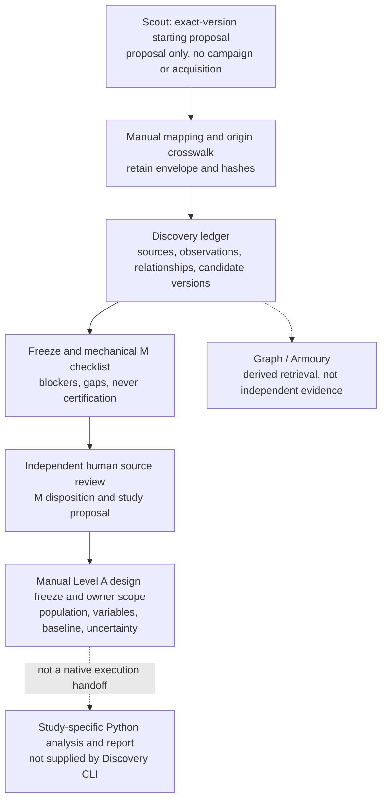

# The Anvil and The Crucible: readiness and scientific integrity audit

**24 October 2026 · Offline adversarial audit · Baseline `5290388` (`main`, including PR #29).**

This is an engineering assessment, not an M certificate, research authorisation or empirical finding. No scientific source was acquired, original archive changed, model invoked, paid service used or real-world economic/strategy evaluation run. All new observations and recorded decision stand-ins are explicitly synthetic. Existing public records were read without re-adjudicating them.

## A. Executive verdict

**A clean mechanical M checklist can coexist with scientifically invalid evidence.** It checks declarations and selected consistency rules; it does not establish the truth of a source passage, independent measurement, historical ownership or a defensible sample. Human source-level review is indispensable. The audit reproduced and fixed four narrow correctness defects, while retaining tests that expose more fundamental contract and trust limitations. An attempted fifth tightening was withdrawn when full-suite testing exposed its conflict with existing frozen fixture semantics; see AC-01.

**The current native workflow stops at `LEVEL_A_DESIGN_CANDIDATE`.** There is no general Level A investigation contract/runner behind that label. A first honest investigation needs a frozen, separately authorised study design and a small study-specific analysis script, rather than another research framework.

| Boundary/component | Verdict after the narrow fixes | Meaning and remaining condition |
| --- | --- | --- |
| Forge → Anvil | **CONDITIONALLY READY** | Scout exports an exact-version starting proposal with the card hash and reviews. It deliberately creates no Discovery campaign. Retain that envelope and independently check a manual field mapping. |
| The Anvil | **CONDITIONALLY READY** | Records, freezes, mechanical blockers, human-review requirements and provenance references work. A responsible human must verify the actual originals, units, independence, joins and materiality; declarations are insufficient. |
| Anvil → Crucible | **BLOCKED** as a native execution handoff | An M/design-candidate disposition does not contain a complete population, baseline, analysis plan, freeze receipt or executable study. Supply and review these explicitly before investigation. |
| The Crucible | **CONDITIONALLY READY** as a Python research toolkit | Basic numerical, provenance and design primitives exist. There is no validated general Level A executor; frozen investment-inference routines are not a generic economics API. A scoped script can be sufficient after design review. |
| Full hypothesis → Level A workflow | **BLOCKED** for unattended/native execution | The synthetic rehearsal reaches the design-candidate proposal and a manually hashed example design, then finds no investigation command. A human-reviewed design, actual measurements and authorised study script are the smallest remaining bridge. |

“Blocked” here does not mean a new platform must be built. It identifies work that has not been specified or implemented for a real study. It also does not impose Level B timing or Level C execution requirements on a legitimate disclosed Level A reconstruction.

### What changed in this audit

1. Source Passport changes after a claim freeze invalidate the relevant mechanical evidence readiness, including predictor and outcome sources. Stored V001 freezes are not rewritten.
2. A gross-basis exposure cannot be supported solely by a net amount.
3. Cooperating ledger writers are excluded across the complete read/check/append transaction, including create and freeze.
4. Loading refuses a missing final newline before any later append can concatenate two events and corrupt the ledger.

The [shared `records.py` vocabulary](../../src/research/discovery/records.py#L169) is also in the [frozen Scout V004 implementation boundary](../../src/research/opportunity_scout/v004_package.py#L69). It remains byte-identical. The proposed field-depth admission tightening is deferred rather than changing shared or frozen semantics. Scout/critic/automation files, canonical M/A/B/C definitions, experiment states, histories and prompts are unchanged. Existing Graph snapshots retain their strict content pins: use the historically pinned checkout for an old snapshot, not a weakened pin or a rewritten historical result.

## B. Actual architecture and implementation

| Component inspected | Actual responsibility | Implementation class and limitation |
| --- | --- | --- |
| [Scout `handoff`](../../src/research/opportunity_scout/engine.py#L333), [readiness](../../src/research/opportunity_scout/readiness.py#L30) | Exact card/version hash, READY and feasibility references, source limitations, proposed discovery method | Implemented and meaningfully tested for workflow consistency; new audit exercises the actual FORGE path with synthetic stand-ins. `is_discovery_candidate_record`, `creates_campaign`, `writes_ledger` and acquisition authority are false. |
| [Discovery records](../../src/research/discovery/records.py#L64), [ledger](../../src/research/discovery/ledger.py#L274) | Explicit UNKNOWNs, evidence depths, four clocks, version lineage, hash-chain replay, frozen claims | Implemented and tested on fixtures; also six committed R3 Discovery ledgers replay unchanged: 185 events. Their existence is operational history, not independent scientific validation. |
| [M checklist](../../src/research/discovery/review.py#L64), [disposition checks](../../src/research/discovery/ledger.py#L198) | Mechanical blockers and separate M/H review requirements | Implemented; never emits an automatic M certificate. The audit finds declarations which still evade substantive review (AC-06–11). |
| [Source archive](../../src/research/sec_pilot/acquisition.py#L75), [parser](../../src/research/sec_pilot/parsing.py#L33), [surfaces](../../src/research/surfaces/base.py#L6) | Original-byte integrity, source-specific parsing, evidence tiers | Existing bounded implementations and offline tests. The SEC parser has a separate pinned interpreter and source-specific assumptions; it is not an arbitrary-document verification service. No private originals were opened here. |
| [Graph projection](../../src/research/graph/project.py#L427), [rules](../../src/research/graph/rules.py#L44), [classification](../../src/research/graph/connections.py#L69) | Derived joins, visibility, retrieval and explained suggestions | Implemented/tested; exact identifiers and document hashes are retrieval grounds, not economic exposure or independent corroboration. R3 utility evidence is inconclusive and potentially unblinded; R4 remains NOT_RUN/unauthorised. |
| [Store](../../src/research/store.py#L51), [specification](../../src/research/spec.py#L32) | Frozen investment specifications, stage/trial gates, owner Test/paper confirmations | Meaningfully tested software controls. Their mandatory PIT/universe/portfolio assumptions are not a generic Level A contract. Canonical states remain untouched. |
| [Proof V1](../../src/research/phase3d/proof.py#L49), [Proof V2](../../src/research/proof_v2.py#L9) | Synthetic compilation/replay and predictive design-only manifests | V1 refuses real compilation; V2 is predictive/design-only and explicitly does not register, certify or execute an experiment. Neither executes a Discovery Level A proposal. |
| [Analysis helpers](../../src/research/analysis.py#L68), [feasibility guard](../../src/research/inference_feasibility.py#L5), [Phase 3 inference](../../src/research/phase3d/inference.py#L24) | Paired resampling, multiplicity, chronology and frozen synthetic dependence/power diagnostics | Implemented/tested algorithms with narrow assumptions. Their applicability to a particular economic question is unestablished until reviewed; see AC-14. |
| General Level A sample/transform/analysis/result workflow | Frozen question, frame, variables, baseline, methods, conclusions and reproduction | Partially present as prose and a [proposed river design](river_transport_pilot_proposed.json); a native schema/runner is missing. The river proposal is unapproved and was not executed. A small reviewed script is the practical first implementation. |

The [architectural roadmap](forging_an_edge_roadmap.md), [Discovery design](discovery_lab_design.md), [guide](discovery_lab_guide.md), [walkthrough](discovery_lab_walkthrough.md), [Measurement Gate M](measurement_gate_m.md), [frontier standard](frontier_selection_standard.md), [Levels A/B/C](next_frontier_review.md), [operating contracts](../research_os.md), [master plan](../acceleration/master_plan.md), README and AGENTS were reviewed alongside execution paths. The master plan and owner decisions retain authority. At audit start, GitHub inspection found provider/pipeline PRs #27/#28 open and unmerged. PR #27 subsequently merged into `main` (`ee6800d`) during this work; the audit remains explicitly pinned to `5290388`, not that later provider revision. The active Forge branches were not changed or used as the audit baseline.

### Historical failure controls

| Historical case | What a real investigation must retain/check |
| --- | --- |
| [F01 salmon](salmon_verification_final_report.md) | Access to historical tracks did not identify treatment tasks, independent sharing or feasible capacity. A track is not an allocated treatment-resource predictor. |
| [F03 chemicals](frontier_selection_ii_report.md) | Permission and marketed substitutes did not establish qualified, material substitute sales. A permit is not realised demand or exposure. |
| [F09 / F19](discovery_bottleneck_report.md) | Redacted cash amounts and missing state/cohort joins prevent net-exposure inference; a recognised credit or aggregate assessment is not the distinctive predictor. F19 remains HOLD/unapproved. |
| [SH09](sh09_verification_report.md) | Omitted lease/security schedules and an unreconstructed pre-announcement chain remain missing. An entitlement, aggregate security or later narrative is not independently collected cash. The source stop stands. |
| [Measurement campaign / EF06](measurement_gate_campaign_report.md) | Zero original M passes. The measurable gross-book reformulation is a distinct, post-inspection object, not an original retained-premium success or new investment result. |
| [EXP002](../../experiments/EXP002/research/final_freeze_review.md) / [EXP003](../../experiments/EXP003/research/final_freeze_review.md) | Missing historical population and uncertified joint coverage cannot become zero signals or fair controls. |
| [EXP004](../acceleration/exp004_execution_gap_report.md) | Numeric enrichment does not certify provider/session/population semantics; retain all 26 unresolved cases. No new price study or strategy test follows. |
| [EXP005](../acceleration/phase3_final_report.md) | Five annual groups did not certify the approved inference without an independently justified restriction on persistent dependence. Software calibration did not resolve the scientific assumption. |
| [EXP006](../acceleration/exp006_cover_identity_report.md) / [EXP007](../acceleration/exp007_house_repair_report.md) | Missing source/population/security identity and ambiguous original disclosure/OCR evidence are source-feasibility failures, not negative economic results. |

These reports are preserved evidence of earlier bounded work. This audit did not verify their private receipts, reopen their routes or replace their dispositions.

## C. Findings register

Severity: **P0** can materially falsify evidence/readiness/provenance; **P1** needs resolution before a trustworthy first investigation; **P2** is a reliability/usability improvement; **P3** should wait for demonstrated need. A procedural limitation is not automatically a code defect. Tests named `test_current_*` deliberately document a surviving limitation: their passing means the counterexample reproduced, not that the scientific behaviour is acceptable.

### AC-01 · P0 · Field declaration is not proof of a field reading · REPRESENTATION/TRUST LIMIT; TIGHTENING DEFERRED

**Intended:** seeing a document does not establish its distinctive field. **Actual:** [shared `records.supported`](../../src/research/discovery/records.py#L169) accepts either original evidence depth, allowing an observation or passport quantity declared `VERIFIED_ORIGINAL_FIELD` to cite `VERIFIED_ORIGINAL_RECORD`. A synthetic claim can have zero M blockers. This is a permissive representation, not proof that a real field claim is false: the observation's field-reading declaration and its supporting document describe different evidential objects. The actual passage still needs review.

**Reproduction/compatibility:** replace the fixture evidence with `D.syn('record', 'VERIFIED_ORIGINAL_RECORD')`; the field-labelled record is admitted. An attempted rule requiring the supporting evidence to repeat FIELD depth rejected thirteen existing Graph tests, including frozen holdout fixtures. That rule was withdrawn, not made to pass by editing Graph fixtures, historical records or their methods. The boundary test now documents the accepted representation; higher field evidence can still support a lower document-depth assertion.

**Consequence/minimal control:** an unsupported field claim can survive shape checks if the operator or model falsely asserts it was read. Verify the actual field/passage as part of the human crosswalk (AC-06); software must not certify it from the badge. If machine-enforced evidence-depth alignment is desired, decide its semantics and compatibility in a new reviewed contract/profile. **First-study impact:** an actual field reading is mandatory; changing this representation is not necessary for a human-reviewed study. **Effort/dependencies:** small manual check now; version/fixture review before any broader tightening. It is not treated as an isolated schema bug that can safely be fixed in place.

### AC-02 · P0 · Source Passport revisions leave frozen evidence/reviews apparently current · FIXED

**Intended:** review the exact evidence basis of a frozen claim. **Actual baseline:** [freeze references](../../src/research/discovery/ledger.py#L150) stored observation/relationship versions but not Source Passport versions. A passport's units/meaning could change after an M review and the old review could still support a new `M_PASSED` disposition. Observation/relationship version changes were already blocked; passport changes were not.

**Reproduction/test:** freeze the fixture, add the synthetic M review, append passport v2 with a different meaning, then attempt `M_PASSED`. Baseline accepted; the [regression](../../tests/test_discovery_lab.py#L399) now refuses it. Separate tests cover the direct outcome passport and allow pre-freeze or unrelated-source changes.

**Correction:** [derive relevant source versions at freeze from event history](../../src/research/discovery/review.py#L40) and add `SOURCE_REVISED_AFTER_FREEZE` to the relevant requirement. No new stored freeze/derived fields or historical bytes are introduced. A new candidate version and a fresh applicable review are needed; old events remain historical events. **First-study impact:** blocker when evidence changes; fixed. **Effort/dependencies:** small, completed; all six existing Discovery ledgers and the deterministic demo still replay. This is not universal compatibility proof: an uninspected ledger containing an old post-revision approval could now fail stricter replay. Retain such bytes for explicit review; do not rewrite or silently migrate them.

### AC-03 · P0 · Net-only quantity satisfies a gross-basis exposure · FIXED

**Intended:** gross and net economic objects are different measurements. **Actual baseline:** [financial bridge checks](../../src/research/discovery/review.py#L119) rejected only the case where both amounts were UNKNOWN, plus net-basis claims missing net. `claim_basis='GROSS', gross='UNKNOWN', net={...}` had no financial blocker.

**Reproduction/test:** supply only a net amount on the gross fixture. Baseline produced `[]`; [the regression](../../tests/test_discovery_lab.py#L490) now gets `GROSS_EXPOSURE_UNVERIFIED` and cannot record an all-evidenced M review. The existing all-unknown and net-basis behaviour is preserved.

**Consequence/correction:** prevents an explicit basis mismatch of the kind exposed in EF06/F09 reasoning. It does not verify the amount or issuer allocation. **First-study impact:** blocker for such a claim; fixed. **Effort/dependencies:** tiny checklist correction, no policy change and no altered historical record.

### AC-04 · P1 · Concurrent successful writes corrupt the hash chain · FIXED

**Intended:** competing operations must not append from the same stale head. **Actual baseline:** `append` and `freeze` loaded state before an unlocked `_write`. A deterministic two-thread probe paused one writer after load, let a second append, then resumed the first: both reported success, but replay failed because sequence/previous hashes conflicted. Locations: [append/freeze](../../src/research/discovery/ledger.py#L304), [writer exclusion](../../src/research/discovery/ledger.py#L318).

**Correction/test:** an exclusively created canonical-path sibling `.writer.lock` covers create/load/check/write for mutations. [The regression](../../tests/test_discovery_lab.py#L440) holds a freeze open and requires another append to refuse; the surviving ledger replays. Invalid-input exceptions release the marker; a stale marker is never stolen automatically.

**First-study impact:** block concurrent operators/tools until corrected; fixed for cooperating writers. **Effort/dependencies:** small, completed, standard library only. It is not a hostile-user lock or a reader snapshot protocol. After process termination, an operator must retain bytes, stop writers, compare the known head and reconcile the stale marker. Filesystem owners can bypass it; see AC-16.

### AC-05 · P1 · Parseable final event without newline is corrupted by next append · FIXED

**Intended:** interrupted or ambiguously framed files must fail closed before mutation. **Actual baseline:** [load](../../src/research/discovery/ledger.py#L287) used `splitlines()`, which accepted a complete final JSON object missing its newline. A later append concatenated the next JSON object directly to it, and the next load failed with `JSONDecodeError`.

**Reproduction/correction:** remove only the final LF from a synthetic ledger; baseline loaded it and then corrupted it. [The regression](../../tests/test_discovery_lab.py#L432) now requires both load and append to refuse with the original bytes unchanged. No repair, newline insertion or retry is performed. **First-study impact:** blocking on interrupted/copied files; fixed. **Effort/dependencies:** tiny framing check. Complete suffix loss and power-loss durability remain AC-16, not solved by newline validation.

### AC-06 · P0 · VERIFIED labels do not prove value, units, completeness or transformation · CONFIRMED TRUST/SEMANTIC LIMIT

**Intended:** M needs actual measurements with defensible units/scope. **Actual:** [evidence validation](../../src/research/discovery/records.py#L153) checks shape, kind/depth and a hash or pointer, not original bytes or passage meaning. [Outcome validation](../../src/research/discovery/records.py#L329) does not compare its value/units to linked observations. A different outcome value/unit, a fake 64-hex hash, an estimate described as realised, and a nonempty predictor transformation without a formula can all be admitted. UNKNOWN denominator is a gap, not a blocker.

**Reproductions:** [boundary tests](../../tests/test_discovery_lab.py#L537) include outcome `999 USD million/year` backed by `61 tonnes/quarter`, arbitrary conversion text and an opaque all-zero hash. No M software certification occurs, but the resulting checklist can be clean. Requiring another matching depth badge would not solve these semantic errors either.

**Minimal control/tests:** a human source-to-variable crosswalk must identify the exact original version/hash, field/passage, value, units, denominator or explicit non-applicability, scope, measured/estimated/conditional status, and transformation code/hash. Check complete relevant passages and any truncation; an acquired prefix may support a fully preserved passage, never a complete-population/filing assertion. Test actual extraction and unit conversions when the first study's source is known. **First-study impact:** mandatory source review, not an automatic badge. **Effort/dependencies:** a short per-study crosswalk and targeted extraction tests; no general semantic validator or new source acquisition here. A typed transform contract is deferred until needed.

### AC-07 · P0 · Renaming/reconstructing an outcome evades independence checks · CONFIRMED LIMIT

**Intended:** the outcome measures a consequence independently, including when the publisher is the same. **Actual:** [candidate validation](../../src/research/discovery/records.py#L329) blocks overlapping observation IDs and identical normalised quantity names. It does not trace mathematical derivation, common source numbers or retrospective attribution; the independence explanation can be UNKNOWN. A copied predictor entered under another observation ID and outcome label produces no blocker. [Reproductions](../../tests/test_discovery_lab.py#L553).

**Consequence:** a tautology or issuer explanation can masquerade as an empirical relationship. **Minimal control/tests:** before M, review the predictor and outcome's original measurement processes and transformation lineage, not their names or publishers. Record why the outcome is realised rather than a forecast, entitlement formula or narrative attribution. For the actual study, test that target construction does not use predictor arithmetic or future outcomes. **First-study impact:** unresolved until this review is evidenced. **Effort/dependencies:** source-specific review/tests, usually small for one variable pair; no reliable universal independence test is possible from current free text. A different publisher must not be imposed as a substitute rule.

### AC-08 · P0 · Plausible but unrelated records can form a clean exposure/join · CONFIRMED LIMIT

**Intended:** dated entity, cohort, geography, period and accounting basis must match the claimed economic object. **Actual:** [relationship checks](../../src/research/discovery/records.py#L298) enforce declared original evidence, non-NAME IDs and documentary basis. [Checklist exposure](../../src/research/discovery/review.py#L64) requires a verified relationship touching the company and checks its period against predictor dates; it does not prove a path from the predictor's entity to that company. All join dimensions may instead be `NOT_REQUIRED` with assertion-only notes.

**Reproductions:** [unrelated facility relationship](../../tests/test_discovery_lab.py#L542), [wrong cohort/accounting basis](../../tests/test_discovery_lab.py#L570). Names are blocked in declared verified relationships, but a syntactically valid ID or ticker is not independently checked against an original historical entity certificate. Current ownership beginning after the event is correctly blocked when its real period is declared; a falsely declared period is not detectable.

**Minimal control/tests:** an explicit dated entity/ownership/exposure crosswalk, supported by originals, with each required join dimension and any allocation explained. Test the actual one- or multi-hop chain, effective dates, renames/mergers, scope and duplicate keys. Do not add a blanket direct-edge rule that would reject legitimate multi-hop relationships. **First-study impact:** mandatory review. **Effort/dependencies:** moderate source-specific work; no new graph or identity service. The graph's exact joins are aids, not exposure certificates.

### AC-09 · P0 · First-public certificate is not bound to the observed version · CONFIRMED; CONTRACT CHANGE DEFERRED

**Intended:** an old publication record must not certify revised content as historically actionable. **Actual:** [clock validation](../../src/research/discovery/records.py#L264) requires original publication-record evidence and checks first-public/source-version times against retrieval. It does not bind the certificate to the content/version actually measured. A 2000 publication certificate plus 2024 source version/retrieval can be marked `VERIFIED_AS_OF`. [Reproduction](../../tests/test_discovery_lab.py#L582).

**Consequence:** a later revision can acquire a misleading historical status. This does not by itself invalidate a disclosed Level A reconstruction; it blocks a Level B knowledge-at-the-time claim. H gaps alone are not a Level B admission control.

**Minimal control/tests:** retain separate clocks, label the actual version retrospective and require a content/version-specific publication binding before historical actionability. Test the binding against the actual first study's revisions if a Level B claim is later proposed. Changing this shared frozen vocabulary in place risks Scout/history compatibility; use a separately reviewed version if software certification is needed. **First-study impact:** manageable for Level A through explicit reconstruction limits; blocks Level B claims. **Effort/dependencies:** small manual disclosure now, versioned contract/consumer changes later; no inferred historical timestamp is supplied here.

### AC-10 · P0 · Outcome-informed selection and material revisions can be under-labelled · CONFIRMED; LINEAGE CHANGE DEFERRED

**Intended:** post-inspection reformulation must not regain original/untouched status. **Actual:** [core](../../src/research/discovery/ledger.py#L65) omits outcome evidence/source/value, horizon, falsifier, much exposure and selection detail. Changing the outcome's evidence/value after freeze can be a `CLARIFICATION` in the ORIGINAL lineage. [Candidate lineage](../../src/research/discovery/ledger.py#L110) makes `after_outcome_seen` sticky but not prior `selection.outcome_inspected_before_freeze`, famous-case or purposive flags. Clearing the former in a later version removes the explicit post-outcome gap when `after_outcome_seen` was never declared true.

**Reproductions:** [evidence swap](../../tests/test_discovery_lab.py#L589), [selection history](../../tests/test_discovery_lab.py#L598). The synthetic fixture class still prevents calling these test ledgers untouched live evidence; the analogous LIVE risk follows from the same flag-dependent code. Declared post-outcome/purposive flags and exact-version review checks are tested and work. No actual historical claim is relabelled by this audit.

**Minimal control/tests:** review the full version diff and exposure/selection history, not only `core_digest` or ORIGINAL. Retain a separate exposure statement; classify the first study exploratory if outcomes or famous cases were already known. A future version should make knowledge/selection history monotone and distinguish material design changes from wording corrections. That changes stored derived semantics and needs a new version/compatibility decision, not an in-place rewrite. **First-study impact:** blocks any untouched/confirmatory claim until controlled; exploratory research remains possible. **Effort/dependencies:** small manual diff now; moderate versioned lineage work later.

### AC-11 · P0 · Human identity, authority and review references are assertions · CONFIRMED TRUST LIMIT

**Intended:** an assistant cannot create a human approval or owner research scope. **Actual:** [reviewer validation](../../src/research/discovery/records.py#L385) trusts `kind='HUMAN'` plus nonempty name; even an explicitly AI-named HUMAN form passes pure validation. [Campaign authority](../../src/research/discovery/ledger.py#L246) checks that the first referenced path exists, not that its contents authorise this campaign/budget; `README.md` passes that existence check. [Review references](../../src/research/discovery/ledger.py#L171) resolve recognised ID prefixes, but an arbitrary differently prefixed string is not resolved or bound to a hash.

**Reproductions:** [identity](../../tests/test_discovery_lab.py#L610), [authority](../../tests/test_discovery_lab.py#L619), [untyped citation](../../tests/test_discovery_lab.py#L625). HUMAN forms and LIVE authority are tested only through pure admission/validation calls; no fabricated HUMAN review or LIVE campaign was written. Explicit ASSISTANT dispositions are correctly refused; dispositions always authorise nothing.

**Minimal control/tests:** the responsible human independently reviews and enters/approves M and owner scope; do not import a model's HUMAN field. Review the exact authority contents, payload, budget and permitted source scope before work; retain a human-controlled committed reference. Resolve each review citation to an existing source/record/version/passage. A name denylist is not authentication and would not solve this. **First-study impact:** mandatory operational boundary; no unattended model-to-human-record path is safe. **Effort/dependencies:** a human act and scoped review, not an identity platform. Changing authority/reviewer contracts requires owner review; no owner fields are supplied here.

### AC-12 · P1 · No enforced origin mapping between Scout and Discovery · MISSING INTEGRATION; MANUAL BRIDGE SUFFICIENT

**Intended:** investigation preserves the exact original hypothesis/provenance and labels changes. **Actual:** [Scout handoff](../../src/research/opportunity_scout/engine.py#L333) is a well-labelled starting proposal, not a Discovery candidate. [Discovery candidate fields](../../src/research/discovery/records.py#L73) contain no mandatory Scout ID/version/card hash or field crosswalk. The proposal is rejected if passed directly as a candidate. Manual copying can omit the falsifier, change an outcome or lose the original context.

**Reproduction:** [actual FORGE-path walkthrough](../../tests/test_discovery_lab.py#L710) retains the exact envelope and hash in a temporary exclusive file, records origin hashes in campaign notes and explicitly maps predictor, outcome, mechanism and falsifier. This is a documented manual bridge, not a newly implemented importer or proof that arbitrary mappings are correct.

**Minimal correction/test:** retain the envelope bytes/hash and record card ID/version, scope, mapped fields, unresolved terms and each changed proposition. Have another reading check the diff before source interpretation. If the next study actually needs an importer, build only a small mapping/check tool with changed-field tests, outside Scout's frozen implementation. **First-study impact:** the crosswalk is required; new software is not. **Effort/dependencies:** small manual task, existing export; no Forge change.

### AC-13 · P1 · Design-candidate status is not a complete frozen Level A study · CONFIRMED MISSING CAPABILITY

**Intended:** a study has a falsifiable question, frame, measured variables, temporal ordering, baseline, competing explanations, analysis/decision rules and authority before intended results are inspected. **Actual:** [design-candidate checks](../../src/research/discovery/ledger.py#L198) require M, a separate H assessment and three stated propositions. They do not freeze those study elements. Population, mechanism and falsifier can be UNKNOWN while the M checklist is clean. [Discovery CLI](../../src/research/discovery/cli.py#L44) has no investigation/result execution command; [Proof V2](../../src/research/proof_v2.py#L9) is predictive/design-only and [V1 compilation](../../src/research/phase3d/proof.py#L49) is synthetic-only.

**Reproduction:** the boundary test admits UNKNOWN study fields to a clean checklist; the walkthrough reaches the design-candidate proposal and a manually hashed example design, then `investigate-level-a` is rejected as an unknown command. No actual economic result is computed.

**Minimal correction/test:** one reviewed, study-specific design, immutable input/transform/code references, human owner scope and a short analysis script that emits denominators, estimates/uncertainty, diagnostics and an honest conclusion. Test that script on fixed synthetic vectors and source edge cases. A JSON/Markdown design hashed and committed before analysis can be enough; no new Store state or general framework is necessary. **First-study impact:** required before execution. **Effort/dependencies:** small-to-moderate for a simple descriptive comparison; empirical feasibility and inference may dominate. No defensible universal estimate exists before selecting the study.

### AC-14 · P1 · Numerical tools do not establish sampling, identification or valid uncertainty · CONFIRMED METHODOLOGICAL LIMIT

**Intended:** conclusions match the estimand, sample and dependence structure. **Actual:** [paired bootstrap](../../src/research/analysis.py#L68) resamples aligned sequences using a caller-supplied block length; it knows nothing of source identity, repeated economic units, revisions, outcome-driven selection, common trends or confounders. Its output labels are daily investment excess, not generic economic units. [Exact sign inference](../../src/research/phase3d/inference.py#L24) is explicitly frozen/synthetic and accepts only two/six supplied cluster values; it cannot verify cluster independence. [Feasibility guards](../../src/research/inference_feasibility.py#L5) assess declared resolution/power, not identification or the truth of those declarations.

**Reproduction:** [synthetic trend/pseudoreplication test](../../tests/test_discovery_lab.py#L659) gives the bootstrap a positive interval when one series is a deterministic multiple of the same trend, and gives `exact_p` six copies of one positive shock to obtain `1/64`. These calculations are correct under their numerical inputs; treating them as independent economic evidence would be wrong. This is not a reproduced bug in Holm or the frozen sign algorithm, and no frozen method was changed.

**Minimal correction/tests:** predeclare the economic estimand, complete eligible frame, comparison, temporal order, missingness and true independent units. Use descriptive estimates if stronger inference is unjustified. For a first script, test known null/positive/negative vectors, common-trend/common-shock controls, clustered duplicates, missing-not-at-random sensitivities, measurement error and influential episodes as relevant. Retain all attempted specifications and adjust the declared testing family when confirmatory tests are justified. No fixed p-value threshold proves an effect, and a narrow synthetic calibration is not a certificate for a real sample. **First-study impact:** a justified analysis plan is essential; complex causal inference is not universally required. **Effort/dependencies:** study-specific statistical review and a few useful diagnostics, not a general causal library.

### AC-15 · P2 · Repeated pass events inflate a “claims” metric · CONFIRMED REPORTING DEFECT; DEFERRED

**Intended:** a claim-count denominator is distinct from review/disposition event counts. **Actual:** [metrics](../../src/research/discovery/report.py#L115) counts every `M_PASSED` disposition in “M PASSED (original claims)”. Two validly recorded synthetic pass events for one candidate produce one claim formed but two “original claims” passed, and can halve reported minutes per pass. Duplicate observation IDs for the same economic measurement are also allowed. [Reproduction](../../tests/test_discovery_lab.py#L649).

**Minimal correction/test:** report unique claim/lineage counts alongside event/version counts under a separately reviewed reporting change; retain the events. Use an actual study's entity/period/source/measurement key to test duplicates before statistical aggregation. **First-study impact:** does not stop a one-claim investigation with inspected records; it blocks interpreting raw discovery-yield ratios as comparative evidence. **Effort/dependencies:** small reporting correction and clarified denominator semantics. Deferred because this task permits critical fixes, not a general metrics rewrite.

### AC-16 · P2 · Hash-chain trust, durability and scale are narrower than the prose implies · CONFIRMED LIMIT / PLAUSIBLE RELIABILITY RISK

**Intended:** preserve an auditable sequence without claiming authenticity or invulnerability. **Actual:** [load and write](../../src/research/discovery/ledger.py#L287) detect broken links and replay rule violations. A valid complete suffix can be removed without detection when no expected head is supplied. A filesystem owner can alter a policy-conforming earlier record and recompute every subsequent hash; replay succeeds. [Both cases are reproduced](../../tests/test_discovery_lab.py#L632). This is not a cryptographic forgery: the chain has no external trust anchor.

The new writer marker does not authenticate an actor, prevent hostile deletion, snapshot concurrent reads or guarantee power-loss durability. `_write` has no explicit `fsync`/external commit receipt. A separate synthetic probe set `ledger.clock=lambda: 'not-a-time'`: append and load accepted that recording timestamp. The normal UTC clock is valid, but event-envelope timestamp syntax/monotonicity is not independently enforced; these editable recording times are not historical-publication proof. `read_bytes` plus full replay on every append gives growing memory use and quadratic total replay work across many appends; no real-scale performance claim or hardware-crash test was made. Malformed JSON is refused, but some CLI filesystem/parse errors can produce technical exceptions rather than a concise refusal.

**Minimal control/tests:** one active writer, quiescent reads, retained raw failure bytes and an independently known committed head/checkpoint. Check restored copies against the expected head, not merely “chain valid”. Do not silently repair or replay a disputed mutation. Add crash/durability tests or bounded IO only when study volume warrants it; no database or signing service is needed for the first small study. **First-study impact:** requires procedural checkpointing, not new infrastructure. **Effort/dependencies:** small operational practice; durable recovery/performance improvements deferred until measured need. Private passages/paths stay off public summaries unless reviewed; the summariser prints entered content and is not a redaction tool.

### AC-17 · P2 · Strict access/readiness vocabulary can be mistaken for scientific impossibility · POLICY/USABILITY LIMIT

**Intended:** refuse unauthorised acquisition without discarding legitimate Level A evidence. **Actual:** [source next-step](../../src/research/discovery/review.py#L174) and checklist stop/block `PAID`, `AUTHENTICATED` and `BLOCKED` sources even if a hypothetical separately licensed historical body is already cached. The present enum does not separately represent licensed retained evidence versus permission to dispatch a new request. This audit had no paid/authenticated allowance and did not use such evidence, so it is not a demonstrated rejected authorised study.

UNKNOWN denominator, UNKNOWN outcome independence and exact public-time uncertainty are treated differently: the first two still need explicit human justification; exact public timing is correctly a Level B question. H information-event/5–20-session gaps must not become an automatic Level A refusal. `LEVEL_A_DESIGN_CANDIDATE` requires a separate H assessment but does not require it to be PLAUSIBLE; that is not a bypass. A useful economic measurement can have no established short-horizon investment channel.

**Minimal correction/test:** explain the reason and scope of each stop. Before any future licensed-evidence case, obtain owner review of the rights/retention/dispatch distinction rather than relabelling access to evade a block. Preserve F19/SH09 and all source stops. **First-study impact:** not a blocker for an authorised open-source or retained-public-evidence study. **Effort/dependencies:** small documentation/owner clarification if the case arises; a policy/vocabulary change is deferred.

### AC-18 · P3 · Broader automation is not the next empirical bottleneck · FUTURE OPTIONS, NOT CURRENT REQUIREMENTS

The missing general study runner (AC-13) does not justify a scraper, The Quarry, another graph, an agent team, a model-judgment service, embedding search, portfolio/execution machinery or automatic claim reconsideration. None is necessary to test one measured variable against one independent outcome with an honest baseline. The [master plan](../acceleration/master_plan.md#forward-milestones) reserves later capabilities and authority separately.

**Recommendation/tests:** defer each until a completed investigation demonstrates a specific need, then test that narrow capability. **First-study impact:** none. **Effort/dependencies:** deliberately unestimated; do not build now. The audit added no model agents or runtime integrations.

## D. Adversarial testing and validation

### What the new tests demonstrate

The existing Discovery module had **32** test methods. This audit adds **33**: nine correction regressions/compatibility controls, twenty-three boundary/characterisation tests and one actual Scout-to-Discovery rehearsal. They are in [the existing public test module](../../tests/test_discovery_lab.py#L377) and registered in [the offline inventory](../../tests/offline_inventory.json). No expected-failure decorators or silently skipped tests hide unresolved weaknesses.

| Adversarial case | Expected scientific/operational behaviour | Observed behaviour and disposition |
| --- | --- | --- |
| Field declaration supported by document-depth evidence | Require an actual field reading, not merely a badge | Representation remains admitted; attempted stricter admission conflicted with 13 existing Graph tests and was withdrawn for contract review. |
| Changed predictor/outcome passport after freeze | Old review must not certify revised basis | Baseline accepted a new pass; now a source-revision blocker. |
| Net-only amount on gross claim | Keep missing gross exposure unresolved | Baseline clean; now blocked. |
| Simultaneous append/freeze | At most one mutation can use a given head | Baseline both returned success and broke replay; now competing writer refused. |
| Final JSON lacks LF | Refuse mutation without repair | Baseline load succeeded, next append corrupted; now load/append refuse, bytes retained. |
| Wrong outcome unit/value; arbitrary predictor conversion | Do not accept the measurement as established | Still mechanically admissible; source crosswalk/review required. |
| Same predictor copied to another outcome ID | Do not call it independent | Direct overlap is blocked; renamed copy remains admissible. |
| Unrelated historical company link, wrong cohort/accounting basis | Require actual supported join | Self-declared verified/NOT_REQUIRED fields can yield zero blockers; manual crosswalk required. |
| Ownership starts after event | Keep period mismatch visible | Existing rule blocks when actual periods are declared; a falsely asserted period is not independently checked. |
| Later source version plus old publication record | Do not claim old availability of revised content | `VERIFIED_AS_OF` can still be accepted; disclose retrospective version for Level A and do not promote to B. |
| Missing denominator or independence explanation | Explicit unresolved semantic judgment | Denominator is a gap; independence text may be UNKNOWN without blocker. Human review remains necessary. |
| AI says it is HUMAN; README cited as authority | No inferred human identity or owner permission | Pure validation/admission accepts declarations; no real HUMAN/LIVE record created. ASSISTANT dispositions are refused. |
| Unrecognised review reference | Do not infer that evidence exists | Accepted as opaque text; resolve citations manually. Recognised missing ledger IDs are already refused. |
| Material outcome provenance/value change; selection flag cleared | Preserve materiality/selection history | Can remain ORIGINAL/CLARIFICATION or lose explicit post-outcome gap; tests expose, do not endorse this. |
| Duplicate economic records/pass events | Do not count independent observations/claims twice | Duplicate IDs/semantically duplicate observations are not deduplicated economically; pass metric counts events. |
| Trend or one shock copied six times | Do not infer identified independent economic evidence | Numerical helpers can return positive intervals/small p-values; assumptions must be reviewed. |
| Explicit post-outcome/purposive claim or stale candidate-version review | Retain exposure flags and reject wrong-version certification | Existing protections work when declared; old review cannot pass a new candidate version. |
| Nonfinite measurement or frozen-line edit | Refuse rather than contaminate evidence | Canonical serialisation rejects nonfinite measurements without ledger change; existing hash-chain edit checks work. |
| Complete tail removal or whole-chain rehash | Do not confuse chain consistency with authenticity | Both can replay without an externally known head; trust limit documented. |
| Malicious source passage gives commands | Treat text as data | Under mocked process/network tripwires it stays data, with no subprocess/network call or assistant disposition. No general LLM prompt-injection safety claim follows. |

Initial proposed correction regressions were run against the unmodified implementation: nine tests produced seven failing assertions, including two subtests of the depth case. The additional gross/net regression failed independently before its fix. Full public runs during development then exposed thirteen Graph compatibility errors from the field-depth tightening. That proposed change was removed and its test became an explicit characterisation; frozen fixtures were not edited. Final receipts below distinguish the completed fixes from that deferred contract question. Characterisation tests are intentionally green for surviving counterexamples, with the intended behaviour stated above.

### Validation record

Final results below cover the retained four fixes and the final test inventory. All commands are offline/public checks or synthetic fixtures; private archive integration and remote execution were excluded.

- `python -m unittest tests.test_discovery_lab tests.opportunity_scout.test_acceptance.ReadinessAcceptanceTests -v`: **70 tests PASS**, including 65 Discovery tests and five Scout handoff acceptance tests.
- `python -m src.research.public_checks`: **445 tests PASS** on the final implementation. The earlier 13 field-depth compatibility errors are resolved by withdrawing that proposed change, not editing frozen fixtures.
- Additional restricted offline suite: **212 run, zero failures/errors/skips and zero forbidden operations; 11 explicitly excluded dependencies/side effects**.
- Discovery and Graph `demo --check`: **PASS**; no fixture walkthrough regeneration or historical result editing needed.
- `python -m src.presentation.exp001 --check`: **PASS**, all six deterministic artifacts unchanged.
- `python -m src.research.offline_checks --inventory`: **PASS**, final Discovery inventory 65 methods; original inventory line endings retained.
- Committed Discovery ledger compatibility: **six ledgers, 185 events replay; original bytes unchanged**. This is compatibility testing, not a new review of their scientific judgments.
- Frozen Scout V004 implementation boundary: **byte-identical to baseline**. Graph content pins remain strict; no pin, policy or stored snapshot was updated.
- Audit architecture Mermaid parses; local links/line targets and Markdown fences validate; `git diff --check` passes. Final scope is the audit, guide, two Discovery modules, existing Discovery test module and its inventory entry. No private archives, credentials, frozen records or unrelated work are included.

Not tested: real-world source completeness, data rights, real human identity, provider operation, statistical power for an unselected real study, arbitrary-document extraction, malicious filesystem owners, hardware-crash durability or real-scale performance. Existing synthetic successes do not supply those missing empirical facts.

## E. End-to-end operational walkthrough

The [reproducible test](../../tests/test_discovery_lab.py#L710) uses an actual Scout FORGE fixture transport and the real handoff function. The fictional question is whether a reduced terminal loading ceiling predicts lower subsequent terminal shipments. There is no real regulator, terminal, company, observation or human approval in the rehearsal.

| Step | What works today | Manual work, precise stop and silent-failure risk |
| --- | --- | --- |
| 1. Receive hypothesis | One fixture output enters the normal versioned Scout card/archive and deterministic assessment. No model call. | A real task still needs its own authority. A valid card is a proposal, not a measured mechanism. |
| 2. Preserve original meaning/provenance | Handoff carries the exact card, digest, applicable READY/feasibility stand-ins, limitations and `PROPOSAL_ONLY`. The test retains exact envelope bytes/hash exclusively. | Keep original scope/falsifier and diff every material change. Digest matching establishes byte consistency, not a truthful source. |
| 3. Create Discovery records | Separate synthetic HYPOTHESIS_FIRST campaign, passports, predictor/outcome observations and documented relationship can be recorded through existing validators. | No importer exists. The test explicitly maps core fields and puts origin hashes in notes. General mappings can lose meaning unless reviewed. |
| 4. Cheapest decisive check | Checklist/`source_next` return the first blocked requirement or next rung and the claim's stated falsification. | This is a fixed order, not a validated cost optimiser. The operator must decide whether a permitted original can actually resolve the question; no source is fetched by these commands. |
| 5. Evaluate M | Freeze/checklist shows six mechanical states, gaps and `software_certifies_M=false`. When fields are complete, the next step is `HUMAN_M_REVIEW_REQUIRED`. | A clean fixture is not evidence that the real measurement exists. Without originals, stop at the corresponding blocker/HOLD. |
| 6. Review/decision | Direct `M_PASSED` without a qualifying M review is refused. The test uses only `SYNTHETIC_FIXTURE` review/disposition stand-ins. Sceptic structures are available. | An actual human must independently check the source crosswalk and record uncertainty; do not convert model text into that review. |
| 7. Study proposal | M plus separate H assessment and stated propositions can record `LEVEL_A_DESIGN_CANDIDATE`, with `requires_separate_owner_approval=true`, `authorizes=[]`. | H in this example is NOT_ESTABLISHED; that does not make a Level A measurement invalid. The disposition is not a complete design or authority. |
| 8. Frozen Level A design | Plain canonical JSON can retain the question, frame, variables, baseline, confounders, missingness, method, outcome categories and hashes. The test writes a labelled example exclusively. | This is manual hashing, not a runtime scientific validator. The real design needs review, selection/exposure disclosure and owner scope before its intended results are inspected. No owner authorisation is drafted here. |
| 9. Execute analysis | Existing Python/NumPy, source hashes, statistical primitives and report conventions can support a small reviewed script. | **Native stop:** `investigate-level-a` is not a Discovery command; V1 proof compilation is synthetic-only and V2 is predictive/design-only. No generic consumer executes the design-candidate record. |
| 10. Preserve/report results | Existing files, hashes, Git and original-source receipts can retain inputs, transformations, code/environment and a human-readable report. | A real study-specific report must preserve all eligible/excluded/missing/failed observations and positive, negative, null, inconclusive or blocked conclusions. No real result was produced in this audit. |

**If an excellent, appropriately authorised Forge hypothesis arrived tomorrow:** it could be preserved and manually mapped, investigated with permitted sources, frozen as a Discovery claim and reviewed through M. If evidence fails, it can stop honestly at HOLD/REJECT as applicable. If it passes, the existing native path reaches the design-candidate proposal. Executing an empirical study still requires a reviewed frozen design and a small source/analysis-specific script. If the variable or outcome is absent, no amount of new infrastructure removes that evidence stop.

## F. Scientific design and minimal remediation

### Must resolve before the first real investigation

1. **Use the four corrected readiness/writing controls.** Review this PR before relying on them; do not resume paused work because they exist.
2. **Human-controlled origin and evidence crosswalk.** Retain the exact Scout envelope, candidate lineage, originals and receipt hashes. Resolve values/units/denominators, source versions, independent outcome measurement, dated joins, allocation, gross/net basis and material exposure. A complete document is not always necessary for a field reading, but complete relevant context is, and a prefix cannot certify the whole frame.
3. **One frozen study design and owner scope.** Specify the economic proposition and estimand; eligible population including failed/negative/missing records; sample-selection history; predictor/target definitions and transforms; economic dates and disclosed reconstruction; horizon; baseline/comparison; confounders; uncertainty method or descriptive limits; allowed analyses/diagnostics; decision/conclusion categories; cost/source ceilings and stopping conditions. Obtain actual human approval rather than filling it in by software.
4. **A short, reviewed analysis script for that design.** Use fixed synthetic examples and meaningful failure cases before real results. Emit counts and row lineage, estimates in economic units, uncertainty/sensitivity, exclusions/missingness and a conclusion whose strength matches the design. Hash/commit code, input manifest and environment. No data acquisition or script for an unknown real question was implemented here.

No further general infrastructure is necessary before identifying that first study. These controls can be a concise source crosswalk, committed design and script rather than new services. They do not supply missing measurements or permission to acquire them.

### Statistical review the design must actually earn

| Concern | Proportionate first-study control |
| --- | --- |
| Effective sample size and dependence | Identify the economic unit/shock, repeated entities, overlapping horizons and common time/cross-sectional exposure. Report clusters/episodes, not just rows. If too few independent units support inference, report descriptive/inconclusive findings. |
| Population, survivorship and convenience selection | Fix eligibility before outcome-based inclusion; retain failures, unavailable sources, ended/renamed entities and exclusions. A purposive measurement control proves existence, not population generality. |
| Missing-not-at-random data and measurement error | Retain missing/revised values with reasons; avoid omission-as-zero. Compare conclusions under defensible exclusions/bounds where possible. State which quantities are measured versus estimated. |
| Baselines and confounding | Use the closest sensible simple baseline, lagged outcomes/seasonality where justified, and the strongest competing explanation. A common trend or same accounting identity is not mechanism evidence. |
| Temporal ordering and reconstruction | Define when the economic predictor is measured relative to the target; exclude future target information from its construction. Label later source versions and inspected episodes. Exact original publication clocks are not a universal Level A prerequisite. |
| Multiple testing and researcher choices | Declare the question, transformations, windows, diagnostics and trial family; retain alternatives/failed attempts. Do not reclassify favourable exploration as confirmation or choose significance rules after outcomes. |
| Uncertainty and significance | Choose an estimator and uncertainty method for the actual units and dependence; do not infer power from event count or treat bootstrap draws as independent sample size. Holm corrects a declared family of valid p-values, not invalid individual tests. |
| Causal language and interpretation | Association or incremental retrospective forecast comparison does not identify causality. Stronger causal questions require separately justified identification/controls; do not require an elaborate causal design for every descriptive question. |

A positive association can justify further investigation, not alpha. A negative comparison can reject the stated increment within its sample, not every related mechanism. NO EVIDENCE, NOT IDENTIFIABLE, INCONCLUSIVE and BLOCKED are acceptable final conclusions, alongside positive/negative/null. Source access failure is not an economic null; inadequate sample/identification is not proof of no effect.

### Should fix after the first investigation

- Clarify unique-claim versus event/version counts before evaluating discovery efficiency (AC-15).
- Use observed mapping/extraction friction to decide whether a small origin crosswalk/checker or typed transform record saves real effort.
- Add a new, explicitly versioned lineage/knowledge-history contract if prospective confirmation is actually needed; retain old bytes and meanings.
- Improve concise error reporting, checkpoint/recovery ergonomics and IO bounds only where the study exposes a reliability problem. Measure scale before replacing the ledger.

### Defer until demonstrated need

General study schemas/runners, broad causal libraries, automated deduplication across unrelated source families, external timestamp/signing systems and general identity/rights services. Their absence does not prevent one carefully reviewed script. A future operational Level B or unattended workflow will need stronger content-specific clocks, authority capture and provenance bindings than these manual arrangements.

### Explicitly do not build or do here

The Quarry, scrapers/source harvesters, new graphs, agents/model integrations, portfolio/execution systems, automated M certification, automatic human labels or owner authorisations. Do not change frozen inference, experiment states, source stops or Scout automation. Do not run a real source campaign, backtest, predictive/strategy evaluation or paper/live deployment from this report.

## G. First-investigation readiness checklist

- [ ] Exact Scout card/version, envelope bytes/hash and original falsifier retained; manual field mapping and changed claims reviewed.
- [ ] An actual human-owned authority permits the exact investigation, sources, resource ceilings and permitted operations; all historical stops respected.
- [ ] Original predictor value exists with exact version, field/passage, units, denominator/scope and disclosed measurement/estimation status.
- [ ] Separate realised outcome exists and its construction is independently checked; no renamed predictor, circular arithmetic, forecast-as-realisation or outcome-informed predictor.
- [ ] Dated legal entity/cohort/geography/period/accounting joins and required allocations are evidenced; company exposure and gross/net materiality are explicit.
- [ ] Four clocks and source revisions are recorded; retrospective reconstruction and unknown publication times are disclosed without implying Level B actionability.
- [ ] Claim freeze and current evidence versions agree; mechanical blockers resolved and genuine human M review applies to this exact version.
- [ ] Selection history includes positive controls, famous cases, prior outcome exposure and material reformulations; the study is labelled exploratory where appropriate.
- [ ] Population/frame, exclusions/failures/missingness, falsifiable economic proposition, baseline, horizon and competing explanations are frozen before intended result inspection.
- [ ] Statistical plan is feasible for the actual independent units; confidence/decision rules and all allowed diagnostic/alternative analyses are declared.
- [ ] Reviewed study-specific code, input/transform hashes and environment are retained; synthetic null/positive/negative and source-edge tests pass.
- [ ] A real human owner separately authorises the frozen design; the Discovery disposition itself grants nothing.
- [ ] Quiescent ledger reads, one writer, known committed head and immutable original/derived boundaries are established.
- [ ] Final report will include all denominators, uncertainty, limitations and unsuccessful/blocked outcomes; no causal, predictive or investment claim exceeds its evidence level.

Unchecked items are explicit stopping questions, not permission to fill a field with plausible prose. A checklist is not a human signature or an M certificate.

## H. Final recommendation

Review and retain the four narrow fixes. Keep source interpretation, independent-outcome judgment, historical exposure verification and owner decisions human-controlled. Resolve the field/document-depth contract question separately rather than rewriting frozen fixtures. For one promising hypothesis, the remaining practical work is **a checked origin/evidence crosswalk, a frozen authorised study design and one reviewed reproducible analysis script**. Do not build a new Crucible framework first.

The missing empirical predictor/outcome or independent sample may still stop that study. Preserve such a stop as a valid research result. The repository can help record and reproduce an honest investigation, but it cannot turn completed forms, AI assertions or synthetic tests into economic evidence.
