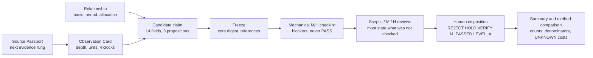

# Discovery Lab v1: evidence before mechanism, decisions before outcomes

**2026-10-21. Implemented offline; no live campaign has run.** Discovery Lab is a small Python module and record discipline for the stage *before* [Measurement Gate M](measurement_gate_m.md). It makes an idea start from evidence: a recorded observation, a documented relationship or a dated event. A mechanism-first baseline is kept for comparison. Every idea then passes through the unchanged six M requirements, mechanically checked, sceptically reviewed and decided by a human. It changes no evidence level, experiment, Store transition, trial count or source stop.

[Owner instruction](owner_discovery_lab_2026-10-21.md) · [Operator guide](discovery_lab_guide.md) · [Claude prompts](discovery_lab_prompts.md) · [Offline walkthrough](discovery_lab_walkthrough.md) · [Validation](discovery_lab_validation.json) · Code: [`src/research/discovery/`](../../src/research/discovery/) · Tests: [`tests/test_discovery_lab.py`](../../tests/test_discovery_lab.py)

## The failure it targets

Past candidates often had credible economics but no observable distinctive variable. Each safeguard below exists because a recorded case failed that way:

| Recorded failure | What Discovery Lab now does mechanically |
| --- | --- |
| F01 salmon: private capacity allocation unobserved | A predictor must be seen in an original field (`VERIFIED_ORIGINAL_FIELD`). Allocations between entities stay `UNVERIFIED` unless a document states them, and then block the join. |
| F03 chemicals: permission without qualified sales | `ROUTE_ONLY` or `UNVERIFIED` outcomes block the separate-outcome requirement. A typed relationship (for example `SUBSTITUTE_CAPACITY`) is not a quantity. |
| F09 receivables: redacted amounts | Unknown gross/net exposure blocks the financial bridge. A net claim with unknown net exposure is a separate blocker. |
| F19 assessments/credits: no state or cohort join | Each join dimension (legal entity, cohort, geography, period, accounting basis) is evidenced or blocked. |
| SH09 offshore: omitted schedules, unallocated security | Later accounts are recorded at `RETROSPECTIVE_DESCRIPTION` depth. Omissions live on the Source Passport, and aggregate security stays `AGGREGATE_AS_COHORT`/`UNVERIFIED`. The retrospective control in the walkthrough blocks four of six requirements from recorded evidence alone. |
| EF06: measurable only after reformulation, issuer-explained | After freezing, changing the distinguishing core is labelled `MATERIAL_REVISION`, and reformulations are counted apart from original claims. Information sceptics must state what was checked. The demo shows M PASSED with H UNCONVINCING. |

Whether this raises the yield of measurable, differentiated claims per analyst-hour is **untested**. That needs live campaigns.

## Reused, not rebuilt

- **Hashing and offline guard:** `src.research.spec.canonical/digest` for hashing; `src.research.sec_pilot.parsing.offline` for the network guard.
- **Measurement Gate M unchanged:** the six requirements, dispositions, four clocks, claim versions, append-only status history and retained failures are encoded, not redefined.
- **Source system untouched:** original bytes stay in the existing private archives. Records refer to them only by sha256 or archive pointer, and efforts point to existing acquisition receipts. Nothing here fetches.
- **Existing CI:** the public CI runner (`src.research.public_checks`) now includes the new tests.
- **Not touched:** the experiment Store, specs, `EXP` numbering, trial ledgers, Nexus, Aurora, frozen experiments, source stops, F19, SH09 and EXP004.

**Added:** `src/research/discovery/` with six modules (records, ledger, review, report, demo, cli; about 1,900 lines including the demo), one test file with 32 tests, and four documents.

## Data flow



Each campaign is one JSONL ledger. Every event carries the previous event's hash. Loading replays the whole file through the same rules used when appending, so a hand edit, a silently changed frozen claim or a rule bypass with a recomputed chain is detected.

## Major choices and rejected alternatives

| Choice | Failure prevented | Rejected alternative and why |
| --- | --- | --- |
| Append-only hash-chained JSONL per campaign, replayed on every load | Silent edits to frozen claims; contradictory versions | SQLite or a graph database: a new store with no demonstrated need. A mutable JSON file loses history. |
| Every field present; unknown is literal `UNKNOWN` | Omission read as zero or as "fine" | Optional fields: missing evidence would vanish silently |
| Evidence depth per item; original depth needs a provenance hash or pointer | Schemas, indexes and later accounts promoted to observations | A numeric source-quality score, which rewards unusualness and hides missing fields |
| First-public time only from an original publication record | Availability inferred from caches, filenames or document dates | Modelled availability bounds; these belong to Level B, separately approved |
| Typed relationships with `basis`, dated `period` and `quantity_transfer` | Name-match exposure, current-for-past ownership, pro-rata allocation | A knowledge graph; the report itself advises against it at this stage |
| Core-digest versioning; renamed claims must cite predecessors | Post-outcome reformulation presented as an original claim | Free editing before review |
| Checklist reports blockers, never PASS. M_PASSED needs a human review of all six on a frozen, unblocked version. Dispositions authorise nothing. | Automatic certification from populated fields | An automatic M evaluator, which the M rule itself excludes |
| One validator set; the method fixes only the entry record | Methods judged by different standards | Four separate implementations |
| Sceptics as stage prompts plus structured review records | Unsupported novelty, unchecked competitors | A multi-agent service, with cost and no evidence of benefit |
| Descriptive comparison: fixture classes separated, equal-budget check, no ranking | Rewarding idea volume; small-sample overclaiming | A composite discovery score or an adaptive 50/30/20 allocation |
| Next step = first blocked M requirement plus the claim's cheapest falsification | Parallel open-ended source hunts | The report's expected-information-value formula as a number, which would need probabilities nobody can estimate yet |

A separate failure prior register was **deferred**. Blocker codes and disposition reason types already capture each failure in a countable form. A register should wait until dozens of real failures exist; the supplied report agrees ("Not yet").

## Supplied report: critical review

*Research OS Discovery Lab: Building an Evidence-First Engine for Public Information Advantage*:

- **The file:** a 26-page PDF of 266,048 bytes, SHA-256 `c38b8e92f4da94e61dfc53b98eb855e9dc9de0182686780891073ac9e66b7b79`, read in full. A private copy is kept under ignored `data/raw/discovery_lab_20261021/`, and the PDF is not redistributed.
- **Citations:** it cites 30 listed sources through 36 numbered notes. Its internal `filecite` markers are interface artefacts, not evidence.
- **Nothing was re-checked:** under this task's zero-acquisition rule, none of its external sources was opened.

| Report recommendation | Assessment | Adopted as |
| --- | --- | --- |
| Point-in-time economic inference: observation before hypothesis | Matches recorded failures | Observation-first, relationship-first and event-first entries; observation-only records allowed |
| Observation Contract with separate clocks and semantics | Already in M; adds "what the field does not mean" | Four clocks with a first-public certificate rule; misleading proxies on passports |
| Prefer state changes; snapshot deltas, not today's database | Sound; revisions can manufacture history | `STATE_CHANGE` values `{from,to}`; version/retrieval clocks; `REFERENCE_REVISED_AFTER_FREEZE`. No snapshot infrastructure, since no live source is authorised |
| Sparse relationship ledger; 1–2 hops | Sound | Typed relationship records. The hop limit is not mechanically enforced; claims cite relationships directly |
| Expectation gap as a distinct step | Consistent with EF06 v2 | Closest-substitute field, information sceptic and separate H, without a new gate |
| Seven LLM roles as controlled passes; LLM may not certify facts | Sound division of labour | Stage prompts; assistants may review but never decide |
| Failure Prior Register | Useful later | Deferred; failures recorded as codes now |
| Expected-information-value priority formula | Probabilities unestimable at current scale | Ordered next-step selector |
| Discovery tournament, equal budgets; primary metric = original M passes without reformulation per cost | Sound | Descriptive comparison with that headline count; no ranking |
| Time-sliced and shadow (prospective) evaluation | Sound; LLM knowledge contaminates history | `RETROSPECTIVE_INSPECTED` fixture and `untouched_evaluation_eligible` flag. Shadow mode needs separate authority |
| Source archetypes (NHTSA, EPA ECHO, OSHA, FERC, STB, PHMSA, openFDA, EDGAR, BSEE) | Unverified here; not a ranking | Possible future passports only. The STB caveat matches EF01; the BSEE limitation matches the indexed description recorded in the [short-horizon review](short_horizon_discovery_report.md) |
| Bias to indirect exposures, small/mid caps, low-capacity situations | A selection preference, not evidence | Not encoded; liquidity and execution caveats retained |
| "What not to build" list | Agreed | No graph, crawler, agent swarm, embedding store, ML ranker or market-data integration |

**Evidence classes in the report:**

- **Consistent with repository records:**
  - The eight-family campaign had zero original M passes.
  - EF06 v2 was measurable but issuer-explained.
  - SH09's schedules were omitted.
  - The salmon/rail capacity, F09 redaction and F19 cohort failures are recorded as described.
- **Overstated:** "Bankruptcy ideas depending on omitted schedules are high-risk" and "issuer-interpreted observations have *repeatedly* passed measurement" each rest on one recorded case (SH09; EF06 v2). They are hypotheses for a future register, not priors.
- **Widely cited literature, not re-checked here:** McLean and Pontiff's post-publication decay figures, Cohen and Frazzini on economic links, Swanson's undiscovered public knowledge, and the Deflated Sharpe Ratio. No design decision depends on their exact values.
- **Unverified and not relied on:**
  - The commercial statistics: Neudata dataset, provider and spending counts; Eagle Alpha's product count; RavenPack positioning.
  - The specific NBER working-paper findings (w32767, w24552, w31100).
  - Recent preprints (arXiv 2606.08251, 2508.01285, 2407.08940; HypER).
- **Internal tension:** the report's "discovery equation" is additive (and truncated on page 21), yet the report also rejects composite scores. It is implemented as conjunctive gates.

## Boundaries

- Discovery IDs (`DLC-`, `SRC-`, `OBS-`, `REL-`, `CAND-`, `REV-`, `DSP-`, `EFF-`) are not experiment IDs and never enter the Store or trial counts.
- `M_PASSED` and `LEVEL_A_DESIGN_CANDIDATE` record human judgments. Neither authorises a study, and Level A design still requires separate owner approval. `VERIFY` is a proposal only.
- This task authorised zero acquisition. No live campaign or ledger was created, and the only real-world content is the retrospective SH09 control, built from recorded evidence.
- F19 remains HOLD/unapproved. SH09 remains stopped and is not re-adjudicated. EXP004's restrictions, EXP001–EXP007, river and every prior source stop are unchanged.

## Limitations

- **Tamper-evident, not tamper-proof.** Whoever controls the file can rewrite it entirely and recompute every hash. Git history and review remain the defence.
- **Freeze discipline depends on honest declaration.** Software cannot see what a researcher has read, so `outcome_inspected_before_freeze` and `after_outcome_seen` are self-reported.
- **Structure, not truth.** A fabricated hash or overstated depth passes validation. Human reviewers must open the cited originals.
- **Version 1 vocabulary.** Blocker codes reflect known failure types. Changing derived-field logic needs a new rules version and a migration for old ledgers.
- **Unproven usefulness.** No real campaign has run. The synthetic demo exercises code paths. The SH09 control was built knowing the answer, so it shows the checklist encodes that lesson, not that it predicts new failures.
- **Counts, not statistics.** A meaningful method comparison needs several equal-budget live campaigns and a pre-registered analysis.

## Validation

See the [validation receipt](discovery_lab_validation.json) for exact commands, counts and preservation checks. Reproduce with:

```sh
python -m unittest tests.test_discovery_lab -v
python -m src.research.discovery demo --check
python -m src.research.public_checks
python -m unittest discover -s tests -v
```
