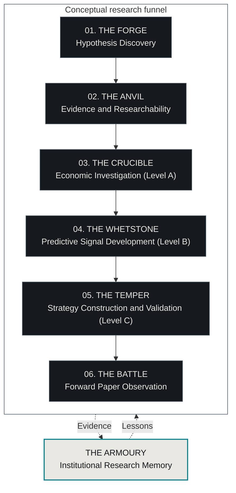

# Research OS — Forging an Edge

Architectural roadmap · **24 October 2026** · [Repository overview](../../README.md)

Research OS aims to discover unusual economic hypotheses, establish what can actually be measured, investigate the mechanism and determine whether any timely information could become a defensible investment edge. The six stage names below organise that work for readers. **They are a conceptual research funnel, not evidence of an automatic end-to-end pipeline.**

This document explains the user-facing architecture. The [governing master plan](../acceleration/master_plan.md), [operating contracts](../research_os.md), frozen specifications and historical owner decisions retain authority. These priorities grant no acquisition, model, experiment, spending or trading permission. Existing pauses and source stops remain in force.

## Architecture and evidence levels



Solid arrows show conceptual progression; dotted arrows show memory feedback. Each handoff requires the applicable evidence and a separate scope of authority. Source-first Discovery Lab work can begin at The Anvil and produce a new Forge hypothesis. The Armoury is cross-cutting, not a seventh sequential gate.

[Levels A/B/C](next_frontier_review.md) describe the strength of a claim: A permits disclosed retrospective economic investigation, B establishes historically actionable information, and C adds execution-aware investment evidence. [Measurement Gate M](measurement_gate_m.md) precedes Level A; it is not a fourth evidence level. Themed names neither replace those definitions nor migrate frozen experiments.

## Implementation snapshot

Inspected against `main` **`e49d76e`** and current GitHub pull-request metadata on 24 October 2026. “Implemented and tested” means software behaviour has supporting tests; “offline only” means those tests or fixtures do not establish live operation or empirical usefulness.

| Component | Status | Evidence boundary |
| --- | --- | --- |
| Scout card/archive, triage, revision, incubation and human handoff controls | Implemented and tested | Proposal records; no autonomous scientific certification |
| Exploratory FORGE runner V001 | Implemented offline only; [PR #26 merged](https://github.com/jarems421/ai-assisted-quantitative-research/pull/26) on 24 October | One-attempt transport with explicit plan-bound owner authority; no live run made with this runner |
| Scientific/economic/adversarial Critic V1 | Implemented offline only | Frozen rubric, import and recommendation policy; calibration and selective routing remain unestablished/inactive |
| Critic provider adapters | Implemented offline on a separate branch; [PR #27](https://github.com/jarems421/ai-assisted-quantitative-research/pull/27) is draft and unmerged | Not present on this document's `main` baseline; no hosted call or spending established |
| Unified generation/criticism pipeline | Implemented offline in draft [PR #28](https://github.com/jarems421/ai-assisted-quantitative-research/pull/28), unmerged and stacked on #27 | Separate branch; not part of this `main` baseline, not live-ready and not exercised by this documentation task |
| Discovery Lab and derived knowledge graph | Implemented and tested; utility evidence limited | Synthetic demos plus historical/source campaign records; R3 comparison INCONCLUSIVE |
| Source contracts, replay, independent metrics and experiment gates | Implemented and tested | Public summaries/fixtures do not certify private originals or full historical execution |
| Economic and predictive investigation | Partial components; next qualifying investigation proposed | No new end-to-end Level A/B result established by Scout, critic or graph software checks |
| Investment evaluation | EXP001 complete; other designs blocked/closed | Negative benchmark result; EXP004 population/execution certification remains unresolved |
| Forward paper observation | Controls partially implemented; operational route not established | No validated paper strategy, forward programme or live-capital path |
| Automatic outcome-to-Scout traceability and reconsideration | Proposed; not yet implemented end to end | No silent historical revision or model retraining |

## 01. THE FORGE — Hypothesis Discovery

**Purpose:** discover, formulate and critically evaluate unusual economic hypotheses.

**Responsibilities and existing components.** [Opportunity Scout](../opportunity_scout/README.md), [`src/research/opportunity_scout/`](../../src/research/opportunity_scout/), supplies generation lanes, immutable card versions, deterministic structural checks, triage, critiques, revision, incubation and diversity shortlists. [`critic_v1/`](../../src/research/opportunity_scout/critic_v1/) adds Scientific, Economic and adversarial critique under frozen texts and an advisory deterministic policy. The [critic contract](../opportunity_scout/ai_critic_v001.md) and [proposed calibration protocol](../opportunity_scout/ai_critic_v001_calibration_protocol.md) distinguish synthetic benchmark checks from demonstrated critic reliability. The owner's requested configuration is Scientific `gpt-6.1-sol` HIGH, Economic `gemini-4-argon` HIGH and generation Claude Opus 5.5 MEDIUM; availability and returned identity still need the existing live checks. Jev's former critic role is retired; [Jev Navigation V001](../jev_navigation_v001.md) supplies independent read-only inspection and workflow leads.

The [exploratory runner](../opportunity_scout/exploratory_runner_v001.md), [`exploratory_v001/`](../../src/research/opportunity_scout/exploratory_v001/), wraps one separately authorised generation attempt. Its documentation records an earlier manual pilot with two VALID cards; that structural validity establishes no empirical result or automated-runner operation. The internal **FORGE generator** is a specific seedless, memory-free Scout lane; **The Forge** is the broader stage, including other generation routes, criticism and relevant [graph discovery operators](../../src/research/graph/operators.py). Memory may inform permitted routes without being injected into a lane that forbids it.

**Input → output → handoff.** An approved idea-generation context, permitted snippets or memory references become versioned proposal cards with explicit mechanisms, predictors, outcomes, falsifiers, unknowns and provenance. Scientific/Economic recommendations may inform review; they never supply human labels, change routing or grant READY. Human `SCOUT_READY_V002` review and feasibility evidence for the exact version are required for an approved handoff proposal. Creating a Discovery Lab campaign or acquiring sources needs separate owner authority.

**Next milestone and blockers.** Complete review and verification of the authorised automated generation-and-criticism workflow, exercising simulated providers before proposing a small controlled pilot. Draft PRs #27 and #28 remain unmerged dependencies; the economic-provider setup, scientific-model identity and live event profile remain unresolved. A live run needs its own payload/plan-bound approval and any spend cap; a merge is not permission. Existing N1/frozen V004 investigations remain separate and are not reopened.

## 02. THE ANVIL — Evidence and Researchability

**Purpose:** determine whether a hypothesis has an identifiable, measurable economic foundation.

**Responsibilities and existing components.** [Discovery Lab](discovery_lab_design.md), [`src/research/discovery/`](../../src/research/discovery/), supplies Source Passports, observations, typed relationships, frozen claim versions, sceptic review and append-only hash-chained ledgers. [`review.py`](../../src/research/discovery/review.py) reports mechanical blockers; it cannot certify M. Original-source verification and receipt practices are supported by [`sec_pilot/`](../../src/research/sec_pilot/) and the [source/replay architecture](../acceleration/phase2_report.md).

The six unchanged [M requirements](measurement_gate_m.md) cover an actual distinctive predictor, usable meaning/units, separately observable outcome, valid join, plausible public-time route and material financial bridge. [Frontier selection](frontier_selection_standard.md) adds economic relevance, closest substitutes, competition and a testable differentiation hypothesis. H remains a separate assessment of a plausible expectation-revision channel, not a measured trading result.

**Input → output → handoff.** A versioned hypothesis or a source-first observation becomes a source-backed frozen claim with units, four clocks, outcome join, dated exposure, omissions and mechanical blockers. Only an evidenced human M review can record `M_PASSED`. An M pass is neither permission nor sufficient scientific design: population, materiality, baseline and feasibility must justify a separately authorised Level A design.

**Next milestone and blockers.** Take one promising Forge hypothesis into a bounded, owner-authorised investigation. Establish a real predictor, independent measurable outcome, credible source route and material exposure—or record the precise unresolved requirement. Redacted values, absent original schedules, unsupported allocations and source denials remain blockers. F19 stays HOLD/unapproved; SH09 and other persisted source stops stand. **Missing measurement is not a falsified mechanism.**

## 03. THE CRUCIBLE — Economic Investigation

**Purpose:** determine whether the proposed economic mechanism survives empirical scrutiny.

**Responsibilities and existing components.** [Level A](next_frontier_review.md) supports economic hypotheses, historical observation/reconstruction, baseline models and competing explanations, with confounder analysis and separately justified causal methods where appropriate. Existing statistical/feasibility components include [`phase3c/inference.py`](../../src/research/phase3c/inference.py), [`phase3d/inference.py`](../../src/research/phase3d/inference.py) and [`phase3er/`](../../src/research/phase3er/). Their synthetic calibration is methodological evidence, not a completed economic investigation. The [Phase 3 final report](../acceleration/phase3_final_report.md) preserves an inference design that failed certification before real performance.

**Input → output → handoff.** A researchable, human-reviewed claim and an authorised frozen question specify predictor/outcome definitions, population, horizon, comparison, missingness, reconstruction limits, competing explanations and analysis scope. The expected output is recorded empirical evidence with uncertainty and a clear supported, null, negative or unresolved conclusion. A promising economic association may justify proposing a Level B investigation; it does not establish causality, predictive alpha or a profitable strategy.

**Next milestone and blockers.** Complete one real, tightly scoped investigation from frozen question through reproducible evidence and conclusion. Measurement, a credible sample and justified dependence/inference remain prerequisites. Causal/counterfactual work remains a separately approved milestone in the master plan; the stage name does not implement a general causal engine. The earlier river proposal remains unapproved.

## 04. THE WHETSTONE — Predictive Signal Development

**Purpose:** determine whether an economic relationship contains timely, incremental information that could plausibly contribute to an investment edge.

**Responsibilities and existing components.** [Level B](next_frontier_review.md), [`spec.py`](../../src/research/spec.py), [`pit_signals.py`](../../src/research/pit_signals.py) and [`signals/`](../../src/research/signals/) provide relevant point-in-time and signal-building controls. [Phase 3A](../acceleration/phase3a_report.md) and [Phase 3D contracts/proof](../acceleration/phase3d_report.md) document availability clocks, accounting scope and historical identity boundaries. These are reusable components; complete source certification and compiler-to-selection integration remain blocked.

**Input → output → handoff.** A surviving economic proposition and separately authorised design must specify information versions, availability clocks, security identities, predictor construction, forecast horizon, closest substitutes and baseline predictions. The expected output is a reproducible incremental-prediction comparison using only what could have been known before the outcome, with a plausible dated signal-to-instrument exposure map. Exposure assumptions and unresolved clocks remain explicit.

**Next milestone and blockers.** Design one predeclared signal investigation establishing historical knowledge, incremental value over an appropriate baseline and plausible listed exposure. Exact publication timing, historical population coverage and security-class/lifecycle evidence are recurring gaps. A modeled eligibility bound is not an observed publication time. Economic predictability alone is not tradable profitability, and Level A reconstructions cannot silently become Level B inputs.

## 05. THE TEMPER — Strategy Construction and Validation

**Purpose:** determine whether a potential edge survives realistic costs, execution constraints, statistical scrutiny and independently separated evaluation.

**Responsibilities and existing components.** [Level C and operating contracts](../research_os.md), the [specification schema](../../experiments/_template/spec.schema.json), [`store.py`](../../src/research/store.py), [`analysis.py`](../../src/research/analysis.py), [`src/metrics/`](../../src/metrics/) and experiment/trial records support freezes, Development selection, Validation, walk-forward, robustness and independent statistical analysis. [`phase3d/execution.py`](../../src/research/phase3d/execution.py) tests Decimal cash/fee/corporate-action accounting on synthetic inputs. Costs, slippage, fees, liquidity, lifecycle, risk constraints and complete populations must be evidenced for a real strategy; fixture accounting alone cannot supply them.

**Input → output → handoff.** A qualifying candidate, executable population, costs and risk contract enter a separately authorised frozen strategy design and counted trial process. Expected outputs are independently calculated candidate-versus-baseline evidence, robustness results, failures, provenance and limitations. Historical Test opens only under the existing explicit human authorisation rule. Modern AI may know historical outcomes; a workflow holdout is not genuinely unseen future evidence.

**Next milestone and blockers.** Resolve relevant execution/population certificates, then complete a bounded cost-aware strategy evaluation for a qualifying candidate. The [EXP004 forensic closure](../acceleration/exp004_execution_gap_report.md) retains all 26 unresolved execution cases and NOT_RUN performance. Neither a pruned population nor an unapproved no-fill policy is an acceptable repair. [EXP001](../../reports/EXP001_final_report.md) is honest negative evidence: the frozen SPY timing winner reduced risk but underperformed passive SPY in return and risk-adjusted ratios. It is not an alpha success or a new strategy to deploy.

## 06. THE BATTLE — Forward Paper Observation

**Purpose:** observe how a frozen, sufficiently validated strategy behaves against genuinely new market information.

**Responsibilities and existing components.** The [operating contracts](../research_os.md) and [`nexus.py`](../../src/research/nexus.py) contain legacy paper authorisation/deployment planning controls. They do not establish an operational paper programme. The [Nexus capability review](../nexus_capabilities.md) and master-plan phases 6–7 retain adapter/population certification and forward evidence as later dependencies. Remote Aurora remains blocked pending audited tool/date isolation.

**Input → output → handoff.** Only a sufficiently validated frozen strategy, certified adapter, reviewed final evidence and separate human paper authorisation can enter a forward-only research route. Intended outputs are execution monitoring, discrepancy analysis, risk/performance measurements and comparison with frozen expectations, accumulated through actual elapsed future time. No historical replay substitutes for those observations.

**Next milestone and blockers.** Establish a safe, separately authorised forward paper-observation route after evidence and adapter certification exist. There is no validated paper strategy or operational forward system today. **The Battle initially means paper research; it neither implements nor authorises live capital deployment.**

## THE ARMOURY — Institutional Research Memory

[Jev's Memory Navigator](../jev_navigation_v001.md) reuses the existing catalogue, Graph search and provenance to suggest earlier records to inspect. Exact references, conceptual similarities and shared methodological problems remain distinct; no model answer upgrades a Graph classification or rewrites a historical conclusion. Its Evidence Prospector can later consume already-authorised Quarry records, but The Quarry itself remains unbuilt and optional. Its Workflow Navigator reports existing blockers and stops without advancing a candidate.

**Purpose:** retain and organise the evidence created at every stage, including failures.

**Responsibilities and existing components.** Scout archives retain hypotheses and revisions; Discovery Lab ledgers retain sources, observations, reviews and dispositions; [`src/research/graph/`](../../src/research/graph/) projects a derived, read-only view. [Graph v1.1](graph_v1_1_design.md) distinguishes grounded economic candidates, methodological warnings and unsupported matches. Neutral entity/document joins are not verified exposure. [`experiments/`](../../experiments/), [`reports/`](../../reports/), [`docs/acceleration/`](../acceleration/) and public processed artifacts preserve experiment results and lessons; immutable original bodies/receipts remain private and git-ignored.

**Input → output → handoff.** Versioned hypotheses, original-source provenance, evidence, abandoned designs, failed investigations and results become traceable records and cited retrieval aids. Graph conflicts defer to source ledgers/reports. AI opinions retain their provenance and never become established facts or independent human judgments.

**Next milestone and blockers.** Improve explicit candidate-to-claim-to-experiment/outcome traceability, then propose lightweight reconsideration of incubated hypotheses with concrete evidence conditions. End-to-end traceability is not complete. Reconsideration must retain old reasons, never automatically modify frozen research, reopen stopped routes or retrain models.

| Recorded outcome | Memory treatment |
| --- | --- |
| Rejected or abandoned | Preserve the exact claim/version, decisive reason, source attempts and scope; do not recast an inaccessible measurement as economic disproof. |
| Blocked or HOLD | Keep unresolved fields and the authority/source stop; a new observation or owner decision is needed before further work. |
| Incubated | Retain the proposal and explicit missing evidence/reconsideration condition. A future change is a recorded revision, not a rewritten past. |
| Revised or reformulated | Link the superseded version and concrete reason. A changed core variable/population/mechanism remains a distinct material reformulation. |
| Null or unsuccessful evaluation | Retain all counted trials, failed/unresolved attempts, results and limitations alongside any surviving candidate. |

## Canonical experiment states remain unchanged

The Forge through The Whetstone organise upstream work; they introduce no Store states. The Temper and The Battle provide reader-facing labels around the existing sequence in [`spec.STAGES`](../../src/research/spec.py):

```text
DRAFT -> HYPOTHESIS_FROZEN -> DEVELOPMENT -> CANDIDATE_FROZEN
      -> VALIDATION -> WALK_FORWARD -> ROBUSTNESS
      -> TEST_AUTHORIZED -> TEST_COMPLETE -> PAPER_AUTHORIZED -> PAPER
```

Development selection and frozen candidate/benchmark snapshots precede later evaluation; chronology, trials and evidence requirements remain those of the contracts. Test and paper confirmations are separate owner acts, never assistant-supplied. Themed stage boundaries are navigation, not runtime transitions, approvals or a reason to revisit immutable EXP001–EXP007 history.

## Measuring whether discovery helps

The meaningful question is whether the process produces useful, measurable research more effectively than a simpler method. No such advantage is currently established. A future separately authorised comparison should predeclare the methods, inputs, equal budgets, outcomes and review independence before seeing outputs.

- Compare against competent structured-ledger search or a simple documented discovery workflow, not a deliberately weak keyword baseline.
- Count all analyst time, tool overhead, source attempts and failed or reformulated claims. Report original human-confirmed M passes and worthwhile Level A design candidates separately from generated card count.
- Track falsification time, unsupported claims, duplication, review load and unresolved measurements. Follow the surviving claims into reproducible downstream results rather than treating critic agreement as research success.
- Separate synthetic software regression, prospective discovery usefulness, economic evidence and investment evidence. Calibrate critics against independently collected human anchors; do not create labels from model opinions.

The [graph review](graph_v1_review.md) found structured search matched synthetic claim connections. [R3](graph_pilot_r3_results.md) supplied only two exploratory pairs, zero original M passes and an INCONCLUSIVE comparison with AI-assisted, potentially unblinded judgments; it proves neither graph improvement nor a general graph null. [R4 readiness](graph_pilot_r4_readiness_v004.md) is infrastructure, while [the pause recommendation](graph_pilot_r4_pause_recommendation_v001.md) is a recommendation, not an owner decision. R4 remains NOT_RUN and unauthorised; no preparation or activation follows this roadmap.

## Reading historical status safely

Some historical document headers still say “draft/not merged” or “no live campaign” at their original checkpoint. `AGENTS.md` retains pre-merge wording for PR #26, while GitHub records its merge; the runner document correctly records offline-only testing. The governing master plan and Discovery Lab design also retain earlier graph checkpoints. Later R3 records establish the limited exploratory campaigns described above. This roadmap does not rewrite those historical records. PRs #27 and #28 remain unmerged at this dated inspection; recheck their live status before treating their code as part of `main`.

For reproduction and private-archive limits, use the [README quick start](../../README.md#running-the-project) and [offline CI review](../offline_ci_hardening.md). Public fixtures demonstrate software behaviour. They do not certify original-source completeness, critic calibration, economic validity, historical execution or a profitable edge.
