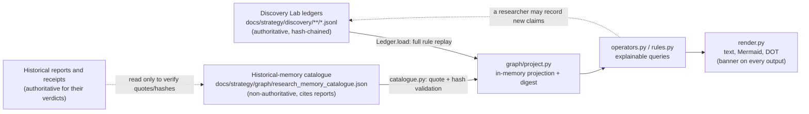

# Economic Knowledge Graph v1: research memory without a second truth system

> DERIVED RESEARCH VIEW - NOT INDEPENDENT EVIDENCE - NO RESEARCH AUTHORITY

**2026-10-21. Implemented offline; no pilot has run.** Graph v1 is a deterministic, read-only, in-memory projection with two inputs: replay-validated Discovery Lab ledgers, and a small non-authoritative historical-memory catalogue. It remembers what research recorded and connects records across campaigns only through exact identifiers, content hashes, documented relationships and a validated requirement vocabulary. Every connection it finds comes with its evidence and its first unsupported economic leap. It writes nothing authoritative, certifies nothing, decides neither M nor H, and authorises no research.

[Owner instruction](owner_graph_v1_2026-10-21.md) · [Guide](graph_v1_guide.md) · [Walkthrough](graph_v1_walkthrough.md) · [Backfill audit](graph_v1_backfill_audit.md) · [Catalogue](graph/research_memory_catalogue.json) · [Validation](graph_v1_validation.json) · Code: [`src/research/graph/`](../../src/research/graph/) · Tests: [`tests/test_graph.py`](../../tests/test_graph.py)

## Sources of truth and dependencies

- **Reads only:** the graph reads the ledgers, the catalogue and the reports the catalogue cites. It never opens `data/raw/`, credentials or experiment state. A test asserts this.
- **Reuses Discovery Lab code:** loading, `State`, prefix replay (`fold`), `checklist` and `source_next`. Discovery Lab's vocabulary and append rules are unchanged, and no field was added.
- **Refuses invalid input:** a tampered ledger, a duplicate campaign ID or a structurally corrupt catalogue stops the build. Changed or missing cited reports are flagged, not refused.
- **Outputs are derived:** if a graph output disagrees with a ledger or report, the source wins.

## Ontology

**Node kinds.** Twelve, each with a stable, namespaced identifier. Discovery Lab IDs are unique only within one ledger, so record nodes are qualified by campaign.

| Node | Identifier | From | Carries |
|---|---|---|---|
| campaign | `campaign:DLC-X` | ledger campaign event | method, authority, budget, effort |
| source | `source:DLC-X/SRC-1@v` | passport version | access, next-evidence rung, omissions |
| document | `document:sha256:<hex>` or `document:locator:<url>` | evidence items, catalogue receipts | content identity (`CONTENT_HASH` or `LOCATOR_ONLY`), independence `NOT_ASSESSED` |
| observation | `observation:DLC-X/OBS-1@v` | observation version | assertion status, value, units, denominator, four clocks, tags |
| entity | `entity:SCHEME:value` (`entity:NAME:<scope>/<name>` for name-only) | entities in records and catalogue | identity status, types seen, names seen |
| relationship | `relationship:DLC-X/REL-1@v` | relationship version (reified assertion) | assertion status, basis, period, scope, allocation status |
| claim | `claim:DLC-X/CAND-1@v` | candidate version | revision kind, claim class, freeze references, blockers, human M/H, reviews, dispositions |
| requirement | `requirement:REQ_*` | catalogue vocabulary (7 classes) | definition and what it does not mean |
| blocker | `blocker:CODE` | Discovery Lab checklist codes | (a hub; never a bridge) |
| history, history_claim, history_finding | `history:HIST-F01[/claim-v1 \| /F1]` | catalogue | verbatim verdicts, findings and citations |

Reviews and dispositions stay attached to their exact claim version.

**Assertion status.** Verification belongs to assertions, not to the nodes they join:

| Status | Applies to | Meaning |
|---|---|---|
| `ORIGINAL_FIELD_OBSERVED` | observation | The economic field itself was seen in an original (`VERIFIED_ORIGINAL_FIELD`) |
| `ORIGINAL_DOCUMENT_REFERENCED` | observation | The document was seen (`VERIFIED_ORIGINAL_RECORD`); the field is not verified |
| `DOCUMENTED_RELATIONSHIP` | relationship | `VERIFIED` with `DOCUMENTED` basis. Allocation is a **separate** field: `VERIFIED_ALLOCATION`, `ALLOCATION_UNVERIFIED` or `NOT_APPLICABLE` |
| `RECORDED_UNVERIFIED` | either | Recorded at lower depth. The reason is one of `RETROSPECTIVE_ONLY`, `SCHEMA_ONLY`, `INDEXED_ONLY`, `ACCESS_BLOCKED`, `NAME_MATCH_ONLY`, `INFERRED_ONLY`, `UNVERIFIED` |
| `CONTRADICTED` | either | Retained and shown, never deleted |
| `SUPERSEDED` | any versioned record | Hidden unless `--history` |
| `HISTORICAL_CONCLUSION` | history nodes | Cited memory, not new evidence |
| `SUGGESTION_ONLY` | operator output | Never stored as an edge |

Entities and documents carry identity information, not verification. A path through a properly identified entity node is traversable. Reaching that entity proves nothing about any linked financial proposition.

**Edges.**
- **Semantic:** `SUBJECT` and `OBJECT` connect a relationship assertion to its two entities. Passing through a relationship node is one *semantic hop*.
- **Structural:** every other edge is structural: `CONTAINS`, `CITES`, `DESCRIBES`, `OBSERVED_IN`, `PREDICTS_WITH`, `OUTCOME_FROM`, `RELIES_ON`, `EXPOSES`, `SUPERSEDES`, `BLOCKED_BY`, `REQUIRES`, `MAY_MEASURE`, `RELATED_CLAIM`, `RECORDS`, `HAS_FINDING`, `REFORMULATES`, `CONCERNS`.
- **Never present:** there is no generic `RELATED_TO` edge, no transitive edge and no derived exposure edge.

## Identity, time and modes

**Identity:**
- **Joins:** cross-campaign joins use exact `SCHEME:value` identifiers only.
- **Name-only entities:** confined to their campaign or investigation.
- **Look-alikes:** similar names under different identifiers raise `IDENTITY_QUESTION` and are never merged.
- **Tickers:** `TICKER:` identities are marked `TICKER_ONLY`, with the restriction that a ticker is not a permanent legal-entity identity.
- **Type conflicts:** the same identifier recorded with different entity types across ledgers raises `ENTITY_TYPE_CONFLICT`. Discovery Lab already refuses this within a single ledger.

**Documents:**
- **Joining:** documents join by SHA-256. A locator alone is `LOCATOR_ONLY` and never proves identical content. One locator with two hashes raises `SOURCE_HASH_CHANGED_AT_LOCATOR`.
- **Independence:** never assessed, for the same hash or for different hashes.
- **Matching:** document matching in `shared` and `revisit` uses content citations only. Timing and source-qualification provenance (retrieval receipts, publication records, passport history, revision, clock and access evidence) is not economic content. This rule came from a test that caught unrelated records "matching" through a shared retrieval receipt.

**Time:**
- **Clocks:** the four Discovery Lab clocks are carried unchanged. First-public time is never derived.
- **`--as-of DATE` (economic validity):** hides relationships whose dated period does not cover the date (`PERIOD_INCOMPATIBLE`; `PERIOD_UNRESOLVED` when the period is unknown) and observations that had not yet occurred. Historical memory is not time-scoped and stays labelled.
- **`--known-at TIME` (recorded knowledge):** replays each ledger only up to events appended by then. The catalogue counts as known from its own `recorded_at_utc`, never from an original investigation's closure date, so a 2026 transcription is never backdated.

**Modes:**

| Mode | Admits | Purpose |
|---|---|---|
| `memory` (default) | live and retrospective ledgers, plus historical memory, all labelled | exploration |
| `prospective` | live ledgers only; no catalogue, no retrospective, no synthetic | evaluation protocols (combine with `--known-at`) |
| `synthetic` | synthetic ledgers only, plus historical memory unless `--no-memory` | demonstrations and tests |

Excluded inputs are listed in every build.

## Anti-noise and abstention

**Admission:**
- **Accepted inputs:** only replay-validated ledgers, the validated catalogue and, in synthetic mode only, synthetic fixtures.
- **Never accepted:** raw rows and LLM-written connections. The graph has no write path at all.

**Bounds:**
- **Defaults:** 2 semantic hops, maximum 3. Structural depth is 2 × semantic + 4, so 8 by default and at most 10.
- **Output caps:** 30 displayed nodes, 10 paths and 10 suggestions.

**Hubs:** campaign, source, requirement, blocker and historical-investigation nodes, and any node with degree above 25, are never bridges in paths or neighbourhoods. They stay searchable and inspectable.

**Match strength** is categorical: exact document hash > exact entity identifier > documented relationship in a compatible period > requirement match > author tag. Requirement links that rest on an author tag are labelled `AUTHOR_TAG_CANDIDATE` and `candidate_only`, so they can never be read as verified.

**Abstention and rejection codes.** Each code comes with its reason:

| Code | When |
|---|---|
| `NO_VERIFIED_IDENTITY` | The entity is `NAME:` or `TICKER:` only |
| `PERIOD_UNRESOLVED`, `PERIOD_INCOMPATIBLE` | A relationship period is unknown, or excludes the observation |
| `SOURCE_DEPTH_INSUFFICIENT` | An assertion is below original-field or documented status |
| `ALLOCATION_UNVERIFIED` | A relationship carries no documented quantity transfer |
| `ONLY_NAME_SIMILARITY`, `ONLY_SHARED_KEYWORD` | Look-alike names, or shared words, without a shared identifier, document or relationship |
| `UNKNOWN_TAG` | A tag is outside the requirement vocabulary |
| `SOURCE_INDEPENDENCE_UNKNOWN` | Any document-based match |
| `NO_PATH_WITHIN_BOUNDS`, `NO_USEFUL_SUGGESTION`, `NO_OPEN_CLAIMS` | Nothing justified to report |
| `RETROSPECTIVE_ONLY` | Hidden or labelled by the view |

**First unsupported leap.** `explain` names the first point where a path stops being supported economic evidence:

| Code | Meaning |
|---|---|
| `SOURCE_DEPTH_INSUFFICIENT` / `RELATIONSHIP_NOT_DOCUMENTED` | An assertion on the path is below verified status |
| `NO_VERIFIED_IDENTITY`, `ENTITY_TYPE_CONFLICT` | An entity on the path is unidentified or has conflicting types |
| `PERIOD_UNRESOLVED` / `PERIOD_INCOMPATIBLE` | A relationship's period is unknown, or excludes the observed date |
| `RESEARCH_HYPOTHESIS_BRIDGE`, `RESEARCH_MEMORY_BRIDGE`, `SHARED_SOURCE_ONLY` | The connection runs through a claim, historical memory or a shared document |
| `NO_ECONOMIC_ASSERTION_ON_PATH` | No observation or relationship asserts the connection |
| `ALLOCATION_UNVERIFIED` | A relationship carries no documented quantity transfer |
| `FINANCIAL_TRANSMISSION_UNVERIFIED` | Every step is supported, but nothing shows transmission, materiality or exposure |

Every path is marked `connectivity_only: true`, `exposure_certified: false`, `causal_claim: false`.

## Operators

| Operator | Input | Returns |
|---|---|---|
| A `shared` | node or campaign | Other campaigns and investigations sharing a content-hash document or identified entity. Each comes with its basis, classification (`SAME_SOURCE_REUSE`, `SHARED_ENTITY_ONLY`, `POTENTIALLY_COMPLEMENTARY`), dispositions and an independence caveat |
| B `complements` | observation | Documented, period-compatible relationships and same-object observations from other campaigns, with what is still required. Name, keyword and period-incompatible candidates are rejected with codes |
| C `same-gap` | requirement or blocker | Claims blocked by it. Each carries its basis (`MECHANICAL_BLOCKER`, `CURATED_HISTORICAL_MAPPING`, `CURATED_MAPPING`, `AUTHOR_TAG_CANDIDATE`), the exact blocking reason and cited evidence |
| D `explain` | two nodes | Up to 10 bounded paths. Each step shows connection type, status, what it establishes, evidence, period, clocks and identity, plus the first unsupported leap |
| E `changes` | (graph) | Hash changes at a locator, entity type conflicts, contradicted records, superseded versions, references revised after a freeze, stale citations, unknown tags, identity questions and excluded inputs |
| F `revisit` | observation or campaign | Earlier claims and investigations a new observation might inform. Each lead states why it matched, field visibility, units and population, identity, time and historical availability, what is unverified, the minimum evidence to resolve it, and the previous status (which stands). It authorises nothing |
| G `gaps` | claim | The specific unverified links, never filled |
| H `next` | (graph) | Requirements ordered categorically: open claims sharing them, then recorded routes, then historical recurrence. Each carries decisive checks and the label `PROPOSAL_ONLY` |

**Base views:** `search`, `show`, `neighbourhood`, `trace`, `failures`, `orphans`, and `export` (Mermaid or DOT for a neighbourhood, explanation or trace).

## Utility check and prospective pilot protocol

**Offline utility check.** [`evaluate.py`](../../src/research/graph/evaluate.py) compares three approaches on identical synthetic records and five fixed tasks, with ground truth written alongside the fixtures:
- **Text search** recovered the true connection, but added two false connections and two premature identity joins.
- **Exact-identifier search** matched the graph on claim connections, but returned one period-incompatible relationship context.
- **The graph** recovered the connection with zero false or premature joins, and flagged both identity questions.

**The graph found no link that identifier search missed.** On this evidence its contribution is precision, period and identity discipline, historical memory and explanation, not recall. The result is synthetic and constructed, and it shows behaviour, not superiority.

**Prospective pilot protocol.** Not launched; it requires separate owner authority.
1. **Arms.** For each new live campaign, use time-matched arms: a baseline triage using Discovery Lab plus ordinary text and identifier search, and a graph-assisted triage, each given the **same analyst-minute budget**. A fresh assistant session without graph access performs the baseline arm, and its notes are recorded before graph outputs are viewed.
2. **Suggestion export.** `python -m src.research.graph suggestions TARGET` exports each graph suggestion with mechanical flags showing whether text or identifier search would also have found it.
3. **Adjudication log.** Each suggestion is logged by a human (`adjudications validate FILE` checks the format) with:
   - **`found_via`:** `GRAPH_ONLY`, `BASELINE_SEARCH_DISCOVERABLE`, `ANALYST_EXTRA_TIME` or `BOTH`.
   - **`outcome`:** `CONFIRMED_AGAINST_ORIGINALS` (which requires the Discovery Lab record that now holds it), `PLAUSIBLE_UNVERIFIED`, `REJECTED_FALSE`, `REJECTED_TRIVIAL` or `NOT_REVIEWED`.
4. **Metrics:**
   - Confirmed graph-only connections.
   - False and trivial suggestions.
   - Adjudication minutes per confirmed connection.
   - Time to identify the decisive missing variable.
   - Repeated dead-end source work avoided.
   - Original frozen M passes per analyst-hour, and H judgments, reported separately.
   - Build reproducibility.

**Failure criteria:**
- **Critical, stop until fixed:** any unverified material shown as verified; any mutation of an authoritative record; any synthetic or retrospective leakage into prospective evaluation.
- **PROPOSED thresholds, not empirically established:**
  - **Tighten or remove an operator** if, after at least 20 adjudicated suggestions, more than 80% are `REJECTED_FALSE` or `REJECTED_TRIVIAL`.
  - **Remove the discovery operators** and keep only `trace`, `explain` and `changes` if, after three live campaigns or 20 new observations (whichever comes later), there are zero `GRAPH_ONLY` confirmed connections.
  - **Consider a disposable SQLite cache** only if the median build exceeds 5 seconds.

## Changes from the architecture plan

- **Assertion-level verification (correction 1):** entities and documents are neutral joining points; status lives on observations and relationships; allocation is separate; exposure is never certified.
- **Semantic and structural hops counted separately (correction 2):** paths through claims, documents or historical memory rank after paths through documented relationships.
- **Research memory is the default mode (correction 3):** historical memory is visible and labelled; prospective mode excludes it; synthetic data is isolated.
- **Append time and catalogue time kept apart from historical dates (correction 4):** `--known-at` replays ledger prefixes; transcription is never backdated.
- **Centrally validated vocabulary (correction 5):** free-text `[REQ:…]` and `[MEASURES:…]` tags are validated, labelled and always candidate-only. Curated mappings live in the catalogue, pending human review.
- **Evaluation hooks separate graph benefit from extra time (correction 6):** baseline-discoverability flags and the adjudication-log format are in place; no pilot was run.
- **Backfill as catalogue memory, not reconstructed retrospective ledgers:** see the [audit](graph_v1_backfill_audit.md).
- **Document matching restricted to content citations**, as described above.

## Supplied PDF review (summary)

*Research OS Graph: A Deep-Research Blueprint for an Evidence-Backed Discovery Orchestrator*:

- **The file:** 35 pages, 276,995 bytes, SHA-256 `e822d02fe2be1ae42317317aa7f8915479bfc8474fe1d150967f8449ff226650`, read in full. A private copy is kept under ignored `data/raw/graph_v1_20261021/`. Its external sources were not opened.
- **Adopted:**
  - The derived, rebuildable index with the canonical record winning (pp. 22–23).
  - Evidence attached to statements, after Wikidata (p. 6).
  - No single confidence number (pp. 10–11).
  - Separate legal entity and ticker (pp. 24–25).
  - AI writes nothing canonical (p. 26).
  - Task-specific views instead of a hairball (pp. 11–12, 26–27).
  - The adversarial regression list (pp. 32–33).
- **Modified:**
  - The four planes became views of one projection (pp. 12–17).
  - The value-of-information formula became categorical ordering (p. 20).
- **Rejected:**
  - In-graph promotion from proposed to verified (pp. 16–17), which would create a second truth system.
  - Treating the graph as Phase 4B (p. 2), given AGENTS.md's `KEEP_PHASE4B_LATER`.
  - The hypothetical "87%" figure (p. 29), which is an illustration, not data.
- **Unverified:** the vendor figures and Graphiti issue reports. No design decision depends on them.

## Limitations

- **Small and synthetic so far.** Real research memory is seven catalogued investigations with no live ledgers. Cross-campaign value is demonstrated only on synthetic fixtures.
- **The evaluation gold set is constructed.** Requirement-class retrieval over the catalogue is not evaluated, because the curated mappings would make that circular.
- **Pending review.** Requirement mappings and the SEC-path identity extraction await human review.
- **Narrow identity coverage.** Without a structured security or cross-scheme identity layer, a CIK and an LEI for the same company never join.
- **Free-text lineage.** Cross-campaign claim lineage depends on the free-text `prior_related_claims` convention (`DLC-X/CAND-Y`). A structured reference would be a Discovery Lab v2 schema decision.
- **Untracked attempts.** Discovery Lab effort records lack a `source_id`, so the graph cannot yet report repeated attempts at a blocked route. It shows blocked routes only from passports and receipts.
- **Not adversarially robust.** Integrity rests on Discovery Lab's tamper-evident ledgers and on Git. The graph is not secure against an adversary who rewrites the inputs.

## Postponed to Graph v2

- An HTML explorer.
- A disposable cache.
- Cross-scheme identity (`SAME_AS` backed by documents) and a securities layer.
- Structured Discovery Lab fields, pending the v2 schema decision: requirement classes, `measures`, `source_id` on efforts, and cross-ledger claim references.
- Persisted suggestion history.
- Failure-rate priors, but only once prospective counts exist.
- Counterfactual propagation.
- Matrix views.
- PROV-JSON export.
