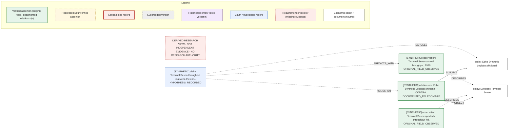

# Graph v1 offline walkthrough

> DERIVED RESEARCH VIEW - NOT INDEPENDENT EVIDENCE - NO RESEARCH AUTHORITY

Generated by `python -m src.research.graph demo --write`; verified by `demo --check`. A fixed synthetic clock makes it byte-reproducible, and everything runs under the repository network guard. Demos A-C read the historical-memory catalogue (cited reports, verbatim verdicts). Demos D-F and the hypothetical lead in A use fully synthetic ledgers in synthetic mode. Memory-mode graph: 99 nodes, 121 edges, digest `8c9167e93b9bb972`. See the [guide](graph_v1_guide.md) and [design](graph_v1_design.md).

## Demo A: F01 salmon treatment capacity (historical memory)

Recorded verdict: **BOUNDED_VERIFICATION_CLOSED / NOT_READY** (NOT_ADVANCED); citation status CURRENT.
Scope: The bounded BarentsWatch verification only; not economic falsification.

Recorded findings (cited verbatim; the graph adds none):

- MEASUREMENT_GAP: Bookings, priority rights, treatment-compatible slots and spare capacity are not exposed. -> REQ_AVAILABLE_CAPACITY
- MEASUREMENT_GAP: Vessel visits are not established treatment episodes. -> REQ_REALISED_ACTIVITY
- SCOPE_LIMIT: Empty treatment arrays mean none recorded in the returned fields, not verified absence of treatment. -> no requirement mapping
- IDENTITY_LIMIT: Actual treatment customers and their independent economic control were not verified; name resemblance is not a parent certificate. -> REQ_ENTITY_COHORT_JOIN
- SOURCE_FIELD_PRESENT: Real site-week health and vessel-visit records exist for the sampled weeks. -> no requirement mapping
- SCOPE_LIMIT: Vessel route contexts demonstrate multi-site movement, not treatment work or independent customers. -> REQ_REALISED_ACTIVITY
- EVIDENCE_TO_CHANGE: A source linking vessel, farm, date and treatment method, dated access constraints and enough allocation episodes. -> no requirement mapping

Observation records attributed to F01 in the graph: 0. Historical memory is not converted into treatment, capacity or allocation observations; vessel visits remain recorded visits.

`same-gap REQ_AVAILABLE_CAPACITY` (shared missing measurement, not an economic link):

- history:HIST-EF03/claim-v1 [HOLD / M NOT PASSED] via CURATED_HISTORICAL_MAPPING: A production increase is not spare deliverable capacity.
- history:HIST-F01/claim-v1 [BOUNDED_VERIFICATION_CLOSED / NOT_READY] via CURATED_HISTORICAL_MAPPING: Bookings, priority rights, treatment-compatible slots and spare capacity are not exposed.

Hypothetical future observation (**synthetic**, `DLC-GSYN-S`): a booking register tagged as measuring available capacity.
`revisit DLC-GSYN-S` in synthetic mode with historical memory loaded:

- history:HIST-EF03/claim-v1: strength **AUTHOR_TAG_CANDIDATE**, candidate only True, identity NOT_ESTABLISHED, previous status stands: `HOLD / M NOT PASSED`
  - not yet verified: historical availability (first-public time UNKNOWN); that this observation measures the requirement (author tag only); units and population match; identity of the linked economic object
- history:HIST-F01/claim-v1: strength **AUTHOR_TAG_CANDIDATE**, candidate only True, identity NOT_ESTABLISHED, previous status stands: `BOUNDED_VERIFICATION_CLOSED / NOT_READY`
  - not yet verified: historical availability (first-public time UNKNOWN); that this observation measures the requirement (author tag only); units and population match; identity of the linked economic object

The lead is a requirement-category candidate only. It does not show the register measures F01 capacity, shares any identifier with F01 records, or existed historically; F01 is not reopened and no work is authorised.

## Demo B: SH09 offshore predecessor obligations (historical memory)

Recorded verdict: **STOP / M NOT PASSED / H NOT ESTABLISHED** (STOPPED).

Documents recorded by hash, with receipt status:

- `1d468393d22cfafe...` https://www.wtoffshore.com/investors/sec-filings/all-sec-filings/content/0001104659-23-126 (200)
- `4c5d6244c33ac206...` https://www.sec.gov/Archives/edgar/data/93410/000009341024000002/cvx-20240102.htm (200)
- `dc6f503969324d8d...` https://www.courtlistener.com/?q=%22MLCJR%22&type=r&order_by=dateFiled%20asc (403)
- `f70acef4d8bb6b5b...` https://chevroncorp.gcs-web.com/static-files/51fe92ca-3680-42a4-b804-2c9433cfe667 (403)

`gaps history:HIST-SH09/claim-v1` (missing links shown as recorded; none filled):

- SOURCE_OMISSION: The W&T filing omits its lease, excluded-asset and financial-support schedules. -> REQ_HISTORICAL_SCHEDULE_OR_VERSION
- MEASUREMENT_GAP: The combined charge is not a cleanup-only, Cox-only or lease-matched outcome. -> REQ_ENTITY_COHORT_JOIN
- MEASUREMENT_GAP: The original December 12 abandonment motion and asset attachment were not acquired. -> REQ_HISTORICAL_SCHEDULE_OR_VERSION
- MEASUREMENT_GAP: The approximately $170m security was neither allocated to leases nor netted. -> REQ_DOCUMENTED_ALLOCATION
- MEASUREMENT_GAP: No pre-announcement change in asset-specific recoverable-net exposure was established. -> REQ_RETAINED_NET_ECONOMICS
- RETROSPECTIVE_ONLY: The 134-lease liability set is known only from a later issuer account. -> -
- ACCESS_BLOCKED: The free RECAP search returned 403; the route stopped without bypass. -> -
- ACCESS_BLOCKED: The Chevron letter host returned 403 on the new request. -> -

`explain HIST-SH09 CIK:0000093410`:

- path: history:HIST-SH09 -> entity:CIK:0000093410 (0 semantic hops, 1 structural edge)
- first unsupported leap: **NO_ECONOMIC_ASSERTION_ON_PATH**: the connection runs only through research records, documents or identities; no observation or relationship asserts it
- connectivity only: True; exposure certified: False

No lease list, security allocation or predecessor-obligation assertion exists anywhere in the graph, so there is no path that could demonstrate Chevron exposure. The recorded access denials (HTTP 403) remain stops.

## Demo C: EF06 claim versioning (historical memory)

Recorded verdict: **HOLD v1; reject v2 as investment priority. No acquisition.**

| Version | Economic object | Basis | Reformulates | Counts as original | Recorded status |
|---|---|---|---|---|---|
| v1 | Per-carrier/cohort accepted and retained premium after cancellations and reinsurance | RETAINED_NET | - | True | HOLD / M NOT PASSED |
| v2 | HCI group 2023 acquired gross book and separately reported Citizens gross earned premium | GROSS | v1 | False | M_PASSED_RESTRICTED_GROSS_OBJECT; REJECT_FURTHER_INVESTMENT_PRIORITY; Issuer already explains the acquired book |

`failures` lists EF06 as: HOLD v1; reject v2 as investment priority. No acquisition. (requirements requirement:REQ_DOCUMENTED_ALLOCATION, requirement:REQ_RETAINED_NET_ECONOMICS).
v2 is a post-observation reformulation of a gross group object; its restricted M pass is never an original v1 success, and the recorded investment limitation (issuer already explains the book) is preserved verbatim.

## Demo D: cross-campaign synthetic discovery

Campaign A (relationship-first) records a documented take-or-pay dependency between `SYN_LISTED:ECHO` and `SYN_FACILITY:T-7` and holds a claim blocked by current-period throughput. Campaign B, recorded later, observes Terminal Seven throughput. The query names only campaign B.

```text
DERIVED RESEARCH VIEW - NOT INDEPENDENT EVIDENCE - NO RESEARCH AUTHORITY
revisit: campaign:DLC-GSYN-B  (mode=synthetic)
[1]
  suggestion_id: SUG-2aad86e0cc98
  status: SUGGESTION_ONLY
  target: observation:DLC-GSYN-B/OBS-GB-1@1
  match: claim:DLC-GSYN-A/CAND-GA-1@1
  match_bases: EXACT_ENTITY_ID, DOCUMENTED_RELATIONSHIP_COMPATIBLE_PERIOD, AUTHOR_TAG_CANDIDATE
  strength: EXACT_ENTITY_ID
  via: entity:SYN_FACILITY:T-7, requirement:REQ_REALISED_ACTIVITY
  why_matched: EXACT_ENTITY_ID, DOCUMENTED_RELATIONSHIP_COMPATIBLE_PERIOD, AUTHOR_TAG_CANDIDATE
  field_visible: True
  observation_depth: VERIFIED_ORIGINAL_FIELD
  units_and_population:
    observation_units: Mt/quarter
    observation_denominator: single identified object
    claim_predictor_units: Mt/year
    claim_population: Terminal Seven and its take-or-pay counterparty Echo.
  identity: EXACT_IDENTIFIER
  time:
    observation_occurred: 2000-06-30
    first_public: 2000-07-10
  not_yet_verified: units and population match, allocation and exposure along the relationship
  minimum_evidence_to_resolve: Show that current-period Terminal Seven throughput is not published at facility level.
  previous_status: HOLD
  previous_status_stands: True
  candidate_only: False
  authority: NONE: suggestion only. Earlier dispositions, historical verdicts and source stops stand; any work needs separate authority.
rejected:
  - node: entity:SYN_FACILITY:T-7B
    code: ONLY_NAME_SIMILARITY
    observation: observation:DLC-GSYN-B/OBS-GB-1@1
    reason: similar name, different identifier: never treated as the same object
```

`complements OBS-GB-1` -> observation:DLC-GSYN-A/OBS-GA-1@1 (EXACT_ENTITY_ID): still required: confirm same quantity definition and units; a frozen Discovery Lab claim and human review
`complements OBS-GB-1` -> relationship:DLC-GSYN-A/REL-GA-1@1 (EXACT_ENTITY_ID, DOCUMENTED_RELATIONSHIP_COMPATIBLE_PERIOD): still required: quantified listed-company exposure and materiality; check whether the issuer or a specialist already explained it; a frozen Discovery Lab claim and human M/H review

`explain OBS-GB-1 SYN_LISTED:ECHO` (best path):

- DESCRIBES (STRUCTURAL) -> entity:SYN_FACILITY:T-7: Joining point SYN_FACILITY:T-7 (IDENTIFIED); proves no financial proposition by itself
- OBJECT (SEMANTIC_RELATIONSHIP) -> relationship:DLC-GSYN-A/REL-GA-1@1: Echo Synthetic Logistics (fictional) -[CONTRACT_COUNTERPARTY]- Synthetic Terminal Seven; basis DOCUMENTED; DOCUMENTED_RELATIONSHIP; allocation VERIFIED_ALLOCATION
- SUBJECT (SEMANTIC_RELATIONSHIP) -> entity:SYN_LISTED:ECHO: Joining point SYN_LISTED:ECHO (IDENTIFIED); proves no financial proposition by itself
- first unsupported leap: **FINANCIAL_TRANSMISSION_UNVERIFIED**: every step is supported, but no step shows quantity transmission, materiality or exposure

Focused Mermaid export of that explanation:



## Demo E: false-positive rejection

`revisit DLC-GSYN-C`: 0 suggestions; abstention NO_USEFUL_SUGGESTION.

Rejected candidates:

- ONLY_NAME_SIMILARITY: entity:SYN_FACILITY:T-7  for OBS-GC-1@1
- UNKNOWN_TAG: observation:DLC-GSYN-C/OBS-GC-1@1 REQ_NOT_IN_VOCABULARY
- ONLY_SHARED_KEYWORD: claim:DLC-GSYN-A/CAND-GA-1@1 (words seven, terminal, throughput)
- ONLY_NAME_SIMILARITY: entity:SYN_LISTED:ECHO  for OBS-GC-2@1
- ONLY_NAME_SIMILARITY: entity:TICKER:ECHO  for OBS-GC-2@1
- ONLY_SHARED_KEYWORD: claim:DLC-GSYN-A/CAND-GA-1@1 (words terminal, throughput)
- ONLY_NAME_SIMILARITY: entity:NAME:DLC-GSYN-C/Echo Logistics  for OBS-GC-4@1
- ONLY_NAME_SIMILARITY: entity:SYN_LISTED:ECHO  for OBS-GC-4@1
- `complements OBS-GC-2`: NO_VERIFIED_IDENTITY: entity:NAME:DLC-GSYN-C/Echo Logistics is NAME_ONLY; no cross-campaign join is made; ONLY_NAME_SIMILARITY: entity:SYN_LISTED:ECHO; ONLY_NAME_SIMILARITY: entity:TICKER:ECHO
- `complements OBS-GC-3`: NO_USEFUL_SUGGESTION: no identified, period-compatible complementary record; PERIOD_INCOMPATIBLE: relationship:DLC-GSYN-A/REL-GA-2@1
- `complements OBS-GC-4`: NO_VERIFIED_IDENTITY: entity:TICKER:ECHO is TICKER_ONLY; no cross-campaign join is made; ONLY_NAME_SIMILARITY: entity:NAME:DLC-GSYN-C/Echo Logistics; ONLY_NAME_SIMILARITY: entity:SYN_LISTED:ECHO

Build issues surfaced (never auto-resolved): IDENTITY_QUESTION, UNKNOWN_TAG.

## Demo F: growth over time

| Build | Nodes | Edges | Digest |
|---|---|---|---|
| Campaigns A and C | 59 | 64 | `11c45352d708cd74` |
| After campaign B becomes available | 71 | 79 | `ab032b59ba0b192e` |

- Existing campaign A nodes identical before and after: True.
- New observation discoverable and useful: 1 suggestion(s); first match claim:DLC-GSYN-A/CAND-GA-1@1 (EXACT_ENTITY_ID).
- 45 evidence citations resolve to 41 document nodes keyed by content hash; ledgers are read, never copied or rewritten.
- Deterministic rebuild: identical digest True.
- Authoritative ledgers unchanged by building and querying: True.
- Known-at filter: campaign B was appended at 2000-01-01T00:09:00+00:00. A build known at 2000-01-01T00:08:59+00:00 includes ['DLC-GSYN-A'] and excludes ['DLC-GSYN-C', 'DLC-GSYN-B'] (campaign C was also appended later). Transcription or append time is never backdated.

## Hub suppression

Thirty routine notices about one regulator: `explain OBS-GH-00 OBS-GH-01` -> NO_PATH_WITHIN_BOUNDS; the neighbourhood of one notice shows 8 nodes and does not expand these as bridges: campaign:DLC-GSYN-H (HUB_SUPPRESSED), document:028e183be176 (HUB_SUPPRESSED), document:10dec16ec1b1 (HUB_SUPPRESSED), document:4544246a1541 (HUB_SUPPRESSED), entity:R-1 (HUB_SUPPRESSED), source:DLC-GSYN-H/S (HUB_SUPPRESSED). Sharing a busy regulator or a common clock document is not a discovery.

## Utility check: ordinary search versus the graph

| Task | Truth | Naive text | Structured search | Graph |
|---|---|---|---|---|
| T1 | CONNECTED | RECOVERED | RECOVERED | RECOVERED |
| T2 | NOT_CONNECTED | FALSE_CONNECTION | CORRECTLY_ABSENT | CORRECTLY_ABSENT |
| T3 | IDENTITY_UNPROVEN | PREMATURE_IDENTITY_JOIN | WITHHELD | WITHHELD_AND_FLAGGED |
| T4 | NOT_CONNECTED | FALSE_CONNECTION | CORRECTLY_ABSENT | CORRECTLY_ABSENT |
| T5 | IDENTITY_UNPROVEN | PREMATURE_IDENTITY_JOIN | WITHHELD | WITHHELD_AND_FLAGGED |

| Outcome counts | Naive text | Structured search | Graph |
|---|---|---|---|
| CORRECTLY_ABSENT | 0 | 2 | 2 |
| FALSE_CONNECTION | 2 | 0 | 0 |
| PREMATURE_IDENTITY_JOIN | 2 | 0 | 0 |
| RECOVERED | 1 | 1 | 1 |
| WITHHELD | 0 | 2 | 0 |
| WITHHELD_AND_FLAGGED | 0 | 0 | 2 |

Items returned for review across tasks: naive text 5, structured search 3, graph 3.
Period-incompatible or unresolved relationship contexts excluded by structured search: 1; the graph rejects the same as PERIOD_INCOMPATIBLE.
Requirement REQ_REALISED_ACTIVITY identified for T1: naive_text True, structured_search True, graph True.
Declared inputs only: three synthetic ledgers and a fixture requirement vocabulary; no catalogue, report or discovered ledger.

- Synthetic look-alikes were constructed to exercise identity and period rules; this shows behaviour, not research superiority.
- A competent structured search matches the graph on every claim connection here; the graph adds identity questions and explanations, not recall.
- No empirical gain is claimed; a prospective pilot must separate graph benefit from extra analyst time.
