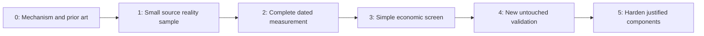

# Research OS: faster tests of unusual economic information

**Strategic review, 2026-10-20. Recommendation submitted for owner approval; implementation has not begun.** Starting checkpoint: `16b72ba722a76af6f6a32982e73e9228f764556d`. The [owner's full instruction](owner_reorientation_2026-10-20.md) governs this review. The accompanying Deep Research PDF supplies research leads, not execution instructions or established findings.

**Recommendation: spend at most one week testing whether a small public-web adoption measure describes the business of Shopify and Wix.** Use existing HTTP Archive technology observations before considering a crawler. Test incremental information about disclosed operating metrics first. If that passes, run one simple, explicitly exploratory 20-session return screen. Stop after one day of unresolved source feasibility; use the two specified backups, rather than extending the archaeology. A negative mechanism result is a completed first test.

The strongest change is the order of investment: mechanism → small complete sample → economic measurement → validation → engineering hardening. Provenance, information timing and honest missingness apply throughout. Production fills, full-market identity and a universal proof compiler are later requirements for stronger claims.

Read the [opportunity ranking and three deep dives](opportunity_map.md), [concrete pilot and one-week gates](web_adoption_pilot.md), and [report/source/prior-art review](evidence_review.md). The latter records all 21 report pages, substantive corrections and verification limits.

## What the repository actually achieved

Research OS has substantial evidence engineering and one completed investment study. It has not established a profitable strategy or a certified paper/live system.

| Record | Economic evidence and lesson |
| --- | --- |
| [EXP001](../../reports/EXP001_final_report.md) | Five SPY timing candidates, Development-only selection, subsequent Validation and authorized historical Test. Selected SMA20/50 reduced risk but underperformed SPY in return and Sharpe in both later windows. This is an economic result with limitations. |
| [EXP002](../../experiments/EXP002/research/final_freeze_review.md) | Closed before freeze: incomplete historical constituents and institutional omission/identity reconciliation. Diagnostic source/runtime jobs are not a candidate study. |
| [EXP003](../../experiments/EXP003/research/final_freeze_review.md) | Closed before freeze: usable complete insider states and genuine zero activity were not established. Price prerequisites alone did not establish joint inception. |
| [EXP004](../acceleration/exp004_execution_gap_report.md) | Frozen hypothesis remains untested. All 7,871,192 original rows were enriched, but 26 execution-critical stock-days remain unresolved under its contract. Seventeen alternative raw bar candidates are not certified fills. No-fill is inactive; all 24 folds and six replays remain NOT_RUN. |
| [EXP005 proposal](../acceleration/phase3_final_report.md) | Approved confirmatory design abandoned before registration/performance. Annual revenue comparability was incomplete, and the selected inference required an unjustified restriction on persistent common exposure. This is not a negative revenue-alpha finding. |
| [EXP006 proposal](../acceleration/exp006_cover_identity_report.md) | Final Item 2.02 source redesign stopped at 227/280 single-common candidates: even perfect downstream work could not reach its frozen 95% certificate threshold. No performance was evaluated. |
| [EXP007 proposal](../acceleration/exp007_house_repair_report.md) | Final House-only repair produced 28/61 decisive original transaction rows, below 55 required. Hypothesis untested; no new OCR/source rescue is proposed. |

The government procurement, FDA drug-decision and merger-enforcement pilots also produced bounded source/frame failures, rather than tests of investment profitability. A denied or missing route does not establish that an entire economic domain is unresearchable.

The recent Git history shows repeated source freezes, reconciliations, bounded remedies and stops. Those stops protected frozen studies. The strategic cost was repeatedly building extensive machinery around a question before establishing a useful small economic measurement. Test counts demonstrate software verification, not accumulated independent investment evidence.

EXP004's 26 gaps are about 0.0095% of required monthly pairs; 25 affect only EW, while TWMC affects EW and two momentum cells. That small percentage does not override a frozen benchmark/execution contract. It is a reason to design a different *new* screening question with a manageable universe, rather than retrofit the old study.

Nor would resolving those gaps alone finish EXP004 certification: raw-share OPEN units, cash-dividend accounting and held terminal paths were deferred. The proposed screen deliberately asks a weaker, useful question using documented adjusted-return measurements. Its result cannot be relabeled a completed version of that frozen nominal-share programme.

## Assessment of the supplied report

The PDF's most useful idea is a large **measurement** universe linked to a small **security** universe (pp. 4, 18–19). Customer-side adoption is closer to demand than developer commits, and a business-metric test before returns is valuable (pp. 7–8, 15–17). The report also correctly warns about free users, changing detectors, historical publication and narrative selection.

Its rankings are too confident about novelty, historical usability and a one-month trading horizon. Independent checks change the practical assessment:

- **Web adoption is an established commercial alternative-data category.** BuiltWith explicitly sells customer additions/losses to investment users. Sparse directly matching academic papers would not imply low professional crowding. The contribution must be a better, cheaper, auditable measurement or a distinct interaction, not the category itself. [BuiltWith's own offering](https://builtwith.com/alternative-data).
- **Automotive complaints already have close financial prior art.** Gokalp and coauthors study NHTSA complaints, future recalls and financial consequences. A component/communication interaction needs to improve on that prior work; “before recall” alone is insufficient novelty. [Original study](https://doi.org/10.1007/s11156-019-00866-9).
- **Monthly web labels are not release dates.** HTTP Archive rounds crawl labels to the first of the month even when testing starts later. A subsequent observation used to confirm an installation delays the signal further. [Publisher release cycle](https://httparchive.org/docs/guides/release-cycle).
- **MAUDE counts do not identify worsening defect incidence.** FDA warns about rates, reporting changes, missing exposure denominators and supplementation. Its current public material does not supply a historical first-public version panel. [FDA limitations](https://www.fda.gov/medical-devices/mandatory-reporting-requirements-manufacturers-importers-and-device-user-facilities/about-manufacturer-and-user-facility-device-experience-maude-database).
- **Historical dependency versions are not automatically historical resolved graphs.** deps.dev distinguishes exported snapshots, package publication and calculated dependencies. Today's graph cannot be dated by an old package's release. [Dataset contract](https://docs.deps.dev/bigquery/v1/).

The resulting choice is **web adoption first, software consumption backup 1, NHTSA telemetry backup 2**. MAUDE is retained but downgraded. FCC/trademark/web convergence and documentation changes are frontier ideas with substantial timing, rights and mining risks. No extra family is needed for this first week.

## A smaller research workflow

| Phase | Required evidence | Time/decision boundary |
| --- | --- | --- |
| 0 — mechanism | One economic link, known prior art, main confounds, fixed direction and target | Half a day including the handoff from this review; no broad feature mining |
| 1 — reality | A representative sample with actual fields, version/availability evidence, access rights and a cost estimate | Primary source gate within one working day; one known ordinary representation, no evasion or repeated rescue |
| 2 — complete measurement | Small auditable panel with real counts, missing states, example rows and dated issuer/product joins | At most one further day; all reported counts come from the data, not this proposal |
| 3 — economic screen | Business-metric check, then one return specification only if justified; transparent benchmarks and costs | Days 3–4; a null/negative result is deliverable, not a reason to tune |
| 4 — validation | A newly reviewed design, disclosed search history, an untouched window and defensible uncertainty | Later authorization; the first screen does not certify alpha |
| 5 — engineering | Only components justified by surviving measurements and a defined operational need | No graph, orchestration service or production trading platform this week |

A source gate can fail cheaply without rejecting the economic hypothesis. A weak economic result can reject this measurement without proving no possible effect exists. Limited sample support can produce INCONCLUSIVE. None should be restated as “strategy failed” or “alpha found.”

The [pilot](web_adoption_pilot.md) proposes a five-working-day effort within October 21–27, with at most two short backup source checks and one family reaching a return screen. These are proposed limits, not current acquisition authority. If all three sources fail, end the week with a documented frontier decision rather than add a fourth family.

## Repository disposition

These are concrete proposed changes. Existing files are retained in place; ARCHIVE means historical/non-operational status and navigation, not deletion, moving frozen paths or rewriting old receipts.

| Decision | Existing paths | Proposed treatment |
| --- | --- | --- |
| KEEP | `src/research/spec.py`; `src/research/store.py`; `src/research/sec_pilot/acquisition.py`; `src/research/sec_pilot/provenance.py` | Reuse canonical hashes, immutable JSON receipts and the exclusive-create original-byte archive helper, without invoking the old collector. `RawStore` canonicalizes JSON; it is not an original HTTP byte archive. No new storage framework. |
| KEEP | `requirements-research.txt`; `src/research/sec_pilot/reconcile.py`; Arrow/DuckDB usage in existing source modules | Existing Python/NumPy/Arrow/DuckDB suffice for a handful of local Parquet tables and joins. Do not install OpenBB/FinRL, cloud services or another warehouse. |
| KEEP | `src/research/analysis.py`; `src/metrics/performance.py`; `tests/test_research_os.py` | Reuse paired descriptive summaries, fold/date checks and validated arithmetic where appropriate. Block bootstrap/Holm utilities do not manufacture valid p-values or certify a new dependence model. Frozen metric code stays unchanged. |
| KEEP | `src/research/public_checks.py`; `.github/workflows/public-synthetic.yml`; `tests/` | Preserve network/private-read guards and relevant regressions. Add only meaningful timing, missingness, detector-change and return-alignment tests if the pilot is approved. |
| KEEP | `src/presentation/exp001.py`; `src/presentation/README.template.md`; `reports/EXP001_final_report.md` | Maintain reproducible published tables and figures; never manually edit generated numeric results. A small new report can be ordinary Markdown with a generated table. |
| SIMPLIFY | `docs/acceleration/master_plan.md`; `docs/research_os.md`; `AGENTS.md`; README template | After review, place one current status and small next-test card above historical architecture. Clearly label stale Item 2.02 continuation text as historical. Avoid adding another long chronological instruction block for every source response. Preserve actual operational guards. |
| SIMPLIFY | `src/research/proof_v2.py`; `src/research/phase3d/proof.py`; experiment template | Keep their strong-claim gates intact. A new, separately authorized descriptive screen needs a short manifest and attempt log; do not require synthetic proof compilation or mutate the legacy state machine to call it a production experiment. |
| ADD, conditionally | Proposed `research/web_adoption/README.md`, `manifest.json`, `screen.py`; `tests/test_web_adoption_screen.py` | One question card, one small runnable analysis, frozen transforms and counts/attempts. Add this directory only after approval; no experiment ID is allocated here. A notebook is optional, never a second source of results. |
| ADD, conditionally | Proposed ignored `data/raw/web_adoption_pilot/`; private derived Parquet; `reports/web_adoption_screen.md` | Original responses, minimal source hashes/availability records, origins panel, vendor-month panel, KPI target panel and event-return panel. Publish permitted aggregates/examples, not copied customer pages or restricted market data. |
| DEFER | `src/research/exp004_local_execution.py`; `src/research/phase3d/execution.py`; `src/research/nexus.py`; graph/causal/portfolio roadmap | Preserve and regression-test existing implementations. No ledger rewrite, execution certificate, engine integration, optimizer, causal lab or paper/live interface for this descriptive test. |
| ARCHIVE | `experiments/EXP002/`, `EXP003/`; Phase 3 EXP005 proposals; EXP006/007 reports, acquisition helpers and private stops | Treat as closed institutional memory. Do not run old acquisition commands, discard failures or migrate outputs into the new screen. |
| PRESERVE PAUSED | `experiments/EXP004/`; all execution-gap artifacts and persisted stops | No change to universe, prices, no-fill policy, trial counts, freezes or missing-day certificates. The new direction does not spend the four unused gap submissions. |

This review adds documentation and navigation only. The obsolete roadmap is not silently replaced with an approved pilot. A later implementation should update only the live summary paragraphs/template and link back to this review; original owner decisions and scientific reports remain immutable.

## What still requires a decision

1. **Approve or decline this bounded first pilot and conditional backup order.** This includes accepting an exploratory measurement/result, with no profitability, execution or significance certification, as the week's goal.
2. **Provide an authorized BigQuery sandbox/project with sufficient unused free quota, or decline cloud queries.** No project, billing enablement or quota consumption was tested here. The proposed default is no paid spend or upgrade. If unavailable, the web source check is blocked; do not assume a hidden free data service.
3. **Approve the new screen's own timing and outcome scope before collection.** Proposed dates, lag rule, costs and gates are in the pilot. They do not reuse or activate any old availability policy or open an existing experiment's sealed data.

Source release history, detector provenance, KPI consistency and field coverage are empirical gates, not questions the owner should be asked to guess. No other preference is needed to begin the approved day-one check.

**First thing tomorrow, after approval:** inspect four fixed historical HTTP Archive monthly partitions and their release/detector lineage under a query dry-run cap. Produce a small actual origins/technology sample and a yes/no decision on usable historical timing by the end of the day. Do not start a new crawler. If it passes, produce a business-metric comparison by day 3; if it fails, record the reason and test backup 1 within its short budget.

## Review boundary

No scientific corpus download, authenticated data/API call, signal, stock-return calculation, experiment registration, source rescue, policy activation, stage opening or remote execution occurred. Browser work was official source documentation and limited prior-art/business-disclosure verification. The displayed issuer disclosures are mechanism examples, not an unseen fundamental-validation set. Existing EXP001 results were read as published history. EXP004 remains paused; EXP005–007 remain closed as recorded. See the [verification and reading record](evidence_review.md#reading-and-verification-record).
